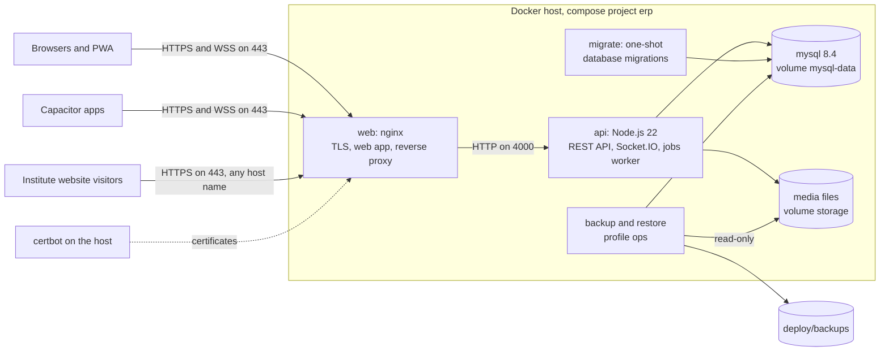

# Deployment

Production runs as a Docker Compose stack on one Linux server. nginx (`web`) terminates TLS, serves the web
app and proxies the API, the live-class WebSocket and the institute websites to the Node.js API (`api`). The
API stores its data in MySQL 8.4 (`mysql`) and its media files on a local volume. Everything lives in
[`deploy/`](../deploy). Unless stated otherwise, the commands below run in that directory on the server (for
example `/srv/erp/deploy`).

Backups and restores are covered in [backup-restore.md](backup-restore.md), security controls in
[security.md](security.md).

- [Files](#files)
- [Architecture](#architecture)
- [Prerequisites](#prerequisites)
- [Configuration](#configuration)
- [TLS certificates](#tls-certificates)
- [Building images](#building-images)
- [First deployment](#first-deployment)
- [Upgrades](#upgrades)
- [Rollback](#rollback)
- [Migration rollback plan](#migration-rollback-plan)
- [Operations](#operations)
- [Scaling](#scaling)
- [CI and local checks](#ci-and-local-checks)
- [Troubleshooting](#troubleshooting)

## Files

| Path                            | Purpose                                                                                                                                                                                 |
| ------------------------------- | --------------------------------------------------------------------------------------------------------------------------------------------------------------------------------------- |
| `deploy/docker-compose.yml`     | The stack: `mysql`, `migrate`, `api` and `web`; `backup` and `restore` (profile `ops`); `redis` (profile `redis`)                                                                       |
| `deploy/.env.example`           | Template for `deploy/.env`, the stack's only configuration file                                                                                                                         |
| `deploy/api.Dockerfile`         | `erp-api` image: the compiled backend, production dependencies, the database CLI and ffmpeg. Runs as the `node` user                                                                    |
| `deploy/web.Dockerfile`         | `erp-web` image: the built web app, served by nginx                                                                                                                                     |
| `deploy/nginx/`                 | `nginx.conf`; the server templates (`templates/`); entrypoint hooks that validate the settings (`18-erp-config.envsh`) and install the certificates (`40-erp-certs.sh`); `erp-certs.sh` |
| `deploy/certbot/deploy-hook.sh` | certbot deploy hook: copies issued certificates into `deploy/certs/` and reloads nginx                                                                                                  |
| `deploy/backup/`                | `erp-backup` image with `backup.sh`, `restore.sh` and `restore-test.sh`                                                                                                                 |
| `deploy/smoke-test.sh`          | End-to-end test of the whole stack through nginx (the CI `deploy` job)                                                                                                                  |
| `.dockerignore`                 | Keeps `node_modules`, build output, env files and local storage out of the build context                                                                                                |

Some runtime state is never committed (see `deploy/.gitignore`): `.env`, `secrets/`, `certs/`, `acme-webroot/`, `backups/` and the host-specific `docker-compose.override.yml` and `local/`.

## Architecture



| Service              | Image                              | Role                                                                                  | State                                                                 |
| -------------------- | ---------------------------------- | ------------------------------------------------------------------------------------- | --------------------------------------------------------------------- |
| `mysql`              | `mysql:8.4`                        | The database (utf8mb4). Not published on the host                                     | Volume `mysql-data`                                                   |
| `migrate`            | `erp-api`                          | One-shot: runs `cli.js migrate` before the api starts, then exits                     | None                                                                  |
| `api`                | `erp-api`                          | REST API on port 4000, Socket.IO for live classes, background jobs worker             | Volumes `storage` (media) and `api-tmp` (upload staging, transcoding) |
| `web`                | `erp-web`                          | nginx on ports 80 and 443: TLS, the web app, the proxy to the api, institute websites | Read-only bind mounts `certs/` and `acme-webroot/`                    |
| `backup` / `restore` | `erp-backup` (`mysql:8.4` + tools) | Profile `ops`, run on demand ([backup-restore.md](backup-restore.md))                 | Bind mount `backups/`; volume `storage` (read-only for `backup`)      |
| `redis`              | `redis:8-alpine`                   | Profile `redis`. Not used by this release; reserved for [scaling](#scaling)           | Volume `redis-data`                                                   |

Start order: `mysql` is healthy, then `migrate` exits with 0, then `api` is healthy (`/api/ready`), then `web` starts. If a
migration fails, the api doesn't start and `docker compose up` exits non-zero.

### Request routing

| Request                                                                                           | Handled by                                                                                                           |
| ------------------------------------------------------------------------------------------------- | -------------------------------------------------------------------------------------------------------------------- |
| `http://<any host>/.well-known/acme-challenge/…`                                                  | Files in `deploy/acme-webroot/`: HTTP-01 challenges for every host name                                              |
| `http://<any host>/nginx-health`                                                                  | `200 ok`, for load balancer probes                                                                                   |
| `<any host>/iclock/…` over HTTPS, and over HTTP with `ADMS_ALLOW_HTTP=true`                       | ZKTeco/eSSL biometric devices: the API, bodies up to 10 MB ([biometric.md](integrations/biometric.md))               |
| Any other `http://` request                                                                       | `301` to the same URL on `https://`                                                                                  |
| `https://SERVER_NAME/api/live-classes/socket.io/`                                                 | Socket.IO (namespace `/live`): WebSocket upgrade and long-polling, unbuffered, 1-hour timeouts                       |
| `https://SERVER_NAME/api/files/signed/…`, `/api/lms/public/hls/…`, institute logos, website media | The API, unbuffered, so large files and `Range` requests stream through (300 s read timeout)                         |
| `https://SERVER_NAME/api/…`                                                                       | The API: 120 s timeouts, bodies up to `MAX_UPLOAD_MB` + 10 MB. The API's own security headers pass through unchanged |
| `https://SERVER_NAME/assets/…`                                                                    | Content-hashed build output, cached for a year; a missing file is a 404                                              |
| Any other `https://SERVER_NAME/…`                                                                 | The web app: the file if it exists, else `index.html` (`Cache-Control: no-cache`)                                    |
| `https://<any other host>/…`                                                                      | Institute websites, proxied to `/api/public/sites/_host<path>` with the original `Host` header (1 MB body limit)     |

If the api can't be reached (stopped or restarting), nginx answers `/api/…` with a 503 `SERVICE_UNAVAILABLE` JSON error and
`Retry-After: 10`. Responses from the API itself pass through unchanged, including a 503 from `/api/ready`.

nginx forwards these headers to the API:

- `Host`, `X-Forwarded-Proto`, `X-Forwarded-Host` and `X-Real-IP`.
- `X-Forwarded-For`, with the client address appended.
- `X-Request-Id`: a well-formed incoming id is kept, otherwise nginx generates one.

The API logs the request id and returns it in the `X-Request-Id` response header. The nginx and API log lines of a
request therefore share one `requestId`.

## Prerequisites

- **Server:** a Linux server (x86-64 or arm64) with Docker Engine and the Compose plugin v2.20 or newer (check with
  `docker compose version`). Builds need BuildKit, which is the default since Docker 23.
  - Members of the `docker` group are effectively root on the host. Limit the group to administrators.
- **Sizing:** size CPU and memory with the [load tests](load-testing.md). Lecture transcoding (ffmpeg) is CPU-bound and
  runs inside the api container. Plan disk space for MySQL, the media volume and the local backups; each full backup
  holds the compressed database plus all media.
- **DNS:**
  - an `A`/`AAAA` record for `SERVER_NAME`;
  - a wildcard record `*.SITES_DOMAIN` if institutes use subdomains;
  - institutes point their custom domains at the server, with a `CNAME` to `SERVER_NAME` or `A`/`AAAA` records.
- **Firewall:**
  - inbound: TCP 80 and 443 (plus SSH). MySQL is not published;
  - outbound: HTTPS for ACME and for the AI provider, if you use one.
- **Certificates:** certbot (or another ACME client) on the host. The wildcard certificate also needs your DNS
  provider's certbot plugin.
- **Clock:** time synchronisation (NTP). Tokens, OTPs and certificates depend on the clock.
- **Checkout:** a clone of this repository at the release tag, for example in `/srv/erp`. The compose file builds the
  images from it, and the certbot hook and the backup scripts live in `deploy/`.

## Configuration

All settings live in `deploy/.env`, created from [`deploy/.env.example`](../deploy/.env.example), which documents every
variable. The MySQL root password is kept in a separate file:

```sh
cd /srv/erp/deploy
cp .env.example .env && chmod 600 .env
(umask 077 && mkdir -p secrets && openssl rand -hex 32 > secrets/mysql_root_password)
```

Compose reads `.env` twice:

- to substitute the `${VARIABLE}` references in the compose file;
- as the `env_file` of `api` and `migrate`.

Format rules:

- one `KEY=value` per line, no inline comments;
- single-quote values that contain `$`;
- a blank value means the default.

| Variable                                                                                                                                                                 | Notes                                                                                                                                                                                                             |
| ------------------------------------------------------------------------------------------------------------------------------------------------------------------------ | ----------------------------------------------------------------------------------------------------------------------------------------------------------------------------------------------------------------- |
| `ERP_REGISTRY`, `ERP_IMAGE_TAG`                                                                                                                                          | Image names are `${ERP_REGISTRY}erp-api:${ERP_IMAGE_TAG}`, and likewise for `erp-web` and `erp-backup`. The tag is the release. It is reported as `version` by `/api/ready` and in every log line and error event |
| `SERVER_NAME`, `PUBLIC_URL`                                                                                                                                              | Host name and origin of the app and API. `PUBLIC_URL` is compiled into the web image, so changing it means rebuilding `erp-web`. If `HTTPS_PORT` isn't 443, include the port (`https://app.example.com:8443`)     |
| `PUBLIC_WEB_URL`                                                                                                                                                         | Origin of the web app in links the API builds (institute website buttons, course checkout). Blank: `PUBLIC_URL`                                                                                                   |
| `SITES_DOMAIN`                                                                                                                                                           | Optional parent domain of the institute subdomains (`<subdomain>.sites.example.com`)                                                                                                                              |
| `HTTP_PORT`, `HTTPS_PORT`                                                                                                                                                | Published ports, 80 and 443 by default                                                                                                                                                                            |
| `CORS_EXTRA_ORIGINS`                                                                                                                                                     | Allowed origins after `PUBLIC_URL`, for the Capacitor apps ([mobile apps](#mobile-apps-and-cors))                                                                                                                 |
| `TLS_SELF_SIGNED_FALLBACK`                                                                                                                                               | Keep it `true` only until the first real certificate is installed ([TLS](#tls-certificates))                                                                                                                      |
| `SPA_CSP_MODE`, `SPA_CSP_REPORT_URI`                                                                                                                                     | Content Security Policy of the web app ([security headers](#web-app-security-headers))                                                                                                                            |
| `DB_NAME`, `DB_USER`, `DB_PASSWORD`                                                                                                                                      | Application database and user. The `mysql` container creates them on its first start only; later edits don't change MySQL ([rotation](#rotating-secrets))                                                         |
| `JWT_ACCESS_SECRET`, `ENCRYPTION_KEY`, `FILE_URL_SECRET`                                                                                                                 | Required: in production the API refuses to start without them ([secrets](#secrets))                                                                                                                               |
| `LOG_LEVEL`                                                                                                                                                              | `info` by default; `debug` for troubleshooting                                                                                                                                                                    |
| `ACCESS_TOKEN_TTL_SECONDS`, `REFRESH_TOKEN_TTL_DAYS`, `IMPERSONATION_TTL_SECONDS`, `OTP_TTL_SECONDS`, `OTP_MAX_ATTEMPTS`, `MAX_ACTIVE_DEVICES`, `SIGNED_URL_TTL_SECONDS` | Session, OTP, device and signed-URL limits                                                                                                                                                                        |
| `MAX_UPLOAD_MB`                                                                                                                                                          | The API's upload limit. nginx accepts `MAX_UPLOAD_MB` + 10 MB per request                                                                                                                                         |
| `ERROR_TRACKING_PROVIDER`, `ERROR_TRACKING_WEBHOOK_URL`                                                                                                                  | [Error tracking](#error-tracking)                                                                                                                                                                                 |
| `RATE_LIMIT_*`                                                                                                                                                           | [Rate limiting](#rate-limiting-behind-the-proxy)                                                                                                                                                                  |
| `JOBS_WORKER_ENABLED`, `JOBS_POLL_INTERVAL_MS`                                                                                                                           | [Background jobs](#background-jobs)                                                                                                                                                                               |
| `PAYMENT_RECONCILE_INTERVAL_MINUTES`                                                                                                                                     | Minutes between checks of open gateway payments, 10 by default ([payment gateways](integrations/payments.md#reconciliation-and-idempotency))                                                                      |
| `ADMS_ALLOW_HTTP`, `ADMS_MAX_BODY_KB`, `ADMS_MAX_RECORDS`, `ADMS_BACKFILL_DAYS`                                                                                          | ZKTeco/eSSL biometric devices ([biometric.md](integrations/biometric.md#server-setup)). `ADMS_ALLOW_HTTP=true` also serves `/iclock/` on `HTTP_PORT`, for firmware without HTTPS                                  |
| `AI_BASE_URL`, `AI_MODEL`, `AI_API_KEY`, `AI_TIMEOUT_MS`                                                                                                                 | Defaults for the AI features; the Super Admin can override them in the app                                                                                                                                        |
| `SMS_PROVIDER`, `WHATSAPP_PROVIDER`, `EMAIL_PROVIDER`, `PUSH_PROVIDER`, `PAYMENT_GATEWAY`, `STREAMING_PROVIDER`, `BIOMETRIC_PROVIDER`                                    | Integration adapters. This release only has `console` and `mock` implementations ([before going live](#before-going-live))                                                                                        |
| `MESSAGING_TIMEOUT_MS`, `MESSAGING_DEFAULT_COUNTRY_CODE`                                                                                                                 | Messaging vendor requests. MSG91, Twilio, WhatsApp Cloud, SMTP and FCM/APNs are configured in the app ([messaging](integrations/messaging.md))                                                                    |
| `SEED_SUPERADMIN_MOBILE`, `SEED_SUPERADMIN_PASSWORD`, `SEED_DEMO_DATA`                                                                                                   | First deployment only ([seeding](#first-deployment))                                                                                                                                                              |
| `BACKUP_HOST_DIR`, `BACKUP_KEEP_COUNT`, `BACKUP_KEEP_DAYS`, `BACKUP_UID`, `BACKUP_GID`                                                                                   | [backup-restore.md](backup-restore.md)                                                                                                                                                                            |

The compose file sets the following for the API itself, overriding any value in `.env`:

- `DB_HOST=mysql` and `DB_PORT`;
- `PORT=4000`;
- `TRUST_PROXY=1`;
- `STORAGE_DRIVER=local` and `STORAGE_LOCAL_ROOT=/var/lib/erp/storage`;
- `API_PUBLIC_URL=$PUBLIC_URL`;
- `PUBLIC_WEB_URL=$PUBLIC_WEB_URL`, or `$PUBLIC_URL` when blank (also for `migrate`: the API refuses to start in
  production without it);
- `CORS_ORIGINS=$PUBLIC_URL,$CORS_EXTRA_ORIGINS`.

The image sets `NODE_ENV=production` and `APP_VERSION`.

> **Warning:** never put `NODE_ENV` in `deploy/.env`. With `development`, the API would start with its built-in
> development secrets.

All backend settings and their defaults are listed in [`backend/.env.example`](../backend/.env.example) and
`backend/src/infrastructure/config/index.ts`.

The `web` service only receives the variables listed in the compose file. Set any other nginx setting in a
`docker-compose.override.yml` next to the compose file. Compose merges that file automatically when no `-f` option is
given:

```yaml
# deploy/docker-compose.override.yml (not committed)
services:
  web:
    environment:
      HSTS_HEADER: 'max-age=63072000; includeSubDomains'
```

| Variable (web)          | Default                                | Notes                                                   |
| ----------------------- | -------------------------------------- | ------------------------------------------------------- |
| `HSTS_HEADER`           | `max-age=31536000; includeSubDomains`  | HSTS of the platform host                               |
| `SPA_CSP`               | See [below](#web-app-security-headers) | The web app's full Content Security Policy              |
| `API_UPSTREAM`          | `api:4000`                             | Address of the API (`host:port`)                        |
| `NGINX_LOCAL_RESOLVERS` | Docker's DNS (`127.0.0.11`)            | Resolver used to re-resolve the api container's address |

These values must not contain double quotes, backslashes, `$` or newlines. At start the container validates every
setting, logs the result and refuses to start on invalid values (`18-erp-config.envsh`).

To keep the state outside the checkout, either symlink `deploy/.env` to a file elsewhere, or set absolute paths in
`.env`:

- `ERP_CERTS_DIR` and `ERP_ACME_DIR`: the certbot hook reads `ERP_CERTS_DIR` from `.env` too, and certbot's `-w`
  must be the `ERP_ACME_DIR` path;
- `ERP_SECRETS_DIR`;
- `BACKUP_HOST_DIR`.

Relative paths are relative to `deploy/`. `ERP_ENV_FILE` names the env file that `api` and `migrate` read (default
`.env`). The `${VARIABLE}` values in the compose file always come from `deploy/.env` (or `--env-file`).

### Secrets

| Secret                        | Generate with                                | Purpose                                                                                                                                                                          |
| ----------------------------- | -------------------------------------------- | -------------------------------------------------------------------------------------------------------------------------------------------------------------------------------- |
| `DB_PASSWORD`                 | `openssl rand -hex 24`                       | MySQL password of `DB_USER`                                                                                                                                                      |
| `secrets/mysql_root_password` | `openssl rand -hex 32`                       | MySQL root password, used by `backup` and `restore`. MySQL reads it only on the first start of an empty `mysql-data` volume                                                      |
| `JWT_ACCESS_SECRET`           | `openssl rand -base64 48`                    | Signs access tokens and live-class join tokens                                                                                                                                   |
| `ENCRYPTION_KEY`              | `openssl rand -base64 32` (exactly 32 bytes) | Encrypts stored integration credentials: AI keys, payment and notification settings, offline LMS keys. **It is not in the backups.** Without it, those values can't be decrypted |
| `FILE_URL_SECRET`             | `openssl rand -hex 32`                       | Signs short-lived file and media URLs                                                                                                                                            |

- **Where secrets live:**
  - on the server, only in `deploy/.env` and `deploy/secrets/` (mode 600, owned by root or the deploy user);
  - in a password manager or secret vault (or a SOPS/age-encrypted file in a private operations repository).
- **Where they must never appear:**
  - in this repository;
  - in images: build arguments are visible in the image history;
  - in CI logs;
  - on command lines, which show up in `ps` and the shell history. Use `read -rs` with `-e VAR`, as in
    [first deployment](#first-deployment).
- **Who can read them:** the containers get the secrets as environment variables, so anyone who can run
  `docker inspect` can read them. This is another reason to keep the `docker` group small.
- **Backing them up:** store `.env` and `secrets/` separately from the database backups, especially `ENCRYPTION_KEY`.

#### Rotating secrets

- **`DB_PASSWORD`:**
  1. Run `docker compose exec mysql mysql -uroot -p` (enter the root password from `secrets/mysql_root_password`), then
     `ALTER USER 'erp'@'%' IDENTIFIED BY '<new password>';`.
  2. Put the new value in `.env`.
  3. Run `docker compose up -d --wait`. This recreates `mysql` (harmless: `MYSQL_PASSWORD` is only used on the first
     start), `migrate` and `api`.
- **MySQL root password:** run `ALTER USER 'root'@'%' IDENTIFIED BY '…';` and
  `ALTER USER 'root'@'localhost' IDENTIFIED BY '…';`, then write the new value to `secrets/mysql_root_password`.
- **`JWT_ACCESS_SECRET`:** set the new value and run `docker compose up -d --wait`. Access tokens (15 minutes) and
  live-class join tokens become invalid. Refresh tokens are stored hashed in the database and are not affected, so the
  apps renew their sessions without asking users to sign in.
- **`FILE_URL_SECRET`:** set the new value and run `docker compose up -d --wait`. Only signed URLs from the last
  `SIGNED_URL_TTL_SECONDS` become invalid.
- **`ENCRYPTION_KEY`:** can't be rotated in place, because there is no key versioning or re-encryption tool. After a
  change, the stored integration credentials (AI keys, payment and notification settings) must be entered again.

## TLS certificates

nginx reads the certificates from `deploy/certs/`, mounted read-only:

```text
certs/
├── platform/{fullchain,privkey}.pem        SERVER_NAME (required)
└── sites/
    ├── _wildcard/{fullchain,privkey}.pem   *.SITES_DOMAIN (optional)
    └── <host>/{fullchain,privkey}.pem      one per institute custom domain (optional)
```

`erp-certs` checks every pair when the container starts and when you run `docker compose exec web erp-certs --reload`:

- both files parse and the key belongs to the certificate;
- the host name matches;
- the expiry date (a warning within 14 days).

Missing or broken certificates:

- A broken site certificate is skipped with a warning.
- A host name without a certificate gets the platform certificate, so browsers show a name mismatch.

`--reload` also tests the nginx configuration and reloads nginx gracefully; if the test fails, it rolls back. The
certificate is chosen per SNI name, so adding a domain needs no nginx configuration change.

TLS settings: TLS 1.2 and 1.3 with Mozilla's "intermediate" ciphers, HTTP/2, session tickets off. For HSTS, see
[security headers](#web-app-security-headers).

### Platform certificate (first deployment)

1. With `TLS_SELF_SIGNED_FALLBACK=true` (the `.env.example` default), nginx starts with a temporary self-signed
   certificate, so port 80 can answer the ACME challenge.
2. Request the certificate with the webroot plugin and the deploy hook. The hook copies the certificate to
   `certs/platform/` and reloads nginx:

   ```sh
   sudo certbot certonly --webroot -w /srv/erp/deploy/acme-webroot -d app.example.com \
     --deploy-hook /srv/erp/deploy/certbot/deploy-hook.sh
   ```

3. Set `TLS_SELF_SIGNED_FALLBACK=false` and run `docker compose up -d --wait`. From now on a missing or broken
   platform certificate stops nginx instead of silently serving a self-signed one.

certbot saves the hook in the renewal configuration, and its timer renews the certificates and runs the hook.
`certbot renew --dry-run` skips deploy hooks, so test the hook directly:

```sh
sudo RENEWED_LINEAGE=/etc/letsencrypt/live/app.example.com RENEWED_DOMAINS=app.example.com \
  /srv/erp/deploy/certbot/deploy-hook.sh
```

### Wildcard certificate for institute subdomains

A wildcard certificate requires the DNS-01 challenge, using your DNS provider's certbot plugin. For example, with
Cloudflare:

```sh
sudo certbot certonly --dns-cloudflare --dns-cloudflare-credentials /root/.secrets/cloudflare.ini \
  -d '*.sites.example.com' --deploy-hook /srv/erp/deploy/certbot/deploy-hook.sh
```

The hook installs it as `certs/sites/_wildcard/`.

### Institute custom domains

The API serves an institute's website on its custom domain once two things are true: the institute has saved the
domain in its website settings, and the domain's DNS points at the server. Until a certificate is installed, HTTPS on
that domain shows the platform certificate. To issue one:

1. Check that the domain is registered for an institute and resolves to this server:

   ```sh
   docker compose exec mysql mysql -uroot -p erp_coaching \
     -e "SELECT custom_domain FROM website_sites WHERE custom_domain IS NOT NULL"
   dig +short www.institute-example.com
   ```

2. Issue the certificate over HTTP-01; nginx serves the challenge for every host name on port 80. For the apex, add
   `-d institute-example.com` (the hook installs one copy per name):

   ```sh
   sudo certbot certonly --webroot -w /srv/erp/deploy/acme-webroot -d www.institute-example.com \
     --deploy-hook /srv/erp/deploy/certbot/deploy-hook.sh
   ```

   The hook installs the certificate as `certs/sites/www.institute-example.com/` and reloads nginx.

3. Check the result: `curl -sI https://www.institute-example.com/` and
   `openssl s_client -connect www.institute-example.com:443 -servername www.institute-example.com </dev/null | openssl x509 -noout -subject -enddate`.

To remove a domain:

```sh
sudo certbot delete --cert-name www.institute-example.com
sudo rm -r certs/sites/www.institute-example.com
docker compose exec web erp-certs --reload
```

Caveats:

- **Ownership:** the app doesn't verify that an institute owns the domain it enters. A domain claimed by one institute
  can't be used by another, so confirm ownership before you issue a certificate.
- **Host matching:** the API matches the host exactly against the custom domains. Failing that, it matches the host's
  first DNS label against the institute subdomains, for any parent domain.
- **Cache:** the mapping is cached in the API process for 60 seconds.
- **Reserved subdomains:** `www`, `api`, `app`, `admin`, `mail`, `static`, `cdn` and `public`.
- **Automation:** the domain list is in the database, so a nightly job can issue certificates for new domains with
  the commands above. A fully automatic alternative is a Caddy front end with on-demand TLS, but its `ask` endpoint
  must approve registered domains only, and the API has no such endpoint yet.

### Behind a CDN or load balancer

If a CDN or an HTTP load balancer sits in front of nginx, nginx must take the client address from `X-Forwarded-For`,
and only from the proxy's addresses. Otherwise all clients share the proxy's address, and with it one rate-limit
budget:

```nginx
# deploy/local/realip.conf (not committed)
set_real_ip_from 203.0.113.0/24;   # the CDN's or load balancer's address ranges
real_ip_header X-Forwarded-For;
real_ip_recursive on;
```

```yaml
# deploy/docker-compose.override.yml (not committed)
services:
  web:
    volumes:
      - ./local/realip.conf:/etc/nginx/conf.d/realip.conf:ro
```

Keep `TRUST_PROXY=1`: nginx appends the real client address, and the API uses that. A TCP (layer 4) load balancer
needs the PROXY protocol instead, which requires editing the `listen` directives in
`deploy/nginx/templates/erp.conf.template`.

## Building images

You can build the images on the server from the checkout, or build them once in CI and push them to a registry.

To build on the server:

```sh
cd /srv/erp && git fetch --tags && git checkout v1.4.0
cd deploy && sed -i 's/^ERP_IMAGE_TAG=.*/ERP_IMAGE_TAG=v1.4.0/' .env
docker compose --profile ops build
```

To use a registry, set `ERP_REGISTRY=ghcr.io/acme/` in `.env`, build in CI and pull on the server:

```sh
docker build -f deploy/api.Dockerfile --build-arg APP_VERSION=v1.4.0 -t ghcr.io/acme/erp-api:v1.4.0 .
docker build -f deploy/web.Dockerfile --build-arg VITE_API_URL=https://app.example.com \
  --build-arg APP_VERSION=v1.4.0 -t ghcr.io/acme/erp-web:v1.4.0 .
docker build -t ghcr.io/acme/erp-backup:v1.4.0 deploy/backup
docker push ghcr.io/acme/erp-api:v1.4.0   # and erp-web, erp-backup
# on the server, with ERP_IMAGE_TAG=v1.4.0 in .env:
docker compose --profile ops pull
```

| Build argument                             | Image    | Default                                                   | Notes                                                                                                                                                                                                                   |
| ------------------------------------------ | -------- | --------------------------------------------------------- | ----------------------------------------------------------------------------------------------------------------------------------------------------------------------------------------------------------------------- |
| `APP_VERSION`                              | api, web | `dev`                                                     | Release name; the compose file passes `ERP_IMAGE_TAG`                                                                                                                                                                   |
| `VITE_API_URL`                             | web      | (required)                                                | The absolute public origin. The web app builds every request URL from it, and an empty or relative value fails the build. Each `erp-web` image therefore serves one origin: staging and production need separate builds |
| `INSTALL_FFMPEG`                           | api      | `true`                                                    | Set it to `false` for a smaller image; uploaded lectures then play as progressive MP4 instead of HLS                                                                                                                    |
| `NODE_IMAGE`, `NGINX_IMAGE`, `MYSQL_IMAGE` | all      | `node:22-bookworm-slim`, `nginx:1.30-alpine`, `mysql:8.4` | Base images. Pin digests for reproducible builds                                                                                                                                                                        |

Use immutable release tags (`v1.4.0` or a git SHA), not `latest`: the previous tag is what you [roll back](#rollback)
to. Keep at least the previous release's images on the server.

## First deployment

1. Prepare the server ([prerequisites](#prerequisites)), clone the repository to `/srv/erp` and check out the release.
2. Create `deploy/.env` and `deploy/secrets/mysql_root_password` ([configuration](#configuration)). Fill in at least
   these:
   - `ERP_IMAGE_TAG`;
   - `SERVER_NAME` and `PUBLIC_URL`;
   - `SITES_DOMAIN`, or leave it empty;
   - `DB_PASSWORD`, `JWT_ACCESS_SECRET`, `ENCRYPTION_KEY` and `FILE_URL_SECRET`;
   - `SEED_SUPERADMIN_MOBILE`: the super admin's login mobile number.

   Generate the secrets, paste them into `.env` and save them in your vault:

   ```sh
   printf 'DB_PASSWORD=%s\nJWT_ACCESS_SECRET=%s\nENCRYPTION_KEY=%s\nFILE_URL_SECRET=%s\n' \
     "$(openssl rand -hex 24)" "$(openssl rand -base64 48)" "$(openssl rand -base64 32)" "$(openssl rand -hex 32)"
   ```

3. Build or pull the images ([building images](#building-images)).
4. Start the stack with `docker compose up -d --wait`. The first start initialises MySQL (about a minute), runs all
   migrations, then starts the api and nginx, for now with a self-signed certificate.
5. Create the super admin. The seeder runs in the `migrate` service. In production it behaves as follows:
   - it creates only the super admin and the subscription plans (`SEED_DEMO_DATA=false`);
   - it refuses the development default password and any password shorter than 12 characters;
   - it never changes the password of an existing user.

   Pass the password without writing it to a file or onto a command line:

   ```sh
   ( read -rsp 'Super admin password (12+ characters): ' SEED_SUPERADMIN_PASSWORD && echo &&
     export SEED_SUPERADMIN_PASSWORD &&
     docker compose run --rm -e SEED_SUPERADMIN_PASSWORD migrate node dist/infrastructure/database/cli.js seed )
   ```

6. Install the platform certificate and turn off the fallback ([TLS](#platform-certificate-first-deployment)). Add the
   wildcard and custom-domain certificates as needed.
7. Check the deployment:
   - `curl -fsS https://app.example.com/api/ready` reports `"status":"ready"` and the expected `version`;
   - you can sign in as the super admin;
   - you can create the first institute.
8. Schedule the backups and the offsite copies ([backup-restore.md](backup-restore.md)), and take the first backup
   now.
9. Set up log rotation and monitoring ([operations](#operations)).

Demo data (`SEED_DEMO_DATA=true`) is for demos and staging only. In production it also requires a non-default
`SEED_DEMO_PASSWORD`.

### Before going live

This release only ships development adapters for the external integrations:

- **Messaging:** until providers are configured in the app, SMS, WhatsApp, email and push use the console adapters,
  which in production deliver nothing and log only the channel and a masked recipient, never the message body. Set up
  the platform providers (and institutes their own) as described in [messaging](integrations/messaging.md): OTP login
  and the OTP for a user's additional devices need the platform SMS provider. Password login on a user's first device
  needs no OTP.
- **Payments:** the mock gateway (`PAYMENT_GATEWAY=mock`) doesn't charge anyone, and production won't use it.
  Institutes and the platform take real payments once they enter their Paytm, Razorpay or Cashfree keys in the app
  ([payment gateways](integrations/payments.md)).
- **Live classes:** `STREAMING_PROVIDER=mock` is the peer-to-peer WebRTC transport ([live classes](#live-classes)).
- **Biometrics:** ZKTeco and eSSL devices connect directly over ADMS push
  ([biometric.md](integrations/biometric.md)). `BIOMETRIC_PROVIDER=mock` is only the payload format of the punch API,
  for other devices and middleware.
- **Storage:** `STORAGE_DRIVER` must stay `local`, because the S3/R2 adapter is not implemented.

## Upgrades

1. Read the release notes. Look for new settings in `.env.example`, for migrations, and for contract (destructive)
   migrations ([policy](#migration-rollback-plan)).
2. Back up, and verify the backup:

   ```sh
   docker compose --profile ops run --rm backup
   docker compose --profile ops run --rm restore --verify-only latest
   ```

3. Get the new images: check out the tag and build, or set `ERP_IMAGE_TAG` and run `docker compose --profile ops pull`
   ([building images](#building-images)). Update `.env` with the new tag and any new settings.
4. Optional, for the shortest downtime: apply the migrations while the old release keeps serving, with
   `docker compose run --rm migrate`. This works because the [policy](#migration-rollback-plan) requires every
   release's migrations to be backward compatible.
5. Switch with `docker compose up -d --wait`.
   - Compose recreates the containers whose image or configuration changed. A release changes both `api` and `web`.
   - It stops the old containers before `migrate` runs, and starts nginx once the new api is healthy.
   - The site is unavailable for the migration time (unless you ran step 4) plus the api's start-up and first health
     check, usually 10 to 30 seconds.
   - Live classes in progress are disconnected, so upgrade outside class hours.
6. Verify the upgrade:
   - `docker compose ps` shows every service healthy;
   - `/api/ready` reports the new `version`;
   - `docker compose run --rm migrate node dist/infrastructure/database/cli.js migrate:status` lists no pending
     migrations;
   - the logs show no errors (`docker compose logs --since 10m api web`).
7. Check that the restart's interrupted jobs were requeued ([background jobs](#background-jobs)).

If `migrate` fails, `up` exits non-zero and the api stays down. Read `docker compose logs migrate`, then fix forward or
follow the [migration rollback plan](#migration-rollback-plan).

## Rollback

A rollback deploys the previous release's images and leaves the database as it is:

```sh
cd /srv/erp/deploy
sed -i 's/^ERP_IMAGE_TAG=.*/ERP_IMAGE_TAG=v1.3.2/' .env   # the previous release
docker compose up -d --wait
```

If you build on the server, check out the previous tag first. Its images are still there unless you pruned them
(`docker image ls erp-api`).

This works as long as the previous release can use the current schema, which the expand/contract policy guarantees for
one release back. The old `migrate` finds nothing to do, because it ignores migrations it doesn't know, and
`/api/ready` stays ready. If the new release's migrations must be reverted, follow the plan below before you switch
the tag.

## Migration rollback plan

### Policy: expand, then contract

- **Backward compatible:** every migration must work with the previous release's code. Both the [rollback](#rollback)
  and step 4 of the [upgrade](#upgrades) rely on this.
- **Expand:** add new tables, nullable columns or columns with defaults, and indexes. Backfill data in the migration or
  in a job. The code starts using the new structures in the same release or a later one.
- **Contract:** drop or rename columns and tables, make columns `NOT NULL`, narrow types or rewrite data only in a
  later release, once no release you might roll back to uses the old structure.
  - A rename takes two releases: add the new column, backfill it and switch the code; then drop the old one.
- **Reversible:** every migration has a `down` that reverts it. Before a contract release, test
  `migrate`, `migrate:undo` and `migrate` again on a copy of the production data, restored into a scratch database
  ([backup-restore.md](backup-restore.md)).
- **Locking:** an `ALTER TABLE` on a large table can rebuild or lock it. Check MySQL's online DDL support
  (`ALGORITHM=INSTANT` or `INPLACE`) and plan a maintenance window when needed.
- **Partial failures:** MySQL DDL is not transactional. If a migration fails half-way, the statements before the
  failure stay applied, and the migration is not recorded in `SequelizeMeta`.

### Choosing what to do

| Situation                                                               | Action                                                                                                                                                                          |
| ----------------------------------------------------------------------- | ------------------------------------------------------------------------------------------------------------------------------------------------------------------------------- |
| The new release misbehaves, and its migrations only expanded the schema | [Roll back the images](#rollback) and keep the schema. Revert those migrations later, if at all, in a planned release                                                           |
| The previous release can't run against the new schema                   | [Undo the new migrations](#undoing-migrations) with the new image, then roll back the images                                                                                    |
| A migration failed half-way                                             | Read `docker compose logs migrate`. Revert the statements that ran by hand (compare with the migration's `down`), or fix forward with a corrected release; then rerun `migrate` |
| A migration or the new code destroyed or corrupted data                 | [Restore the pre-upgrade backup](backup-restore.md#restore) and roll back the images. Changes made since the backup are lost                                                    |
| `migrate:undo` fails                                                    | Restore the pre-upgrade backup                                                                                                                                                  |

### Undoing migrations

`migrate:undo` reverts the most recently executed migration that the running image knows. Only the image that contains
a migration has its `down`. So **run it with the new image**: with the old image, it would revert the old release's
own newest migration instead.

```sh
# 1. List the migrations that the new release added:
git -C /srv/erp diff --name-only --diff-filter=A v1.3.2 v1.4.0 -- backend/src | grep /migrations/
# 2. Stop the api (nginx answers 503 meanwhile) and check the state. ERP_IMAGE_TAG is still the new release:
docker compose stop api
docker compose run --rm migrate node dist/infrastructure/database/cli.js migrate:status
# 3. Undo one migration at a time, newest first, and check the state after each step:
docker compose run --rm migrate node dist/infrastructure/database/cli.js migrate:undo
docker compose run --rm migrate node dist/infrastructure/database/cli.js migrate:status
# 4. Repeat step 3 until the newest executed migration is the previous release's newest one. Then roll back:
sed -i 's/^ERP_IMAGE_TAG=.*/ERP_IMAGE_TAG=v1.3.2/' .env
docker compose up -d --wait
```

The migration history is stored in the `SequelizeMeta` table (and the seeders in `SequelizeData`).
`SELECT name FROM SequelizeMeta ORDER BY name;` shows it in full; `migrate:status` truncates lists longer than 100
entries.

Commands to avoid:

- **Never run against production:**
  - `migrate:undo --all`: reverts every migration, which drops all tables;
  - `seed:undo`: deletes the seeded data, including the super admin and the plans;
  - `reset`: refused in production anyway.
- **Don't undo migrations from before the release you're rolling back to.** The earliest migrations create the core
  tables.

Restore the pre-upgrade backup instead of undoing when:

- **the undo would destroy more than it saves.** For example, its `down` drops a table or column that users have
  already filled. Undoing loses that data, while restoring loses every change since the backup, so choose the smaller
  loss;
- **the migration deleted or rewrote data**, which no `down` can bring back;
- **the undo fails**, or the schema is in an unknown state.

## Operations

### Health and readiness

| Endpoint                         | Response                                                                                                                                                                                                                                | Used by                                                                           |
| -------------------------------- | --------------------------------------------------------------------------------------------------------------------------------------------------------------------------------------------------------------------------------------- | --------------------------------------------------------------------------------- |
| `GET /api/health`                | `200 {"status":"ok","time":…}` while the process serves requests. No dependency checks                                                                                                                                                  | Liveness and uptime monitoring                                                    |
| `GET /api/ready`                 | `200` (`"status":"ready"`) or `503` (`"not_ready"`), with `version`, `uptimeSeconds` and `checks`: `database` (a ping with a 3 s timeout, `latencyMs`), `migrations` (the `pending` count), `storage` (the media directory is writable) | The api's Docker health check (`web` waits for it), load balancers, deploy checks |
| `GET http://<host>/nginx-health` | `200 ok` from nginx on port 80                                                                                                                                                                                                          | The `web` Docker health check, external load balancers                            |

The migrations check stops a release from taking traffic before its migrations have run.

```json
{
  "status": "ready",
  "version": "v1.4.0",
  "uptimeSeconds": 3600,
  "checks": {
    "database": { "ok": true, "latencyMs": 2 },
    "migrations": { "ok": true, "pending": 0 },
    "storage": { "ok": true, "driver": "local" }
  }
}
```

Monitor and alert on:

- `/api/ready` not returning 200 for more than a couple of minutes;
- certificate expiry: `erp-certs` warns 14 days ahead, so alert on that or probe the certificates externally;
- free disk space;
- the age of the newest backup ([backup-restore.md](backup-restore.md#schedule)).

### Logs

- **API:** writes JSON lines (pino) to stdout. Each line has:
  - `level`, `time` and `msg`;
  - `service: "erp-api"`, `version`, `pid` and `hostname`;
  - `requestId`, `instituteId` and `userId` within a request.
- **Redaction:** the `authorization` and `cookie` headers, and fields named `password`, `apiKey`, `accessToken`,
  `refreshToken`, `otp` and `secret`, are redacted. So are the tokens in signed-URL paths and query strings. In
  production the `console` messaging adapters log only the channel and a masked recipient, never message bodies or
  OTPs.
- **nginx:** logs one JSON line per request, with `"source":"nginx"`, the same `requestId`, the status, timings and
  upstream status. Query strings are not logged.
- **Correlating:** `docker compose logs api web | grep '<request id>'`.
- **Rotation:** Docker keeps container logs without limit by default. Configure rotation in `/etc/docker/daemon.json`,
  for example `{"log-driver": "local", "log-opts": {"max-size": "50m", "max-file": "5"}}`. Then restart Docker and
  recreate the containers (`docker compose up -d --force-recreate`); the setting only applies to new containers.
- **Shipping:** to centralise the logs, use an agent that reads the Docker logs as JSON (Vector, Fluent Bit, Grafana
  Alloy, or the Datadog or CloudWatch agents). The logs contain personal data such as user ids and IP addresses; set
  their retention accordingly.

### Error tracking

The API reports these errors to the error tracker:

- 5xx responses;
- failed background jobs;
- unhandled promise rejections and uncaught exceptions;
- start-up failures.

`ERROR_TRACKING_PROVIDER` chooses where they go:

| Value            | Behaviour                                                                                                                                                                                                                                                                                                          |
| ---------------- | ------------------------------------------------------------------------------------------------------------------------------------------------------------------------------------------------------------------------------------------------------------------------------------------------------------------ |
| `none` (default) | Errors appear only as regular error logs                                                                                                                                                                                                                                                                           |
| `log`            | Each error is also logged as a structured entry `msg: "error_tracking"` with an `errorTracking` object. Alert on it in your log system                                                                                                                                                                             |
| `webhook`        | Each error is POSTed as JSON to `ERROR_TRACKING_WEBHOOK_URL`, which is required. Timeout 5 s; at most 60 events a minute, excess events are dropped and counted in `droppedSinceLast`. Event: `{timestamp, level, environment, release, error: {type, message, stack}, tags: {requestId, instituteId, userId, …}}` |

`release` is the image tag. A vendor SDK (Sentry, Rollbar…) can be plugged in with `setErrorTracker()`; see
[ARCHITECTURE.md](../ARCHITECTURE.md).

### Rate limiting behind the proxy

Express's `trust proxy` setting is `TRUST_PROXY`, the number of proxy hops. The compose file sets it to `1` (nginx), so
the API takes the client address from the last `X-Forwarded-For` entry, which nginx appends. With a CDN or load
balancer in front, configure [real IP in nginx](#behind-a-cdn-or-load-balancer) and keep `TRUST_PROXY=1`. Don't raise
it: clients that bypass the CDN could then choose their own address.

The limits apply per client IP:

| Variable                     | Default    | Applies to                                                    |
| ---------------------------- | ---------- | ------------------------------------------------------------- |
| `RATE_LIMIT_API_PER_MIN`     | 600/min    | Every `/api` request except media                             |
| `RATE_LIMIT_MEDIA_PER_MIN`   | 3000/min   | Signed file downloads and HLS segments                        |
| `RATE_LIMIT_AUTH_MAX`        | 30/15 min  | Password login and OTP request and verify                     |
| `RATE_LIMIT_TOKEN_MAX`       | 600/15 min | Token refresh and logout                                      |
| `RATE_LIMIT_PUBLIC_FORM_MAX` | 60/15 min  | Public forms: enquiries, checkout, coupons, self-registration |
| `RATE_LIMIT_DEVICE_PER_MIN`  | 120/min    | Biometric device pushes                                       |
| `RATE_LIMIT_ADMS_PER_MIN`    | 600/min    | ZKTeco/eSSL device pushes and command polls (`/iclock/`)      |
| `RATE_LIMIT_WEBHOOK_PER_MIN` | 300/min    | Payment gateway webhooks and checkout returns                 |

Over the limit, the API answers 429 with the standard `RateLimit` headers.

- **Shared addresses:** clients behind one NAT, such as an institute's Wi-Fi, share one budget. Raise the limits for
  large centres.
- **Restarts:** the counters live in memory, so they reset on a restart, and each API process counts separately
  ([scaling](#rate-limits)).
- **Turning them off:** `RATE_LIMIT_ENABLED=false` is only for load tests.

### Background jobs

The jobs worker runs inside the api process (`JOBS_WORKER_ENABLED=true`). It polls the `jobs` table every
`JOBS_POLL_INTERVAL_MS` (2 s by default). The modules queue their background work there, for example notification
delivery, lecture transcoding with ffmpeg (`lms.transcode`), payslip rendering and live-class recording imports.

A failed job is retried with exponential backoff (up to 15 minutes between attempts), up to `max_attempts` (5), and
then marked `failed`.

Several workers can run at once safely: a job is claimed with `SELECT … FOR UPDATE SKIP LOCKED`, so only one worker
takes it.

On shutdown the api stops polling but doesn't wait for running jobs. Interrupted jobs are recovered automatically: a
running job refreshes its `locked_at` every few minutes, and every worker checks for `running` jobs whose lock is more
than 10 minutes old, when it starts and then every minute. Such a job lost its worker during a deploy, restart or crash,
so it is requeued, which counts as an attempt, or marked `failed` if it was on its last attempt. A failed report export
job marks its export `failed` too, so the user sees an error instead of an export stuck at "running". The log line
`Reclaimed jobs left running by a stopped worker` reports each recovery.

Recovery needs a running worker. If `JOBS_WORKER_ENABLED=false` on every api, or a job looks stuck anyway, check and
requeue stale jobs by hand:

```sql
SELECT id, name, attempts, max_attempts, locked_at FROM jobs
 WHERE status = 'running' AND locked_at < UTC_TIMESTAMP() - INTERVAL 2 HOUR;
UPDATE jobs SET status = 'pending', locked_at = NULL, run_at = UTC_TIMESTAMP()
 WHERE status = 'running' AND locked_at < UTC_TIMESTAMP() - INTERVAL 2 HOUR;
-- recent failures
SELECT id, name, attempts, last_error, updated_at FROM jobs WHERE status = 'failed' ORDER BY id DESC LIMIT 20;
```

Run these in `docker compose exec mysql mysql -uroot -p erp_coaching`. Running jobs keep their lock fresh, so a
`locked_at` more than two hours old means the job's worker is gone.

### Web app security headers

nginx adds these headers to the web app's responses:

- HSTS (`HSTS_HEADER`);
- `X-Content-Type-Options: nosniff`;
- `Referrer-Policy: strict-origin-when-cross-origin`;
- `X-Frame-Options: SAMEORIGIN`;
- a `Permissions-Policy` that allows the camera, microphone, screen capture, fullscreen, geolocation and payment for
  the app's own origin only, and turns off the motion sensors and USB;
- a Content Security Policy.

`/api/` responses keep the API's own (helmet) headers. Institute websites get HSTS for the requested host only,
without `includeSubDomains`, so an institute's other subdomains are not forced onto HTTPS.

The CSP is sent as `Content-Security-Policy-Report-Only` until you enforce it. The default policy is:

```text
default-src 'self'; script-src 'self' https://checkout.razorpay.com https://sdk.cashfree.com PAYTM;
style-src 'self' 'unsafe-inline' PAYTM; img-src 'self' data: blob: https:; media-src 'self' blob:;
font-src 'self' data:; connect-src 'self' blob: data: wss://SERVER_NAME https://lumberjack.razorpay.com GATEWAYS;
frame-src 'self' blob: GATEWAYS; worker-src 'self' blob:; manifest-src 'self'; object-src 'none'; base-uri 'self';
form-action 'self' https://api.razorpay.com PAYTM https://securegw.paytmpayments.in
https://securegw-stage.paytmpayments.in; frame-ancestors 'self'
```

where `PAYTM` is `https://secure.paytmpayments.com https://securestage.paytmpayments.com` and `GATEWAYS` is
`https://api.razorpay.com https://checkout.razorpay.com https://*.cashfree.com PAYTM`: the hosts of the payment
gateways' checkouts ([payment gateways](integrations/payments.md)). Ionic's components set inline styles, which is why
`style-src` needs `'unsafe-inline'`.

To enforce the policy:

1. Collect violations while in report-only mode. Either set `SPA_CSP_REPORT_URI` to a collector (a hosted CSP
   reporting service or your error tracker's CSP endpoint; the API has none), or watch the browser console.
2. Exercise every workflow: live classes, the PDF viewer, video playback, payments and the AI features. If the policy
   needs changes, set the complete policy as `SPA_CSP` in `docker-compose.override.yml`. Double-quote the YAML value:
   the policy contains single quotes and `: `.
3. Set `SPA_CSP_MODE=enforce` and run `docker compose up -d --wait`.

The Capacitor apps load the web app from the device, so this CSP doesn't apply to them.

Only add `preload` to `HSTS_HEADER` after reading the requirements at hstspreload.org: preloading is hard to undo.

### Mobile apps and CORS

The Capacitor apps are built against the public origin:

```sh
VITE_API_URL=https://app.example.com npm run cap:sync -w app
```

Then build and sign them in Android Studio or Xcode (`npm run cap:android` or `npm run cap:ios`).

CI builds both apps on every pull request without signing (the `android` and `ios` jobs in
`.github/workflows/ci.yml`): `assembleDebug`, which also checks that `POST_NOTIFICATIONS` (declared by
firebase-messaging) is in the merged manifest, and an `iphonesimulator` build pinned to the committed
`app/ios/App/App.xcodeproj/project.xcworkspace/xcshareddata/swiftpm/Package.resolved`. After changing a Capacitor
plugin, run `npx cap sync ios` and `xcodebuild -resolvePackageDependencies -project App.xcodeproj -scheme App` in
`app/ios/App` and commit the updated `Package.resolved`.

Push notifications need your `app/android/app/google-services.json` and an APNs key
([messaging](integrations/messaging.md#push-fcm-for-android-apns-for-ios)). CI builds both apps without them: the
Android app then skips push registration.

The API, including the live-class Socket.IO endpoint, accepts these origins, in this order:

1. `PUBLIC_URL`. Links into the web app (institute websites, course checkout) use `PUBLIC_WEB_URL` instead,
   which defaults to `PUBLIC_URL`.
2. `CORS_EXTRA_ORIGINS`, which defaults to:
   - `capacitor://localhost` (iOS);
   - `https://localhost` (Android; `app/capacitor.config.ts` sets `androidScheme: 'https'`);
   - `http://localhost` (Android builds with the `http` scheme, the default before Capacitor 6).

The apps need a publicly trusted certificate on `SERVER_NAME`: self-signed certificates don't work there.

## Scaling

This release runs one API process. Node.js handles requests on one thread, and that includes password hashing
(bcryptjs; see [load-testing.md](load-testing.md)). Extra cores mostly help MySQL and ffmpeg. Running several API
processes or servers needs the following changes:

| Component       | Today                                                 | Needed for more than one API process                                                          |
| --------------- | ----------------------------------------------------- | --------------------------------------------------------------------------------------------- |
| Live classes    | Room state in process memory (`realtime.ts`)          | Sticky sessions, the Socket.IO Redis adapter and room state in Redis ([below](#live-classes)) |
| Rate limits     | In-memory counters per process                        | A shared store, for example `rate-limit-redis` for `express-rate-limit`                       |
| Background jobs | MySQL `jobs` table, `SKIP LOCKED`                     | Nothing: several workers are safe                                                             |
| Media storage   | Local volume `storage`                                | A shared file system, or object storage (the S3/R2 adapter is not implemented yet)            |
| Website cache   | In-process, 60 s TTL                                  | Nothing: each process may serve 60 s stale site settings                                      |
| Authentication  | JWT access tokens; refresh tokens in MySQL            | Nothing                                                                                       |
| Upgrades        | One api container; the site is down during the switch | Rolling restarts behind a load balancer, which needs everything above                         |

The `redis` service (`docker compose --profile redis up -d redis`, with AOF persistence) is prepared for these
changes. Nothing uses it yet.

### Live classes

Live classes use Socket.IO (namespace `/live`, path `/api/live-classes/socket.io`) for signalling, chat, polls, hands
and attendance:

- **Room state:** each room's state lives in a `Map` in the API process. A restart ends every running class: clients
  reconnect, but the room state is gone.
- **Media:** with `STREAMING_PROVIDER=mock`, media flows peer to peer over WebRTC. The teacher's browser sends one
  stream to each student, so a class is limited by the teacher's upload bandwidth, roughly 15 to 25 viewers (see
  `backend/src/modules/live-classes/README.md`).
- **STUN only:** the ICE configuration contains only a public STUN server (`stun:stun.l.google.com:19302`).
  Participants behind symmetric NAT or strict firewalls, which are common on mobile networks and on school or office
  networks, can't connect without a TURN relay.

To run live classes on several API processes:

1. **Sticky sessions.** The Socket.IO long-polling transport needs every request of a session to reach the same
   process. In nginx, use `hash $remote_addr consistent;` or a cookie hash in the `erp_api` upstream. Otherwise, make
   the client use the WebSocket transport only.
2. **[`@socket.io/redis-adapter`](https://socket.io/docs/v4/redis-adapter/)**, so that broadcasts reach the sockets on
   the other processes.
3. **Room state in Redis.** Move the participants, hands and polls out of the in-memory `Map`. Alternatively, route
   each room to one owner process.

TURN with [coturn](https://github.com/coturn/coturn):

- **Host:** run it on a host with a public IP address. Open 3478/udp and 3478/tcp, 5349/tcp (TURN over TLS) and a UDP
  relay port range. A minimal `turnserver.conf`:

  ```ini
  listening-port=3478
  tls-listening-port=5349
  realm=turn.example.com
  use-auth-secret
  static-auth-secret=<openssl rand -hex 32>
  cert=/etc/coturn/fullchain.pem
  pkey=/etc/coturn/privkey.pem
  min-port=49152
  max-port=65535
  fingerprint
  no-cli
  no-multicast-peers
  # Never relay into private, loopback or link-local networks (the latter includes cloud metadata services).
  denied-peer-ip=0.0.0.0-0.255.255.255
  denied-peer-ip=10.0.0.0-10.255.255.255
  denied-peer-ip=100.64.0.0-100.127.255.255
  denied-peer-ip=127.0.0.0-127.255.255.255
  denied-peer-ip=169.254.0.0-169.254.255.255
  denied-peer-ip=172.16.0.0-172.31.255.255
  denied-peer-ip=192.168.0.0-192.168.255.255
  ```

  On a cloud VM behind 1:1 NAT, also set `external-ip=<public>/<private>`.

- **Credentials:** use short-lived credentials (the TURN REST API scheme):
  - the username is `<expiry unix time>:<user id>`;
  - the credential is `base64(HMAC-SHA1(static-auth-secret, username))`.
- **Wiring it in:** the API must return the TURN server and these credentials from the streaming provider's
  `iceServers()` (`backend/src/infrastructure/streaming/`). This needs a code change: today the list is hard-coded.
  Never ship static TURN credentials in the app.
- **Larger classes:** use an SFU (LiveKit, mediasoup, Janus or a hosted service) through a `STREAMING_PROVIDER`
  adapter. The steps are in the live-classes README.

### Rate limits

The `express-rate-limit` counters live in memory. With N API processes, a client gets up to N times the budget, and a
restart resets the counters. Before scaling out, move them to a shared store such as `rate-limit-redis` with the
`redis` service.

### Jobs and workers

Several workers are safe. To keep heavy jobs (transcoding) away from request handling:

1. Set `JOBS_WORKER_ENABLED=false` on the processes that serve traffic.
2. Run another container from the `erp-api` image with `JOBS_WORKER_ENABLED=true` that nginx doesn't route to.

### Database and storage

- **Database:** MySQL runs in the stack. To use a managed MySQL 8.x instead, override `DB_HOST` and `DB_PORT` for
  `api` and `migrate` in `docker-compose.override.yml`, and remove the `mysql` dependency.
- **Media:** stays on the local `storage` volume until the object storage adapter exists.

## CI and local checks

The CI `deploy` job does two things:

1. Runs `shellcheck --external-sources` on every `deploy/*.sh` and `deploy/*.envsh` file.
2. Runs [`deploy/smoke-test.sh`](../deploy/smoke-test.sh), which needs Docker and Compose v2. It:
   - builds the three images and starts the stack under the project name `erp-smoke`, on ports 8080 and 8443, with
     throwaway secrets and a throwaway certificate authority;
   - checks through nginx: health and readiness, the redirect to HTTPS, the web app and its headers, CORS, the
     Socket.IO handshake and the WebSocket upgrade, institute websites on a custom domain and on a subdomain, the
     biometric device paths (`/iclock/`), super admin seeding and sign-in, certificate reload, the 503 while the api is
     down, log redaction, and a backup with its verification and a [restore drill](backup-restore.md#restore-drill);
   - always removes the stack and its volumes, and prints the service logs on failure.

```sh
deploy/smoke-test.sh                  # about 10 to 15 minutes with a cold build cache
SMOKE_KEEP=1 deploy/smoke-test.sh     # leave the stack running for debugging
deploy/smoke-test.sh --prepare-only   # only generate the certificates and env file (no Docker)
```

The `backup-restore` job runs `deploy/backup/restore-test.sh` against MySQL 8.4; see
[backup-restore.md](backup-restore.md#restore-test).

## Troubleshooting

| Symptom                                             | Check                                                                                                                                                                                                      |
| --------------------------------------------------- | ---------------------------------------------------------------------------------------------------------------------------------------------------------------------------------------------------------- |
| `docker compose up` fails, or `api` is unhealthy    | `docker compose ps`, `docker compose logs migrate api`. Check readiness from inside: `docker compose exec api node -e "fetch('http://127.0.0.1:4000/api/ready').then(r=>r.text()).then(console.log)"`      |
| The API refuses to start with a configuration error | A required secret is missing or shorter than 16 characters, `ENCRYPTION_KEY` isn't 32 bytes in base64, or `ERROR_TRACKING_PROVIDER=webhook` has no URL. The log names the variable                         |
| `web` exits at start                                | `docker compose logs web`: `18-erp-config.envsh` (invalid settings) or `erp-certs` (no valid platform certificate while `TLS_SELF_SIGNED_FALLBACK=false`)                                                  |
| A 503 `SERVICE_UNAVAILABLE` on `/api/…`             | nginx can't reach the api: it is stopped, restarting or crashed (`docker compose logs api`)                                                                                                                |
| A 413 on uploads                                    | Raise `MAX_UPLOAD_MB` and run `docker compose up -d --wait`; it applies to both nginx and the API                                                                                                          |
| Live classes don't connect                          | `curl 'https://app.example.com/api/live-classes/socket.io/?EIO=4&transport=polling'` must return `0{"sid":…`. A proxy in front must pass WebSocket upgrades. For media failures, see [TURN](#live-classes) |
| A biometric device doesn't send punches             | The device's last error in Attendance setup → Biometric, and [biometric.md](integrations/biometric.md#troubleshooting)                                                                                     |
| CORS errors in the mobile apps                      | `CORS_ORIGINS` (`docker compose exec api printenv CORS_ORIGINS`) must contain the app's origin                                                                                                             |
| A certificate error on a custom domain              | `docker compose exec web erp-certs --reload` reports skipped certificates; `openssl s_client -servername <host> -connect <host>:443` shows the certificate in use                                          |
| Clients all share one rate limit                    | A proxy in front of nginx without [real IP](#behind-a-cdn-or-load-balancer) configured                                                                                                                     |
| Lectures stay "processing"                          | Stale `running` jobs ([background jobs](#background-jobs)), or the image was built with `INSTALL_FFMPEG=false`                                                                                             |
| Disk full                                           | Docker log rotation, `BACKUP_KEEP_COUNT`/`BACKUP_KEEP_DAYS`, `docker system df`, old images (`docker image prune`)                                                                                         |

### Lost super admin password

There is no password-reset command, and the seeder never changes an existing password. To set a new one:

1. Hash the new password inside the api image:

   ```sh
   ( read -rsp 'New password: ' NEW_PASSWORD && echo && export NEW_PASSWORD &&
     docker compose run --rm --no-deps -e NEW_PASSWORD migrate \
       node -e "require('bcryptjs').hash(process.env.NEW_PASSWORD, 10).then(console.log)" )
   ```

2. Store the hash. Run `docker compose exec mysql mysql -uroot -p erp_coaching`, then:

   ```sql
   UPDATE users SET password_hash = '<hash>' WHERE mobile = '<mobile>' AND is_super_admin = 1;
   ```
