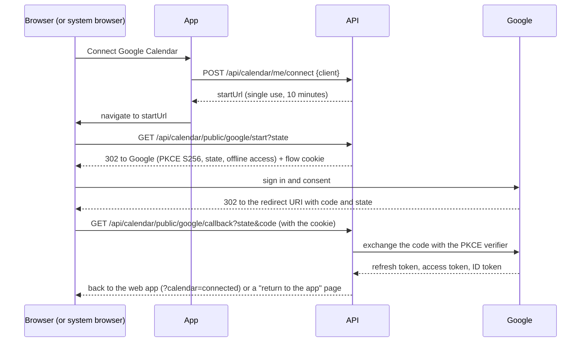

# Google Calendar

Parent-teacher meetings (the appointments module) become events in Google Calendar. Online meetings get a Google Meet
link, and approving, rescheduling and cancelling a meeting in the app updates the event. Google emails the
invitations and updates to the guests.

Calendars are connected per institute and per teacher through the platform's own Google OAuth client. Institutes need
no Google Cloud project, and going live only needs that client's ID and secret.

| Mode                       | When                                     | What happens                                                                                    |
| -------------------------- | ---------------------------------------- | ----------------------------------------------------------------------------------------------- |
| `CALENDAR_PROVIDER=mock`   | The default (development, tests and E2E) | Events go to an in-memory calendar with `https://meet.mock.invalid/…` links. Nothing to connect |
| `CALENDAR_PROVIDER=google` | Production                               | Events go to Google Calendar through the [connected accounts](#whose-calendar-holds-the-events) |

## Whose calendar holds the events

The teacher who approves a meeting runs it, so a meeting goes to **the teacher's own calendar**. If the teacher
hasn't connected one, it goes to **the institute's organiser calendar**, for example a shared office account.

- An event stays in the calendar that created it. Moving it would send every guest a new invitation.
- A teacher's connection that **needs reconnecting blocks** syncing; it doesn't fall back to the organiser calendar.
  The meeting shows "Reconnect Google Calendar to sync this event" until the teacher reconnects, and then everything
  that was waiting syncs.
- With neither calendar connected, the meeting shows "No Google Calendar is connected". Connecting either calendar
  syncs the waiting meetings.
- The calendar's owner is the event's organiser and Meet host. In the organiser fallback, the teacher is a guest.

The teacher and the parent who requested the meeting are invited, when their user has an email address.

## Google Cloud setup

Do this once for the platform, in a Google Cloud project owned by the SaaS operator.

1. **Create or select a project** in the [Google Cloud console](https://console.cloud.google.com/).
2. **Enable the Google Calendar API** (APIs & Services → Library). Meet links are created through the Calendar API,
   so the Meet API isn't needed.
3. **Configure the OAuth consent screen** (Google Auth Platform → Branding, Audience and Data Access):
   - User type **External**, so teachers and institutes can use any Google account (Gmail or Workspace).
   - The app name, a support email, the logo, the home page, and links to the privacy policy and terms of service.
   - Authorized domains: the domain of `PUBLIC_URL`.
   - Scopes: `openid`, `.../auth/userinfo.email` and `https://www.googleapis.com/auth/calendar.events`. The app only
     creates, updates and deletes its own events; the connection test lists one upcoming event.
4. **Create the OAuth client** (Clients → Create client):
   - Application type **Web application**. The mobile apps use the same client through the system browser.
   - Authorized redirect URI: the one shown on the Super Admin's **Google Calendar** page
     ([checking the setup](#checking-the-setup)). By default it is `<PUBLIC_URL>/api/calendar/public/google/callback`,
     for example `https://app.example.com/api/calendar/public/google/callback`.
   - No JavaScript origins: the browser never calls Google's APIs.
5. **Copy the client ID and secret** into the [configuration](#configuration).
6. **Publish the app and get it verified.** `calendar.events` is a sensitive scope:
   - In **Testing** mode only the listed test users (up to 100) can connect, and Google expires their refresh tokens
     after 7 days. Their connections then show "Needs reconnecting".
   - In **Production** mode, until Google verifies the app, users see an "unverified app" warning and the number of
     users is capped. Submit the app for verification: the consent screen details, a privacy policy on an authorized
     domain, and usually a video of the connect flow. Verification can take several weeks.

## Configuration

| Variable                     | Default                                                | Notes                                                                                                 |
| ---------------------------- | ------------------------------------------------------ | ----------------------------------------------------------------------------------------------------- |
| `CALENDAR_PROVIDER`          | `mock`                                                 | `google` turns the integration on                                                                     |
| `GOOGLE_OAUTH_CLIENT_ID`     |                                                        | Required with `google`: the API refuses to start without it                                           |
| `GOOGLE_OAUTH_CLIENT_SECRET` |                                                        | Required with `google`. Keep it like the [other secrets](../deployment.md#secrets)                    |
| `GOOGLE_OAUTH_REDIRECT_URI`  | `<API_PUBLIC_URL>/api/calendar/public/google/callback` | Override it only behind an unusual proxy. It must stay on the `API_PUBLIC_URL` host (the flow cookie) |

Set them in `deploy/.env` and run `docker compose up -d --wait` (in development, set them in `backend/.env` and
restart the API). In production `API_PUBLIC_URL` is `PUBLIC_URL`.

- The client ID and secret live only in the environment, never in the database, and no API returns them. So the app
  has no form for them, and the encrypted settings' rule that a changed endpoint needs its secret re-entered
  (`SECRET_REQUIRED`) doesn't apply.
- **Rotating the secret:** add a second secret to the client in Google Cloud, put it in `.env`, run
  `docker compose up -d --wait`, then disable the old secret. Refresh tokens stay valid, so calendars stay connected.
- **Switching from `mock` to `google`:** upcoming meetings move to Google Calendar when a calendar is connected, or on
  their next change. Mock events live in memory and need no clean-up.

## Checking the setup

- **Super Admin → Google Calendar** (`/admin/calendar`) shows:
  - the mode and the client ID;
  - the **redirect URI to register** in Google Cloud, with a copy button;
  - the scopes to add to the consent screen;
  - how many connections are active or need reconnecting.

  **Check client** sends Google's token endpoint a dummy authorization code. "Google accepted the client ID and
  secret" means the client exists and the secret is right. It doesn't check the redirect URI or the consent screen:
  connect a calendar to check those.

- **Institute admin → Calendar sync** (`/calendar`) shows:
  - the organiser calendar, with **Connect Google Calendar**, **Test connection**, **Disconnect** and **Reconnect**;
  - every teacher's connection, with test and disconnect;
  - the upcoming meetings that are "In Google Calendar", "Waiting to sync" or "Not in Google Calendar".
- **My availability** (`/appointments/availability`), for teachers, has a **Google Calendar** card to connect, test,
  disconnect or reconnect their own calendar, and says whether the organiser calendar is connected.
- **A meeting's details** show its teacher and appointment managers where it stands in Google Calendar, with the last
  error. Parents only see the meeting link.

**Test connection** refreshes the access token and lists one upcoming event, then shows the calendar's name and time
zone. If Google has revoked access, the connection is marked as needing reconnecting.

## Connecting a calendar

1. The app asks the API for a start link: `POST /api/calendar/me/connect` for the user's own calendar, or
   `POST /api/calendar/organiser/connect` (institute admins) for the organiser calendar.
2. The start link is on the API host. It's a **single-use, 10-minute** capability, bound by an HttpOnly cookie to the
   browser that opens it first.
3. Google sends the browser back to the callback. The API checks the state and the cookie, exchanges the code with the
   PKCE verifier, and checks that the calendar scope was granted. It stores the Google account's ID and email and the
   **encrypted refresh token**.
4. The meetings waiting for this account are queued, and so are the owner's upcoming meetings (all upcoming ones for
   the organiser calendar; each one still goes to [its calendar](#whose-calendar-holds-the-events)).

The result is `connected`, `denied` (the user declined), `missing_scope` (the calendar permission was unticked; the
grant is revoked again), `expired` (the link was older than 10 minutes) or `error`.

Connecting again replaces the owner's connection. With the same Google account it just renews the token. With a
different account, the old grant is revoked: the old calendar keeps its events, and later changes create new events in
the new one.

**On the web** the flow runs in the same tab. It ends back on the page it started from with `?calendar=<result>`, which
the app shows as a message.

**In the mobile apps**, Google refuses sign-in inside an app's web view (`disallowed_useragent`), so the flow runs in
the **system browser**:

- The app navigates to the start link. Capacitor hands top-level navigations to other hosts to the system browser:
  `UIApplication.open` on iOS, and an `ACTION_VIEW` intent on Android. A navigation needs no user gesture, unlike
  `window.open`, which iOS blocks after the app has waited for the API.
- The flow ends on a static "Google Calendar connected. You can close this page and return to the app." page.
- The app reloads the connection when it becomes active again.

No deep link, custom URL scheme or extra plugin is involved. **Keep the API and Google hosts out of Capacitor's
`server.allowNavigation`**, or the flow would open inside the web view, where Google refuses it.

Users who manage appointments (`appointments.edit`, normally teachers) connect their own calendar, and institute
admins (`institute.configure`) connect the organiser calendar. Admins can test or disconnect any connection in their
institute. A Super Admin impersonating a user can't connect calendars.

## What syncs

| In the app                                                    | In Google Calendar                                                                                             |
| ------------------------------------------------------------- | -------------------------------------------------------------------------------------------------------------- |
| A parent requests a slot                                      | Nothing yet                                                                                                    |
| The teacher presses **Approve**                               | The event is created and Google emails the invitations. Online meetings get a Meet link, stored on the meeting |
| The teacher **rejects** the request                           | Nothing: it never reached Google                                                                               |
| The teacher **reschedules** a confirmed meeting               | The same event moves (only the time is patched) and keeps its Meet link; guests get an update                  |
| The parent reschedules (the meeting goes back to "requested") | The event is cancelled until the teacher approves it again; then a new event is created                        |
| Either side **cancels**                                       | The event is cancelled; guests get a cancellation                                                              |
| Reminders                                                     | Sent by the app's notifications. The event uses the calendar's default reminders                               |
| The meeting is held (completed or no-show); notes and history | The event stays as it is. Notes and history stay in the app                                                    |

The event:

- **Title:** "Parent-teacher meeting: <student>".
- **Description:** the agenda.
- **Location:** for in-person meetings.
- **Time:** the institute's wall-clock date and time (`shared/timezone.ts`), sent with the institute's time zone.
- **Guests:** the teacher and the requesting parent. Guests can't modify the event, invite others or see the guest
  list.
- **Meet link:** online meetings get one through `conferenceData`. If the teacher entered their own link (for example
  Zoom), no Meet link is created and their link goes into the description.

Google sometimes creates a Meet link a few seconds after the event. The meeting then shows "Updating Google
Calendar…", and the event is read again every 15 seconds, up to 5 times.

### Failures never block the meeting

The meeting is saved first. The calendar sync runs afterwards with a 10-second budget, and its failures never undo or
fail the action:

- **Temporary errors** (Google 5xx, rate limits, timeouts, network errors) leave the meeting "Updating Google
  Calendar…". A `calendar.sync` background job retries with exponential backoff, up to 12 attempts over about 47
  minutes, then shows "Not in Google Calendar". The meeting's next change, or a successful connection test, tries
  again.
- **Revoked or expired access** (`invalid_grant`, or a 401 after a token refresh) marks the connection **Needs
  reconnecting**, and its meetings show "Reconnect Google Calendar to sync this event". Reconnecting syncs them.
- **Retries are idempotent.** Event IDs are derived from the meeting, so a create that timed out but reached Google
  isn't duplicated. Unchanged meetings aren't sent again.
- **Deleted in Google:** the event is created again on the meeting's next sync.

## Security

- **The flow:**
  - The OAuth `state` is 256 random bits. It's stored hashed, is single use and expires after 10 minutes.
  - PKCE (S256) is used. The code verifier is stored encrypted and wiped when the flow ends.
  - The flow cookie (`erp_gcal_…`) is HttpOnly, `SameSite=Lax`, Secure on HTTPS and limited to the public calendar
    path. Without it the callback is refused ("Use the same browser"), so a leaked start link or callback URL is
    useless in another browser.
- **Replays:** opening the callback again shows the stored result without exchanging the code again.
- **Abuse limits:**
  - A user can have at most 10 unused start links.
  - The public start and callback routes use the token rate limiter (`RATE_LIMIT_TOKEN_MAX` per 15 minutes per IP).
- **Pages:** the result pages are static HTML, with `Cache-Control: no-store` and a CSP that allows no scripts, forms
  or framing.
- **Tokens:**
  - Refresh tokens are encrypted with the shared encryption helper (`ENCRYPTION_KEY`), and
    [`secrets:reencrypt`](../deployment.md#rotating-the-encryption-key) moves them to a new key after a rotation.
  - Access tokens are kept in memory only.
  - No API returns a token. Tokens, codes and `state` are never logged; request logs redact `state` and `code`.
- **Disconnecting** revokes the grant at Google, unless another connection on the platform uses the same Google
  account (for example a teacher who connected the office account). Events already created stay in that calendar.
- **Tenancy:** connections belong to an institute, and admins only see, test and disconnect their own institute's.

## API

| Route                                                         | Who                   | Purpose                                                         |
| ------------------------------------------------------------- | --------------------- | --------------------------------------------------------------- |
| `GET /api/calendar/me`                                        | `appointments.edit`   | The user's connection, and whether the organiser's is connected |
| `POST /api/calendar/me/connect` `{client: 'web' \| 'native'}` | `appointments.edit`   | Start link for the user's own calendar                          |
| `POST /api/calendar/me/test`, `DELETE /api/calendar/me`       | `appointments.edit`   | Test or disconnect it                                           |
| `GET /api/calendar/settings`                                  | `institute.configure` | Organiser and teachers' connections, sync counts                |
| `POST /api/calendar/organiser/connect`                        | `institute.configure` | Start link for the organiser calendar                           |
| `POST /api/calendar/connections/:id/test`, `DELETE …/:id`     | `institute.configure` | Test or disconnect any of the institute's connections           |
| `GET /api/admin/calendar`, `POST /api/admin/calendar/test`    | Super Admin           | Platform status, redirect URI, client check                     |
| `GET /api/calendar/public/google/start?state=…`               | Public, rate limited  | Sets the flow cookie, redirects to Google                       |
| `GET /api/calendar/public/google/callback`                    | Public, rate limited  | Google's redirect URI                                           |

The `/api/calendar/me` and institute routes also need the appointments plan module.

Tables:

- `calendar_connections`: one per organiser or teacher, with the encrypted refresh token.
- `calendar_oauth_states`: consent flows; kept a day for replays, then deleted.
- `calendar_events`: which calendar holds each meeting's event, its Meet link and its sync status.

Another module can put its records on the calendar: register a source with `registerCalendarSource()` and call
`syncCalendarEvent()` after each change, both from `modules/calendar/api`, as `appointments/integrations.ts` does.

## Limitations and follow-ups

- **Changes made in Google don't come back to the app.** An event moved in Google is overwritten by the meeting's next
  change, and one deleted in Google is created again. Pulling changes would need push notifications (watch channels to
  a verified HTTPS endpoint) and incremental sync tokens per calendar: a follow-up.
- A Meet link that Google adds after its invitation emails isn't announced by the app; guests see it in the event.
- **Disconnecting** leaves the calendar's events in Google:
  - reconnecting the same Google account picks them up again;
  - a meeting that changes meanwhile gets a new event in whichever calendar applies now, so guests can get a second
    invitation;
  - a meeting cancelled meanwhile shows "Not in Google Calendar" until that account is connected again.
- The counts on the Calendar sync page cover upcoming meetings only.

## What only a real Google account can verify

The tests run against an in-memory Google (`backend/test/fake-google.ts`) and never call Google. Check these with a
real account before going live:

- **Consent:**
  - the consent screen (branding, scopes, the unverified-app warning) and Google's verification of the sensitive
    scope;
  - that Google returns a refresh token with `access_type=offline` and `prompt=consent`;
  - the 7-day refresh-token expiry in Testing mode.
- **Meet:**
  - how long Meet links take, and the "Updating Google Calendar…" path;
  - removing a Meet link when a teacher switches to their own link (`conferenceData: null`);
  - who can admit guests when the organiser calendar holds the meeting (the account's Meet settings).
- **Emails:** the invitations, updates and cancellations sent with `sendUpdates=all`.
- **Revoked access:** removing the app's access in the Google Account → `invalid_grant` → "Needs reconnecting".
- **Deleted events:** an event deleted in Google being created again.
- **Check client:** Google's `invalid_grant` and `invalid_client` answers, which the check relies on.
- **Secret rotation:** connections surviving a client-secret rotation.
- **Mobile:**
  - the system-browser flow on real iOS and Android devices, including the return to the app;
  - the flow cookie in Safari and Chrome, and in in-app browsers that may open the link.

## Development and tests

- Development, tests and E2E use the mock calendar.
- `backend/test/calendar.test.ts` (API, consent flow and appointment sync) and `backend/test/calendar-google.test.ts`
  (provider and OAuth client) run against the in-memory Google, which replaces `fetch` at the adapter boundary.
- To try a real account locally:
  1. Set `CALENDAR_PROVIDER=google` and the client ID and secret in `backend/.env`.
  2. Register `<API_PUBLIC_URL>/api/calendar/public/google/callback` (for example
     `http://localhost:4000/api/calendar/public/google/callback`) as a redirect URI.
  3. Add your Google account as a test user.
