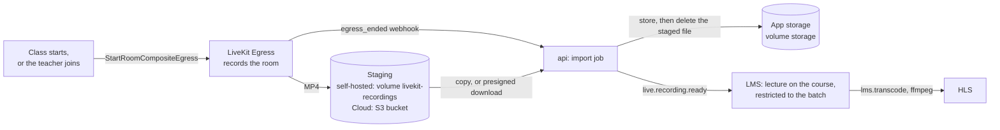

# Live streaming (LiveKit)

Live classes send audio and video through a streaming provider (`backend/src/infrastructure/streaming/`), chosen with
`STREAMING_PROVIDER` on the server:

| `STREAMING_PROVIDER` | Media                                                                                       | Use                                                      |
| -------------------- | ------------------------------------------------------------------------------------------- | -------------------------------------------------------- |
| `mock` (default)     | Peer to peer: the teacher's browser sends one stream to each student, with public STUN only | Development, tests, E2E and small classes on one network |
| `livekit`            | A [LiveKit](https://livekit.io) media server (SFU), self-hosted or LiveKit Cloud            | Production                                               |

With either provider, chat, Q&A, polls, raised hands, microphone requests and the whiteboard stay on the classroom
socket (Socket.IO namespace `/live`). A self-hosted LiveKit server and LiveKit Cloud use the same API, keys and
webhooks, so the only difference is where the media servers run and where recordings are staged.

- [How a class runs](#how-a-class-runs)
- [Attendance](#attendance)
- [Recordings](#recordings)
- [Self-hosted LiveKit](#self-hosted-livekit)
- [LiveKit Cloud](#livekit-cloud)
- [Webhooks](#webhooks)
- [Settings](#settings)
- [Mobile apps](#mobile-apps)
- [Checking the setup](#checking-the-setup)
- [Troubleshooting](#troubleshooting)
- [What needs a real server or device](#what-needs-a-real-server-or-device)

## How a class runs

1. **Schedule.** The teacher schedules the class for a batch. Batch members and the students' guardians are notified.
2. **Start.** The teacher starts the class. The API creates the LiveKit room `<LIVEKIT_ROOM_PREFIX>-<instituteId>-<id>`,
   starts the [recording](#recordings) if the class has recording on, and notifies the batch.
3. **Join.** The app gets a LiveKit token from `POST /api/live-classes/:id/join`, the same endpoint and checks as with
   the development provider. Tokens are issued only while the class is live, and only to the class's teacher, the
   batch's other teachers and students, and branch admins. A token is valid for at most 15 minutes, which only limits
   joining: LiveKit renews the token of a connected participant. Each participant's LiveKit identity is
   `user-<user id>`.
4. **Teach.** The teacher's console has **Mic**, **Camera**, **Share screen**, **Whiteboard** and **End class**.
5. **End.** **End class** stops the recording, closes the LiveKit room, which disconnects everyone, and closes the
   attendance.

LiveKit enforces what each classroom role may send through the token's grants, so a modified app can't publish more:

| Role      | Who                                          | May publish                                       |
| --------- | -------------------------------------------- | ------------------------------------------------- |
| Host      | The class's teacher                          | Camera, microphone, screen share (with its audio) |
| Student   | The batch's students                         | Nothing until the teacher allows the microphone   |
| Speaker   | A student whose microphone is allowed        | Microphone only                                   |
| Moderator | Branch admins and the batch's other teachers | Nothing: they watch and moderate                  |

Everyone may subscribe to the room's tracks. Nobody may send LiveKit data messages or change their own metadata.

**Student microphones.** A student taps **Raise hand**. When the teacher (or a moderator) taps **Allow mic**, the API
grants the student microphone publishing in LiveKit (`UpdateParticipant`), and the student's app turns the microphone
on ("Your mic is on"). **Mute** revokes the grant, and LiveKit stops the track. A student can only be allowed while
their app is connected to the media room.

**Screen share and whiteboard.** **Share screen** appears only where the browser can capture the screen: desktop
browsers, not the iOS and Android apps. Every device draws the whiteboard from the socket. So that recordings show the
board, the teacher's app also publishes it as a screen-share track named `whiteboard` (5 frames per second) while the
board is shown and no screen is shared.

## Attendance

With LiveKit, attendance comes from the media server instead of the classroom socket:

- the `participant_joined`, `participant_left` and `participant_connection_aborted` webhooks become the join and leave
  times of each visit (table `live_participants`) while the class is live, and presence on the classroom socket is
  ignored;
- `room_finished` and **End class** close the visits that are still open;
- when the class ends, the attendance module receives the totals, as with the development provider.

Attendance therefore depends on working [webhooks](#webhooks). After a test class, check "Last verified webhook" on the
admin card ([checking the setup](#checking-the-setup)).

## Recordings



- **Start.** When the class starts, and again whenever the teacher joins the room, the API asks LiveKit Egress to
  record the room (job `live-classes.ensure-recording`); a recording that is still running is kept. Egress records what
  a viewer sees (layout `speaker`) into an H.264 720p MP4 of roughly 3 Mbit/s, about 1.4 GB per hour (an estimate).
  If LiveKit closes the room because everyone left (2 minutes after the last participant leaves), that recording ends,
  and the teacher's return starts a new part.
- **Import.** LiveKit reports each finished file with the `egress_ended` webhook. The `live-classes.import-recording`
  job copies it into the app's storage (local disk, volume `storage`), deletes the staged file and adds it to the
  class's recordings. 15 minutes after the class ends, the `live-classes.collect-recordings` job asks LiveKit for
  recordings whose webhook was lost. Imports are idempotent.
- **Course and batch.** The LMS adds each recording as a published video lecture on the class's course (or else the
  batch's course) and subject, restricted to the class's batch when the batch belongs to that course, and queues its
  HLS transcoding (`lms.transcode`, ffmpeg in the api container). Batch members are notified. Without a course, or
  without the LMS module, the recording is listed on the live class page only.
- **Playback.** Recordings have no public path. For each playback the app asks the API, which checks access and returns
  a short-lived signed URL (`SIGNED_URL_TTL_SECONDS`): the LMS's HLS stream (`/api/lms/public/hls/…`) once transcoded,
  until then (or without the LMS module) the MP4 (`/api/files/signed/…`). The app plays HLS natively where the
  platform can (Safari, iOS, and Android WebViews that report HLS support) and with hls.js elsewhere.
- **Failures** don't stop the class. The API logs `Streaming provider could not start the recording` or
  `The streaming provider could not finish a live class recording` ([troubleshooting](#troubleshooting)).

Plan disk space for the MP4s (about 1.4 GB per class hour) and their HLS renditions in `storage`. Staged files are
deleted after the import. Imported recordings are in `storage`, which the [backups](../backup-restore.md) cover; the
`livekit-recordings` volume only holds files waiting for import and needs no backup.

## Self-hosted LiveKit

The optional Compose profile `livekit` runs LiveKit on the platform server:

| Service          | Image                             | Role                                                                                      |
| ---------------- | --------------------------------- | ----------------------------------------------------------------------------------------- |
| `livekit`        | `livekit/livekit-server:v1.13.11` | Media server: signalling on port 7880 (behind nginx at `/livekit/`), media, built-in TURN |
| `livekit-egress` | `livekit/egress:v1.15.0`          | Records rooms with headless Chrome into the volume `livekit-recordings`                   |
| `livekit-redis`  | `redis:8-alpine`                  | Egress requests between the two, on `127.0.0.1:6380`; nothing is persisted                |
| `livekit-init`   | `redis:8-alpine`                  | One-shot: lets Egress write to the recordings volume                                      |

They use the host network, as LiveKit recommends for WebRTC media. The api reaches LiveKit at
`http://host.docker.internal:7880` and reads the finished files from `livekit-recordings`, which it mounts at
`/var/lib/erp/livekit-recordings`.

### Server

- **CPU:** Egress takes a recording only while 4 CPU cores are free, and it plans with at most 80 % of the machine.
  Recording therefore needs at least 4 cores, and two classes recorded at once need about 8 to 10. Without enough
  cores, classes run but aren't recorded. Lowering Egress's estimate (`cpu_cost.room_composite_cpu_cost` in a custom
  `EGRESS_CONFIG_BODY`) risks choppy recordings. For many recorded classes at the same time, use LiveKit Cloud.
- **Network:** a public IPv4 address, which LiveKit finds with STUN (`use_external_ip`). Behind the 1:1 NAT of most
  clouds that works as long as the [ports](#ports) are open.
- **Certificate:** the platform certificate in `deploy/certs/platform/` for TURN over TLS
  ([TLS certificates](../deployment.md#tls-certificates)).

### Setup

1. Generate an API key and secret:

   ```sh
   docker run --rm livekit/livekit-server:v1.13.11 generate-keys
   ```

2. Add to `deploy/.env`, with your host name:

   ```sh
   STREAMING_PROVIDER=livekit
   LIVEKIT_URL=wss://app.example.com/livekit
   LIVEKIT_API_URL=http://host.docker.internal:7880
   LIVEKIT_API_KEY=<API key>
   LIVEKIT_API_SECRET=<API secret>
   COMPOSE_PROFILES=livekit
   ```

   `COMPOSE_PROFILES` adds the profile to every `docker compose` command, so upgrades and restarts include LiveKit.
   The `livekit` service builds its configuration from `SERVER_NAME`, `PUBLIC_URL` and the key pair, webhook included.

3. Open the [ports](#ports).
4. Run `docker compose up -d --wait`. It recreates the api with the new settings and starts the LiveKit services.
5. [Check the setup](#checking-the-setup).

### Ports

| Port                           | Protocol | Use                                                     | Open to                                      |
| ------------------------------ | -------- | ------------------------------------------------------- | -------------------------------------------- |
| 443                            | TCP      | Signalling, through nginx (`wss://SERVER_NAME/livekit`) | Everyone (already open)                      |
| 50000–60000                    | UDP      | Media                                                   | Everyone                                     |
| 7881                           | TCP      | Media over TCP, when UDP is blocked                     | Everyone                                     |
| 3478                           | UDP      | TURN                                                    | Everyone                                     |
| `LIVEKIT_TURN_TLS_PORT` (5349) | TCP      | TURN over TLS, for networks that block UDP              | Everyone                                     |
| 7880                           | TCP      | LiveKit's API and signalling, plain HTTP                | Only the Docker networks (nginx and the api) |
| 6380                           | TCP      | Redis                                                   | Nobody (it listens on 127.0.0.1)             |
| 7980                           | TCP      | Egress's internal page server                           | Nobody                                       |

The host firewall applies to these services because they use the host network. (Ports that Docker publishes, like
nginx's, bypass UFW; these don't.) With UFW:

```sh
sudo ufw allow 50000:60000/udp
sudo ufw allow 7881/tcp
sudo ufw allow 3478/udp
sudo ufw allow 5349/tcp
# nginx and the api reach 7880 from the compose network; docker network inspect erp_default shows its subnet.
sudo ufw allow from 172.16.0.0/12 to any port 7880 proto tcp
```

UFW's default policy denies everything else, which keeps 7880 and 7980 off the internet. Open the same ports in the
cloud provider's firewall or security group.

### TLS and TURN

- Signalling uses the platform certificate through nginx; LiveKit itself serves plain HTTP on 7880.
- TURN relays media for clients behind strict NAT or firewalls. TURN over TLS uses the platform certificate
  (`certs/platform/fullchain.pem` and `privkey.pem`) for `SERVER_NAME`. Start the profile once the real certificate is
  installed: until then `livekit` can't start, unless you set `LIVEKIT_TURN_TLS_PORT=0` (TURN over UDP only).
- LiveKit reads the certificate only when it starts. After each renewal (certbot renews 30 days before expiry),
  restart it outside class hours with `docker compose restart livekit`; a restart interrupts running classes.
- Some school and office networks allow only TCP 443. A self-hosted TURN server can't use 443, which nginx holds;
  LiveKit Cloud serves TURN on 443.

### Webhooks on the server

The `livekit` service posts webhooks to `PUBLIC_URL`, so the server must reach its own public name:

```sh
curl -s -o /dev/null -w '%{http_code}\n' -X POST https://app.example.com/api/live-classes/public/livekit/webhook
```

The expected answer is `401` (no signature). If the request times out, the network doesn't route the server's public
address back to the server (no hairpin NAT). Then map the name to the server itself for the `livekit` service, in
`deploy/docker-compose.override.yml`:

```yaml
services:
  livekit:
    extra_hosts:
      - 'app.example.com:127.0.0.1'
```

## LiveKit Cloud

LiveKit Cloud runs the media servers, TURN (also on port 443) and Egress. Its Egress can't write to your server, so it
uploads each recording to an S3-compatible staging bucket. The API copies the file into its local storage and deletes
it from the bucket.

1. In the [LiveKit Cloud](https://cloud.livekit.io) project settings, create an API key. Note the project URL,
   `wss://<project>.livekit.cloud`.
2. Create the staging bucket (AWS S3, Cloudflare R2, MinIO…) and a key for that bucket only, allowed to:
   - `s3:PutObject`: Egress uploads;
   - `s3:GetObject` and `s3:DeleteObject`: the API imports and deletes;
   - `s3:ListBucket`: the connection test.

   LiveKit receives this key with every recording request, so don't reuse a key with wider access. Add a lifecycle rule
   that deletes objects after about 7 days, in case an import never happens. Files are written under
   `livekit-recordings/`.

3. Add to `deploy/.env`:

   ```sh
   STREAMING_PROVIDER=livekit
   LIVEKIT_URL=wss://<project>.livekit.cloud
   LIVEKIT_API_KEY=<API key>
   LIVEKIT_API_SECRET=<API secret>
   LIVEKIT_RECORDING_OUTPUT=s3
   LIVEKIT_S3_BUCKET=<bucket>
   LIVEKIT_S3_REGION=<region>
   LIVEKIT_S3_ACCESS_KEY=<access key id>
   LIVEKIT_S3_SECRET_KEY=<secret access key>
   ```

   For R2, also set `LIVEKIT_S3_ENDPOINT=https://<account id>.r2.cloudflarestorage.com` and `LIVEKIT_S3_REGION=auto`;
   for MinIO, its endpoint and `LIVEKIT_S3_FORCE_PATH_STYLE=true`. Leave `LIVEKIT_API_URL` blank and don't enable the
   `livekit` profile. Apply with `docker compose up -d --wait`.

4. In the project settings, under webhooks, add the URL from the admin card
   (`https://app.example.com/api/live-classes/public/livekit/webhook`) and choose the same API key as the signing key.
   The API rejects webhooks signed with any other key.
5. If the web app's CSP is enforced (`SPA_CSP_MODE=enforce`), add `wss://*.livekit.cloud https://*.livekit.cloud` to
   `connect-src` in a custom `SPA_CSP` ([web app security headers](../deployment.md#web-app-security-headers)). The
   self-hosted setup needs no change: the default policy allows `wss://SERVER_NAME`.

## Webhooks

LiveKit reports joins, leaves, closed rooms and finished recordings to:

```text
<PUBLIC_URL>/api/live-classes/public/livekit/webhook
```

The admin card shows this URL with a **Copy** button. The self-hosted profile configures it by itself.

- **Signature.** Each request carries a JWT in its `Authorization` header, signed (HS256) with the API secret. Its
  issuer is the API key and its `sha256` claim is the base64 SHA-256 of the body. The API checks all three and the
  expiry, with 60 seconds of clock tolerance, and answers `401 INVALID_SIGNATURE` otherwise. Keep the clocks in sync
  (NTP).
- **Events.** The API uses `participant_joined`, `participant_left`, `participant_connection_aborted`,
  `room_finished` and `egress_ended`; the self-hosted profile sends only these. It acknowledges and ignores events
  about other rooms, so several deployments can share a LiveKit project with different `LIVEKIT_ROOM_PREFIX` values
  and their own webhook URLs.
- **Idempotency.** The API stores each event's id, and a redelivered event changes nothing (`{"duplicate":true}`). If
  applying an event fails, the API answers with an error and forgets the id, so LiveKit's retry applies it. Event ids
  are kept for 7 days.
- **Rate limits.** Webhooks count against `RATE_LIMIT_WEBHOOK_PER_MIN` (300 per minute) and the general
  `RATE_LIMIT_API_PER_MIN` (600 per minute), both per client IP. Every join and leave is one webhook, and they all come
  from LiveKit's address. Size both for the busiest minute: ten 100-student classes starting at 10:00 send over 1000
  joins within a few minutes. `RATE_LIMIT_API_PER_MIN` applies to every client, so raise it only as far as needed.
  Over a limit the API answers 429. A self-hosted LiveKit retries a delivery up to 4 times, waiting as the
  `Retry-After` header says, but it holds only 100 pending events and drops the rest; dropped joins and leaves are
  missing from the attendance.

## Settings

All settings go in `deploy/.env` (`backend/.env` in development). The API refuses to start with
`STREAMING_PROVIDER=livekit` and no URL or key pair, or with `s3` output and no bucket or bucket key.

| Variable                                                              | Default                    | Notes                                                                                                          |
| --------------------------------------------------------------------- | -------------------------- | -------------------------------------------------------------------------------------------------------------- |
| `STREAMING_PROVIDER`                                                  | `mock`                     | `livekit` turns this integration on                                                                            |
| `LIVEKIT_URL`                                                         |                            | The URL the apps connect to: `wss://SERVER_NAME/livekit` (self-hosted) or `wss://<project>.livekit.cloud`      |
| `LIVEKIT_API_URL`                                                     | `LIVEKIT_URL`              | Where the API calls LiveKit, if that differs: `http://host.docker.internal:7880` with the self-hosted profile  |
| `LIVEKIT_API_KEY`, `LIVEKIT_API_SECRET`                               |                            | The key pair: it signs join tokens and API calls, and verifies webhooks                                        |
| `LIVEKIT_ROOM_PREFIX`                                                 | `erp`                      | Room names are `<prefix>-<instituteId>-<id>`: 1 to 16 lowercase letters and digits, one per deployment         |
| `LIVEKIT_RECORDING_OUTPUT`                                            | `local`                    | `local`: Egress writes to a directory that the API reads (self-hosted). `s3`: a staging bucket (LiveKit Cloud) |
| `LIVEKIT_EGRESS_OUTPUT_DIR`                                           | `/out`                     | `local`: that directory as Egress sees it                                                                      |
| `LIVEKIT_RECORDINGS_DIR`                                              | `./tmp/livekit-recordings` | `local`: that directory as the API sees it. The compose file sets `/var/lib/erp/livekit-recordings`            |
| `LIVEKIT_S3_BUCKET`, `LIVEKIT_S3_ACCESS_KEY`, `LIVEKIT_S3_SECRET_KEY` |                            | `s3`: the staging bucket and its key                                                                           |
| `LIVEKIT_S3_REGION`                                                   | `us-east-1`                | `s3`: the bucket's region (`auto` for R2)                                                                      |
| `LIVEKIT_S3_ENDPOINT`                                                 | AWS                        | `s3`: the endpoint of another S3-compatible store                                                              |
| `LIVEKIT_S3_FORCE_PATH_STYLE`                                         | `false`                    | `s3`: `true` for stores without virtual-hosted buckets, such as MinIO                                          |
| `LIVEKIT_TURN_TLS_PORT`                                               | `5349`                     | Profile `livekit`: the TURN over TLS port; `0` turns it off                                                    |
| `RATE_LIMIT_WEBHOOK_PER_MIN`, `RATE_LIMIT_API_PER_MIN`                | `300`, `600`               | See [webhooks](#webhooks)                                                                                      |

Secrets stay on the server: the admin card never shows them, and the API never logs them.

## Mobile apps

- The iOS and Android apps already declare camera and microphone access (`NSCameraUsageDescription` and
  `NSMicrophoneUsageDescription`; `CAMERA`, `RECORD_AUDIO` and `MODIFY_AUDIO_SETTINGS`). The system asks the user on
  first use. A student needs the microphone only once the teacher allows it.
- The apps can't share the screen, because their WebViews can't capture it. Teachers share their screen from a desktop
  browser.
- Phones may keep the sound off until the user touches the page. The room then shows **Tap to enable sound**.
- Recorded classes play as HLS: natively on iOS, and on Android natively or with hls.js, depending on the WebView.
- The app loads `livekit-client` only when a LiveKit class opens.

## Checking the setup

Platform admins open **Integrations** and find the **Live classes** card. It shows the provider, the settings without
secrets, the webhook URL and the time of the last verified webhook.

1. **Test connection** calls LiveKit's API with the key pair and checks the recording storage: that the API can write
   and read `LIVEKIT_RECORDINGS_DIR` (`local`), or reach the bucket (`s3`). It doesn't check Egress or TURN.
2. Run a short test class. The teacher starts it in a desktop browser and a student joins from a phone on mobile data,
   so the media crosses NAT. The teacher allows the student's microphone, shares the screen, shows the whiteboard and
   ends the class.
3. Check that "Last verified webhook" shows the time and that the attendance lists the student. Within a few minutes
   the recording should appear on the class page and in the course's lectures, and play.

## Troubleshooting

| Symptom                                                               | Check                                                                                                                                              |
| --------------------------------------------------------------------- | -------------------------------------------------------------------------------------------------------------------------------------------------- |
| **Test connection** says "Check LIVEKIT_API_URL / LIVEKIT_URL"        | `docker compose ps livekit` and `docker compose logs livekit`; UFW must allow 7880 from the Docker networks                                        |
| **Test connection** says "Check LIVEKIT_API_KEY / LIVEKIT_API_SECRET" | The key pair in `.env` doesn't match LiveKit's. Recreate both with `docker compose up -d --wait`                                                   |
| The room stays at "Connecting media…", or `/livekit/` answers 502     | nginx can't reach LiveKit: `docker compose logs web livekit`, and the same 7880 rule                                                               |
| Media works on Wi-Fi but not on mobile data or office networks        | UDP 50000–60000, TCP 7881 and TURN (3478/udp, 5349/tcp) in the firewall and the security group; the external IP in `docker compose logs livekit`   |
| "Last verified webhook" stays empty and attendance is blank           | [Webhooks on the server](#webhooks-on-the-server) and webhook errors in `docker compose logs livekit`; on LiveKit Cloud, the URL and signing key   |
| Joins and leaves are missing in large classes                         | The [rate limits](#webhooks)                                                                                                                       |
| Classes aren't recorded                                               | `docker compose logs api livekit-egress`. Usually fewer than 4 free CPU cores ([server](#server))                                                  |
| A recording finished but wasn't imported                              | The api logs; the volume permissions (`docker compose run --rm livekit-init`); with `s3`, the bucket key's permissions                             |
| `livekit` exits at start                                              | `docker compose logs livekit`: the certificate files are missing (install the certificate or set `LIVEKIT_TURN_TLS_PORT=0`), or the keys are empty |

## What needs a real server or device

The automated tests mock LiveKit's API at the adapter and send signed sample webhooks, and CI never starts the
`livekit` profile. Verify on a real server and real devices:

- LiveKit, Egress and TURN on the server: media through the firewall, TURN over UDP and TLS from restricted networks,
  and the 7880 rule;
- webhook delivery from the server to its own `PUBLIC_URL` (hairpin NAT), and the `extra_hosts` workaround;
- recording: Egress's CPU headroom, the whiteboard in the recording, the shared volume's permissions, the import, the
  HLS transcoding and playback;
- LiveKit Cloud: uploads to your bucket, and webhooks signed with your key;
- the iOS and Android apps: camera and microphone prompts, the student microphone flow, **Tap to enable sound**, that
  **Share screen** stays hidden, and HLS playback;
- webhook bursts at the start of large classes against the rate limits;
- restarting `livekit` after a certificate renewal.
