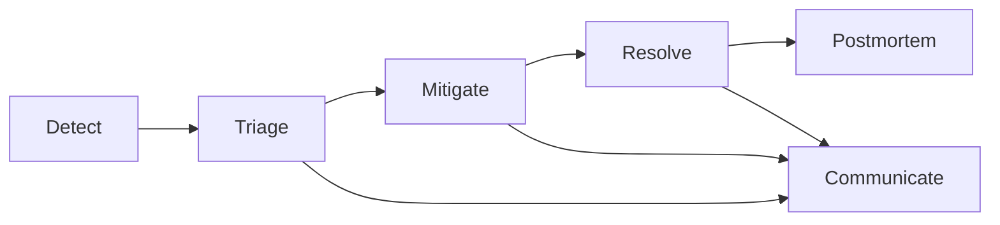

# Operations

How production is monitored, how incidents are handled and how institutes get support. This document covers these
release gates in the requirements spec:

- Section 10, Availability: "Production uptime target, monitoring, alerting and incident process defined."
- Section 10, Operations: "Monitoring, error tracking, deployment runbook and rollback procedure ready."
- Section 11.1: "Production deployment, monitoring, support and rollback plans are approved."

The spec leaves the numbers open: "Targets such as uptime percentage, p95 API latency, supported device/OS versions,
concurrent live viewers and recovery objectives are not yet specified. They should be agreed before performance and
operational acceptance testing." Until they are agreed, every target here is **TBD**. Where a starting point helps, it
is marked **Proposal**: a suggestion to agree or change, not a commitment. [Section 9](#9-open-decisions) lists every
open decision.

This document links to the existing guides rather than repeating them:

| Document                                                         | Covers                                                                                                                                                                                                                                                                                                                                                                                                                                                |
| ---------------------------------------------------------------- | ----------------------------------------------------------------------------------------------------------------------------------------------------------------------------------------------------------------------------------------------------------------------------------------------------------------------------------------------------------------------------------------------------------------------------------------------------- |
| [deployment.md](deployment.md)                                   | install, [upgrades](deployment.md#upgrades), [rollback](deployment.md#rollback), [health and readiness](deployment.md#health-and-readiness), [logs](deployment.md#logs), [error tracking](deployment.md#error-tracking), [secrets](deployment.md#rotating-secrets), [TLS](deployment.md#tls-certificates), [sign-in locks](deployment.md#sign-in-locks), [scaling and Redis](deployment.md#scaling), [troubleshooting](deployment.md#troubleshooting) |
| [backup-restore.md](backup-restore.md)                           | backups, offsite copies, restore, restore drill, [RPO and RTO](backup-restore.md#rpo-and-rto)                                                                                                                                                                                                                                                                                                                                                         |
| [security.md](security.md)                                       | tenant isolation, rate limiting, [sign-in lockout](security.md#passwords-otps-and-sign-in-lockout), secrets, [website domains](security.md#website-domains), logging, and the residual risks in the [open findings](security.md#open-findings)                                                                                                                                                                                                        |
| [load-testing.md](load-testing.md)                               | the load test and its [thresholds](load-testing.md#thresholds)                                                                                                                                                                                                                                                                                                                                                                                        |
| [integrations/biometric.md](integrations/biometric.md)           | biometric attendance devices                                                                                                                                                                                                                                                                                                                                                                                                                          |
| [integrations/live-streaming.md](integrations/live-streaming.md) | live classes on LiveKit: attendance, recordings, ports and webhooks                                                                                                                                                                                                                                                                                                                                                                                   |
| [integrations/messaging.md](integrations/messaging.md)           | SMS, WhatsApp, email and push providers, the [login OTP SMS](integrations/messaging.md#login-otp-sms), delivery webhooks and retries                                                                                                                                                                                                                                                                                                                  |
| [integrations/payments.md](integrations/payments.md)             | Paytm, Razorpay and Cashfree: webhooks, reconciliation and refunds                                                                                                                                                                                                                                                                                                                                                                                    |
| [ARCHITECTURE.md](../ARCHITECTURE.md)                            | how the system fits together                                                                                                                                                                                                                                                                                                                                                                                                                          |

## Conventions

- Commands run on the production server in `/srv/erp/deploy`, as in [deployment.md](deployment.md).
  `app.example.com` stands for your `SERVER_NAME`.
- SQL runs in the MySQL shell, `docker compose exec mysql mysql -uroot -p erp_coaching`; the root password is in
  `secrets/mysql_root_password`. The database stores times in UTC, so compare with `UTC_TIMESTAMP()`, not `NOW()`.
- Times in incident records are UTC.
- **This repository is public.** Keep incident records, postmortems, contact lists and anything that names an institute,
  a person or a server in a private place (TBD), not in this repository or its issues.

## 1. Service-level targets

Nothing here is agreed yet. Production is a single server running Docker Compose ([scaling](deployment.md#scaling)),
so a host failure, an upgrade or an api restart is downtime. Set the targets with that in mind, or plan the scaling
work first.

| Target                           | Agreed | Proposal                                                                                                                                                                                                                                          | Measured by                                                              |
| -------------------------------- | ------ | ------------------------------------------------------------------------------------------------------------------------------------------------------------------------------------------------------------------------------------------------- | ------------------------------------------------------------------------ |
| Availability                     | TBD    | 99.5% per calendar month (about 3.6 hours down in 30 days), not counting announced maintenance                                                                                                                                                    | external check of `/api/ready` ([section 2](#2-monitoring-and-alerting)) |
| Maintenance                      | TBD    | outside class hours, announced to institutes 48 hours ahead. An upgrade means 10–30 s of downtime plus migrations, and disconnects live classes ([upgrades](deployment.md#upgrades))                                                              | maintenance log                                                          |
| API latency                      | TBD    | p95 under 500 ms for API requests at the agreed peak load                                                                                                                                                                                         | `requestTime` in the nginx logs; load test                               |
| Peak load                        | TBD    | TBD: institutes, active users and requests per second in the busiest hour                                                                                                                                                                         | [load test](load-testing.md)                                             |
| RPO (data loss)                  | TBD    | database 1 hour (needs the optional hourly database backup), uploaded files 24 hours                                                                                                                                                              | [backup schedule](backup-restore.md#schedule)                            |
| RTO (time to restore)            | TBD    | 4 hours restoring in place, 1 business day onto a new server                                                                                                                                                                                      | timed [restore drill](backup-restore.md#restore-drill)                   |
| Live-class viewers               | TBD    | TBD: measure it on the production LiveKit setup ([live streaming](integrations/live-streaming.md)). With `STREAMING_PROVIDER=mock`, media is peer to peer and a class holds roughly 15 to 25 viewers ([live classes](deployment.md#live-classes)) | load test                                                                |
| Concurrent live classes          | TBD    | TBD: recording a class on self-hosted LiveKit needs about 4 free CPU cores, and two at once about 8 to 10; classes beyond that run but aren't recorded ([server](integrations/live-streaming.md#server))                                          | load test                                                                |
| Mobile devices                   | TBD    | the build floors, Android 8.0 (API 26) and iOS 15.0, tested on a device list to agree                                                                                                                                                             | device test run                                                          |
| Browsers                         | TBD    | the latest two versions of Chrome, Edge, Safari and Firefox                                                                                                                                                                                       | browser test run                                                         |
| Support hours and response times | TBD    | see [severity levels](#3-severity-levels) and [support](#6-support-for-institutes)                                                                                                                                                                | support tickets                                                          |

Notes:

- The [load-test thresholds](load-testing.md#thresholds) are guard rails set at roughly four to five times a laptop
  baseline; they are not targets. When latency targets are agreed, put them in `load/thresholds.json` too.
- Agree how uptime is measured along with the number: which check counts, from where, how often, and what counts as
  announced maintenance.
- [RPO and RTO](backup-restore.md#rpo-and-rto) in backup-restore.md explains what the backups allow today: up to 24
  hours of data loss with the default daily backup, and an RTO that hasn't been measured. Record the agreed values
  there too.

## 2. Monitoring and alerting

What the repository provides:

- `GET /api/health` (the process is up), `GET /api/ready` (database, migrations and storage), the Docker health check
  on the api and `/nginx-health` on nginx ([health and readiness](deployment.md#health-and-readiness)). The storage
  check only tests that storage is writable, not how much space is left.
- JSON logs from the api and nginx, with a request id on every request ([logs](deployment.md#logs)).
- Error reports through `ERROR_TRACKING_PROVIDER`: `none` (the default), `log` or `webhook`
  ([error tracking](deployment.md#error-tracking)).
- Certificate expiry warnings from `erp-certs`, the backup log, and the `jobs` and `audit_events` tables.
- Redis fallback warnings, and the errors logged by the messaging, live-class and payment integrations
  ([5.11](#511-integration-provider-outage), [5.12](#512-redis-unavailable)).

Nothing in the repository sends alerts or pages anyone. Choose an external uptime monitor, somewhere to collect logs
and a route to the on-call person (all TBD), and wire the signals below to them. deployment.md lists the minimum
under "Monitor and alert on" in [health and readiness](deployment.md#health-and-readiness); the matrix below extends
it. Until alerting is in place, the [routine checks](#routine-checks) are the monitoring.

### Alerts

Thresholds are proposals. Severities are defined in [section 3](#3-severity-levels).

| Signal                 | How to check                                                                                                                                                                                                                                                                               | Alert when (Proposal)                                                                         | Severity                                    | Runbook                                                                                                                                                                      |
| ---------------------- | ------------------------------------------------------------------------------------------------------------------------------------------------------------------------------------------------------------------------------------------------------------------------------------------ | --------------------------------------------------------------------------------------------- | ------------------------------------------- | ---------------------------------------------------------------------------------------------------------------------------------------------------------------------------- |
| Site ready             | external HTTPS check of `https://app.example.com/api/ready` every minute                                                                                                                                                                                                                   | not 200 for 2 minutes                                                                         | SEV1                                        | [5.2](#52-api-down-not-ready-or-slow)                                                                                                                                        |
| nginx up               | on the server, `curl -sS http://localhost/nginx-health` returns `200 ok` (port `HTTP_PORT`, 80 by default)                                                                                                                                                                                 | fails                                                                                         | SEV1                                        | [5.2](#52-api-down-not-ready-or-slow)                                                                                                                                        |
| Readiness checks       | `checks` in the `/api/ready` body; api warnings `readiness: database unavailable`, `readiness: migration status unavailable` and `readiness: storage not writable`                                                                                                                         | any, for 2 minutes                                                                            | SEV1                                        | [5.2](#52-api-down-not-ready-or-slow), [5.3](#53-mysql-down-or-out-of-space)                                                                                                 |
| Containers             | `docker compose ps`; restarts and out-of-memory kills with `docker inspect --format '{{.RestartCount}} {{.State.OOMKilled}}' $(docker compose ps -q api)`                                                                                                                                  | api `unhealthy`; the restart count goes up; `OOMKilled` is `true`                             | SEV2, or SEV1 if not ready                  | [5.2](#52-api-down-not-ready-or-slow)                                                                                                                                        |
| Crashes                | api log lines at level 60 (`failed to start`, `uncaught exception`) and `unhandled promise rejection`                                                                                                                                                                                      | any                                                                                           | SEV2                                        | [5.2](#52-api-down-not-ready-or-slow)                                                                                                                                        |
| Server errors          | nginx log lines with `"status":5`                                                                                                                                                                                                                                                          | over 1% of requests in 5 minutes                                                              | SEV2                                        | [5.2](#52-api-down-not-ready-or-slow)                                                                                                                                        |
| Error tracker          | events from `ERROR_TRACKING_PROVIDER`: your webhook receiver, or api log lines with `"msg":"error_tracking"`                                                                                                                                                                               | a new kind of error, or a jump in volume                                                      | SEV3, to triage                             | [5.2](#52-api-down-not-ready-or-slow)                                                                                                                                        |
| Error-tracker delivery | api warnings `error tracking webhook rejected an event` or `error tracking webhook failed`; events arriving with `droppedSinceLast` above 0                                                                                                                                                | any, for 15 minutes                                                                           | SEV3                                        | [error tracking](deployment.md#error-tracking)                                                                                                                               |
| Latency                | `requestTime` (seconds) in nginx log lines for `/api/` paths                                                                                                                                                                                                                               | p95 above the agreed target for 10 minutes                                                    | SEV2                                        | [5.2](#52-api-down-not-ready-or-slow)                                                                                                                                        |
| Live-class signalling  | `curl -sS 'https://app.example.com/api/live-classes/socket.io/?EIO=4&transport=polling'` starts with `0{"sid":`                                                                                                                                                                            | fails                                                                                         | SEV2                                        | [5.2](#52-api-down-not-ready-or-slow)                                                                                                                                        |
| Rate limiting          | 429 responses in the nginx logs, especially on `/api/auth/`, where the OTP limit (`OTP_RATE_LIMITED`) and sign-in locks (`ACCOUNT_LOCKED`) answer 429 too                                                                                                                                  | a sudden jump, or many from one address                                                       | SEV3                                        | [rate limiting](deployment.md#rate-limiting-behind-the-proxy), [sign-in locks](deployment.md#sign-in-locks), [5.8](#58-suspected-security-incident-or-cross-tenant-exposure) |
| Disk space             | `df -h` for the disks holding `/var/lib/docker` and `/srv/erp/deploy/backups`                                                                                                                                                                                                              | 80% used SEV3, 90% SEV2, 95% SEV1                                                             | as listed                                   | [5.4](#54-disk-filling-up)                                                                                                                                                   |
| Database               | `database.latencyMs` in the `/api/ready` body; `docker compose ps mysql`                                                                                                                                                                                                                   | not healthy; latency far above its usual value                                                | SEV1                                        | [5.3](#53-mysql-down-or-out-of-space)                                                                                                                                        |
| Redis                  | `docker compose ps redis`; api errors `Redis connection error` and `Redis connect failed`, and the fallback warnings in [5.12](#512-redis-unavailable)                                                                                                                                     | not `healthy`, or the errors for 5 minutes                                                    | SEV3; SEV2 during live classes              | [5.12](#512-redis-unavailable)                                                                                                                                               |
| Background jobs        | the queries in [5.5](#55-background-jobs-stuck-or-failing)                                                                                                                                                                                                                                 | jobs overdue by 15 minutes; any `failed` job; a sweep missing                                 | SEV3; SEV2 for the billing and fee sweeps   | [5.5](#55-background-jobs-stuck-or-failing)                                                                                                                                  |
| Backups                | `find /srv/erp/deploy/backups -maxdepth 1 -type d -name 'erp_coaching-*Z' -mmin -1560` prints nothing; `backup FAILED` in `/var/log/erp-backup.log`                                                                                                                                        | no backup in 26 hours; any failure                                                            | SEV2                                        | [schedule](backup-restore.md#schedule)                                                                                                                                       |
| Offsite copies         | age of the newest offsite copy                                                                                                                                                                                                                                                             | older than 26 hours                                                                           | SEV2                                        | [offsite copies](backup-restore.md#offsite-copies)                                                                                                                           |
| Certificates           | external expiry check with `openssl` ([5.6](#56-certificate-expiry)); `erp-certs: WARNING:` in `docker compose logs web`                                                                                                                                                                   | 21 days left SEV3; 7 days SEV2; platform certificate expired SEV1; custom domain expired SEV2 | as listed                                   | [5.6](#56-certificate-expiry)                                                                                                                                                |
| Biometric devices      | the query in [5.7](#57-biometric-devices-not-pushing)                                                                                                                                                                                                                                      | an active device silent for 30 minutes during attendance hours                                | SEV3; SEV2 if every device is silent        | [5.7](#57-biometric-devices-not-pushing)                                                                                                                                     |
| Sign-in codes          | api errors `OTP SMS not sent`, and `Unhandled error` on sign-in, which users see as `503 MESSAGE_NOT_SENT`, both also in the error tracker; `Global messaging provider unavailable; using the built-in provider`; `Cannot decrypt platform integration secrets`                            | any                                                                                           | SEV2                                        | [messaging providers](#messaging-providers)                                                                                                                                  |
| Notification delivery  | api warnings `Notification delivery failed:`; `failed` rows in `notification_messages`                                                                                                                                                                                                     | a jump, or one channel failing for every institute                                            | SEV3                                        | [messaging providers](#messaging-providers)                                                                                                                                  |
| Live streaming         | api error `Streaming provider could not create the room`, which users see as `STREAMING_UNAVAILABLE`                                                                                                                                                                                       | any, during class hours                                                                       | SEV2                                        | [live classes on LiveKit](#live-classes-on-livekit)                                                                                                                          |
| Live recordings        | api warnings `Streaming provider could not start the recording` and `The streaming provider could not finish a live class recording`; files left in the `livekit-recordings` volume ([5.4](#54-disk-filling-up))                                                                           | any                                                                                           | SEV3                                        | [live classes on LiveKit](#live-classes-on-livekit)                                                                                                                          |
| Payment discrepancies  | api errors `Gateway amount mismatch`, `SaaS gateway amount mismatch` or `Gateway reports a refund we marked failed as processed; check the gateway dashboard`                                                                                                                              | any                                                                                           | SEV2                                        | [payment gateways](#payment-gateways)                                                                                                                                        |
| Payment gateways       | api warnings `Payment gateway request failed`, `Payment gateway is misconfigured`, `Payment webhook rejected`, `SaaS payment webhook rejected`, `Payment reconciliation failed for institute`, `SaaS payment reconciliation failed` and `Stored payment gateway secrets could not be read` | repeated for one gateway, or for every institute                                              | SEV3; SEV2 if no one can pay online         | [payment gateways](#payment-gateways)                                                                                                                                        |
| Security events        | super admin → Audit log: unexpected `impersonation.started`, `role.permissions_changed`, `platform.*` or `tenant_data.export_downloaded` events                                                                                                                                            | anything unexpected                                                                           | SEV1 if data may be exposed                 | [5.8](#58-suspected-security-incident-or-cross-tenant-exposure)                                                                                                              |
| Sign-in locks          | `auth.sign_in_locked` events: super admin → **Audit log**, or `audit_events` with `action = 'auth.sign_in_locked'`                                                                                                                                                                         | many in an hour or from one address, or a lock on an admin or super admin                     | SEV3; SEV1 if an account may be compromised | [sign-in locks](deployment.md#sign-in-locks), [5.8](#58-suspected-security-incident-or-cross-tenant-exposure)                                                                |
| Nightly CI             | the scheduled CI run (tests in reverse and shuffled order)                                                                                                                                                                                                                                 | fails                                                                                         | SEV4                                        | [CI](../CONTRIBUTING.md#ci)                                                                                                                                                  |
| Host load              | `docker stats --no-stream`; host CPU and memory                                                                                                                                                                                                                                            | above 80% for 15 minutes                                                                      | SEV3                                        | [5.2](#52-api-down-not-ready-or-slow)                                                                                                                                        |

### Routine checks

Until alerts cover the matrix, someone (TBD) runs these by hand. Proposal:

- **Daily:** `docker compose ps`; `curl -sS https://app.example.com/api/ready`; `df -h`; the end of
  `/var/log/erp-backup.log` and the newest backup in `/srv/erp/deploy/backups`; the last day's errors with
  `docker compose logs --since 24h api | grep -E '"level":(50|60)'`; failed and overdue jobs
  ([5.5](#55-background-jobs-stuck-or-failing)).
- **Weekly:** certificate expiry for the platform host and every custom domain ([5.6](#56-certificate-expiry)); silent
  biometric devices ([5.7](#57-biometric-devices-not-pushing)); disk growth and the largest institutes
  ([5.4](#54-disk-filling-up)); `auth.sign_in_locked` events, by account and address; the nightly CI results.
- **Monthly:** the [restore drill](backup-restore.md#restore-drill), recorded in the
  [drill log](backup-restore.md#drill-log); a review of the audit log for super admin actions, and of
  `impersonation.started` events against support tickets.
- **After each release:** the checks in steps 6 and 7 of [upgrades](deployment.md#upgrades), then watch server errors
  and the error tracker for 30 minutes.

## 3. Severity levels

Response and update times are proposals until agreed. Support hours are TBD.

| Severity | Meaning                                                                                          | Examples                                                                                                                   | First response (Proposal) | Updates to institutes (Proposal) |
| -------- | ------------------------------------------------------------------------------------------------ | -------------------------------------------------------------------------------------------------------------------------- | ------------------------- | -------------------------------- |
| SEV1     | The platform is down or unusable for most institutes, data is lost, or data may be exposed       | `/api/ready` failing; MySQL down; platform certificate expired; a leaked secret; one institute seeing another's data       | 15 minutes, at any time   | every hour until mitigated       |
| SEV2     | A major feature is broken for many users with no workaround, or a SEV1 is likely soon            | live classes failing; sign-in failing for one institute; billing or fee sweeps not running; backups failing; disk 90% full | 1 hour in support hours   | every 4 hours                    |
| SEV3     | Something is degraded for some users and there is a workaround, or a risk to fix before it grows | one biometric device silent; a failed job; a certificate expiring within 21 days; disk 80% full                            | 1 business day            | when resolved                    |
| SEV4     | A minor bug, a cosmetic issue or a question                                                      | a layout glitch; a how-to question                                                                                         | 2 business days           | when resolved                    |

- If unsure, pick the higher severity; you can lower it later.
- A suspected cross-tenant exposure, a leaked secret or a compromised account is SEV1 until shown otherwise.
- Record every change of severity, with the time, in the incident timeline.

## 4. Incident process



### Roles

For SEV1 and SEV2 incidents (Proposal; SEV3 and SEV4 just need an owner):

- **Incident lead:** owns the incident until it's resolved, sets the severity, decides on mitigations and escalates.
  The first responder is the lead until they hand over.
- **Communications:** sends the updates to institutes and to the team ([communicate](#communicate)).
- **Scribe:** keeps the timeline: what was seen and done, when (UTC) and by whom.

On a small team one person can hold all three roles. The on-call rota and escalation contacts are TBD.

### Detect

An incident starts from an alert or a routine check ([section 2](#2-monitoring-and-alerting)), a support ticket
([section 6](#6-support-for-institutes)) or an outside report, such as one from a security researcher. For anything
that may be SEV1 or SEV2, open an incident record in the private incident location straight away and note the time.

### Triage

1. Run the [first checks](#51-first-checks).
2. Work out the scope: every institute or one, one feature, one platform (web, Android or iOS), or one device.
3. Set the [severity](#3-severity-levels) and name the incident lead.
4. Find the matching runbook in [section 5](#5-runbooks).

### Mitigate

Restore service first; find the root cause afterwards.

- **Save the logs before recreating any container.** Recreating a container deletes its logs, and upgrades,
  rollbacks, `docker compose up` after a configuration change and `--force-recreate` all recreate containers:
  `docker compose logs --timestamps api web > /root/incident-<id>.log`
- Restarting the api briefly disconnects every live class, and the clients reconnect and rejoin. Chat, questions,
  polls and attendance are in MySQL, and raised hands, speakers, screen sharing and the whiteboard in Redis, so they
  survive the restart; if Redis is down too, the hands and the whiteboard are lost
  ([live classes](deployment.md#live-classes)). Check first with
  `SELECT COUNT(*) FROM live_sessions WHERE status = 'live';` and warn those institutes if you can.
- If the problem started with a release, roll back ([5.9](#59-bad-release)) rather than fixing forward.
- Before changing data by hand, take a database snapshot. It goes into its own folder, so that it doesn't push a daily
  backup out of [retention](backup-restore.md#retention-and-disk-space), and `--no-prune` keeps earlier incidents'
  snapshots:
  `BACKUP_HOST_DIR=./backups/incident docker compose --profile ops run --rm backup --no-media --no-prune`
- Write every action, with its time, in the timeline.

### Communicate

There is no status page or in-app banner yet (TBD). Until there is, tell institute admins through the support
channels ([section 6](#6-support-for-institutes)); they tell their teachers, students and parents.

- Send the first notice within the update interval for the severity: what's affected, since when, what users should
  do, and when the next update will be.
- Keep to the update interval even when nothing has changed.
- Finish with a resolution notice: what happened, the impact, what was done, and whether users need to do anything,
  such as signing in again.
- During an outage users stay signed in: the app keeps the session through network errors and server errors.

Templates (Proposal):

```text
[Investigating] <time UTC>: Since <time UTC>, <who> can't <what>. We're working on it.
Next update by <time UTC>.

[Resolved] <time UTC>: <What> has worked normally since <time UTC>. Cause: <one line>.
<What users need to do, or "No action is needed.">
```

Notification duties for security incidents and personal-data breaches depend on law and contracts. In India they
include, for example, the CERT-In directions on reporting cyber incidents and the Digital Personal Data Protection
Act, 2023. Before go-live, confirm with legal counsel who must be told, by whom and how fast (TBD); this document
doesn't set those deadlines.

### Resolve

An incident is resolved when service is back to normal and the alerts have cleared, even if the root cause isn't fixed
yet. Before closing it:

- Repeat the checks that showed the problem: `/api/ready`, the affected feature, the alerts.
- Look for side effects: jobs that failed or were delayed ([5.5](#55-background-jobs-stuck-or-failing)), sweeps that
  didn't run, a missed backup.
- Send the resolution notice.
- Record the follow-up work. Use a GitHub issue only when it contains nothing sensitive; otherwise use the private
  tracker.

### Postmortem

Write one for every SEV1, SEV2 and security incident (Proposal), using the [template](#7-postmortem-template).
Proposal: draft it within 5 business days and review it with the team. Keep it blameless: describe what the system
and the process allowed, not who made a mistake. Store it in the private incident location, and share a summary with
the affected institutes if that is agreed.

## 5. Runbooks

Each runbook starts from what you see. Use them inside the [incident process](#4-incident-process): save the logs
before recreating containers, keep the timeline and keep institutes informed. Smaller problems are in the
[troubleshooting table](deployment.md#troubleshooting) in deployment.md.

### 5.1 First checks

1. From outside the server, `curl -sS https://app.example.com/api/ready`. On the server,
   `curl -sS http://localhost/nginx-health` (port `HTTP_PORT`). If nginx answers on the server but the outside check
   fails, look at DNS, the firewall, the network and the certificate ([5.6](#56-certificate-expiry)).
2. `docker compose ps`: every service should be running, and `mysql`, `redis` and `api` should be `healthy`.
3. `docker compose logs --since 10m api web`: api lines with `"level":50` (error) or `"level":60` (fatal), and nginx
   lines with `"status":5` (server errors). To follow one failing request, take the `X-Request-Id` response header
   from the browser's developer tools and run `docker compose logs api web | grep '<request id>'`.
4. `df -h` and `docker stats --no-stream`: disk space, CPU and memory.
5. What changed recently: a release (`ERP_IMAGE_TAG` in `.env`), a configuration change, a certificate renewal, or a
   super admin action in the audit log.

### 5.2 API down, not ready or slow

| What you see                                                           | Likely cause                                                   | What to do                                                                                                                                                                                                                                                                                                                           |
| ---------------------------------------------------------------------- | -------------------------------------------------------------- | ------------------------------------------------------------------------------------------------------------------------------------------------------------------------------------------------------------------------------------------------------------------------------------------------------------------------------------ |
| 503 with `"code":"SERVICE_UNAVAILABLE"` and a `Retry-After: 10` header | nginx couldn't reach the api, or the api didn't answer in time | `docker compose ps api`. If it's stopped or restarting, read `docker compose logs --since 30m migrate api` for `failed to start`, `uncaught exception` or a failed migration. It starts only once `mysql` and `redis` are healthy and `migrate` has finished ([5.3](#53-mysql-down-or-out-of-space), [5.12](#512-redis-unavailable)) |
| 503 from `/api/ready` with `"status":"not_ready"`                      | the api runs, but a readiness check fails                      | read `checks` in the body: `database` → [5.3](#53-mysql-down-or-out-of-space); `migrations` with `pending` above 0 → pending migrations, below; `storage` → the `storage` volume is missing or not writable. Redis isn't one of the checks ([5.12](#512-redis-unavailable))                                                          |
| The api stays `unhealthy`                                              | it is stuck, overloaded or not ready                           | fix any failing readiness check first, then see "Unhealthy isn't restarted" below                                                                                                                                                                                                                                                    |
| The api restarts again and again                                       | it crashes at start, or runs out of memory                     | `docker compose logs --since 30m api`; `docker inspect --format '{{.RestartCount}} {{.State.OOMKilled}}' $(docker compose ps -q api)`                                                                                                                                                                                                |
| Responses are slow                                                     | the database, a heavy job, or the host                         | see "Slow responses" below                                                                                                                                                                                                                                                                                                           |
| It started with a release                                              | the release                                                    | [5.9](#59-bad-release)                                                                                                                                                                                                                                                                                                               |

- **Pending migrations:** `docker compose up` runs the `migrate` service first, and the api doesn't start if it
  fails. Check with `docker compose run --rm migrate node dist/infrastructure/database/cli.js migrate:status`, and run
  them with `docker compose run --rm migrate`. If a migration fails, follow the
  [migration rollback plan](deployment.md#migration-rollback-plan).
- **Unhealthy isn't restarted:** Docker restarts a container that exits, not one that is `unhealthy`. The health check
  calls `/api/ready` every 15 seconds, so an api that can't reach MySQL is `unhealthy` too, and restarting it won't
  help. If MySQL is healthy and the api still doesn't answer, save the logs and run `docker compose restart api`. A
  restart keeps the container's logs; live classes drop for a moment and reconnect ([mitigate](#mitigate)).
- **Slow responses:**
  - Compare `upstreamTime` and `requestTime` in the nginx logs. A high `upstreamTime` means the api is slow; a high
    `requestTime` with a low `upstreamTime` points to the client's network.
  - Check `database.latencyMs` in the `/api/ready` body, and look for long-running queries with
    `SHOW FULL PROCESSLIST;` in the MySQL shell.
  - `docker compose top api` shows what runs in the api container. The job worker runs there too, so a lecture
    transcode (`ffmpeg`), a large export or a report competes with requests. To move the worker to its own container,
    see [jobs and workers](deployment.md#jobs-and-workers).
  - `docker stats --no-stream` shows CPU and memory. The Compose file sets no memory limits, so one container can use
    all of the host's memory.
  - Slow sign-ins under load: password hashing runs on Node's thread pool of `UV_THREADPOOL_SIZE` threads (4 by
    default), which bounds the sign-ins the api hashes at once. On a server with more cores, raise it in `.env`
    towards the core count, then run `docker compose up -d --wait` ([scaling](deployment.md#scaling)).

### 5.3 MySQL down or out of space

Signs: `checks.database.ok` is `false` and the api logs `readiness: database unavailable`; `mysql` isn't `healthy` in
`docker compose ps`; or saving fails while pages still load. With a full disk MySQL can't write, but `/api/ready` can
stay 200, because the database check is only `SELECT 1`.

1. `docker compose logs --since 30m mysql` for disk-full errors and crash recovery, and
   `docker inspect --format '{{.RestartCount}} {{.State.OOMKilled}}' $(docker compose ps -q mysql)` for an
   out-of-memory kill.
2. `df -h /var/lib/docker`. The database is in the `mysql-data` volume, at
   `/var/lib/docker/volumes/erp_mysql-data/_data`. If the disk is full, free space first
   ([5.4](#54-disk-filling-up)).
3. If MySQL stopped and there is space, start it with `docker compose up -d --wait`. After a crash, MySQL recovers
   before it reports healthy, which can take a while on a large database: follow `docker compose logs -f mysql` and
   don't stop it halfway.
4. Find what uses the space inside MySQL. The largest tables:

   ```sql
   SELECT table_name, ROUND((data_length + index_length) / 1048576) AS mb
   FROM information_schema.tables WHERE table_schema = 'erp_coaching'
   ORDER BY mb DESC LIMIT 10;
   ```

   - **Binary logs:** MySQL 8.4 writes them and keeps them for 30 days, and each restore drill adds about three times
     the database size ([restore drill](backup-restore.md#restore-drill)). `SHOW BINARY LOGS;` lists them with their
     sizes. If nothing uses them (no replica, no point-in-time recovery), `PURGE BINARY LOGS BEFORE NOW();` frees
     the space.
   - **Restore-test leftovers:** an interrupted [restore test](backup-restore.md#restore-test) can leave scratch
     databases behind. `SHOW DATABASES LIKE 'erp_restore_test%';` lists them; drop only those names, never
     `erp_coaching`.

5. Check that `/api/ready` returns 200 again. If it doesn't within a minute, run `docker compose restart api`. Then
   look for jobs that were due during the outage ([5.5](#55-background-jobs-stuck-or-failing)).
6. If the data is damaged and MySQL won't start, restore from a backup ([5.10](#510-data-loss-or-a-lost-server)).

### 5.4 Disk filling up

`/api/ready` doesn't notice a full disk: the database check is `SELECT 1`, and the storage check only tests write
permission. Watch `df -h` instead ([alerts](#alerts)).

Uploaded files stay on the server's disk: `STORAGE_DRIVER` must stay `local`, because the S3/R2 adapter isn't
implemented ([before going live](deployment.md#before-going-live)). Live-class recordings are stored there too:
with LiveKit, about 1.4 GB per class hour plus their HLS renditions
([recordings](integrations/live-streaming.md#recordings)). The `storage` volume keeps growing, so the lasting fix is a
bigger disk, or moving the backups to another disk; cleaning up only buys time. Plans can cap each institute's uploads
with the `storageMb` limit (super admin → Plans).

Find what uses the space with `df -h`, `docker system df -v` (volumes, images and build cache) and
`sudo du -sh /var/lib/docker/volumes/*/_data /var/lib/docker/containers /srv/erp/deploy/backups`.

| Location                                                                             | Holds                                                                                                                                                       | To free space                                                                                                                                                                                                                                                                                                                                                                                           |
| ------------------------------------------------------------------------------------ | ----------------------------------------------------------------------------------------------------------------------------------------------------------- | ------------------------------------------------------------------------------------------------------------------------------------------------------------------------------------------------------------------------------------------------------------------------------------------------------------------------------------------------------------------------------------------------------- |
| `/var/lib/docker/volumes/erp_storage/_data` (volume `storage`)                       | uploaded files, under `institutes/<id>/`                                                                                                                    | Never delete files by hand: the database still points to them. Find the largest institutes with `sudo du -sh /var/lib/docker/volumes/erp_storage/_data/institutes/* \| sort -h \| tail` and look up their names with `SELECT id, name FROM institutes WHERE id IN (<ids>);`. An institute's files are removed when its data is purged ([institute data](../ARCHITECTURE.md#institute-data-tenant-data)) |
| `/var/lib/docker/volumes/erp_mysql-data/_data` (volume `mysql-data`)                 | the database and its binary logs                                                                                                                            | [5.3](#53-mysql-down-or-out-of-space)                                                                                                                                                                                                                                                                                                                                                                   |
| `/var/lib/docker/volumes/erp_api-tmp/_data` (volume `api-tmp`)                       | upload staging (`lms-uploads/`, `uploads/`), transcode work directories (`lms-hls-*`), and generated PDFs, exports and recordings while they're being built | Upload sessions expire after 24 hours, so older upload parts are abandoned: `docker compose exec api find /srv/erp/backend/tmp/lms-uploads -name '*.part' -mmin +1440 -delete`. Remove `lms-hls-*` directories only while no `lms.transcode` job is running                                                                                                                                             |
| `/var/lib/docker/volumes/erp_livekit-recordings/_data` (volume `livekit-recordings`) | live-class recordings from the self-hosted LiveKit profile, until they're imported into `storage`                                                           | Each file is deleted once it's imported, so files that stay weren't imported. Fix the cause ([live streaming troubleshooting](integrations/live-streaming.md#troubleshooting)) rather than deleting them, which loses the recordings                                                                                                                                                                    |
| `/var/lib/docker/volumes/erp_redis-data/_data` (volume `redis-data`)                 | Redis's append-only file: rate-limit and OTP counters, sign-in locks and live-class state. [Not backed up](backup-restore.md#what-is-not-backed-up)         | Nothing to clean up: the keys expire by themselves ([scaling](deployment.md#scaling)). If Redis can't write, see [5.12](#512-redis-unavailable)                                                                                                                                                                                                                                                         |
| `/srv/erp/deploy/backups` (`BACKUP_HOST_DIR`)                                        | backups                                                                                                                                                     | [Retention](backup-restore.md#retention-and-disk-space) (`BACKUP_KEEP_COUNT`, `BACKUP_KEEP_DAYS`) leaves other files and folders alone, so delete incident snapshots yourself once they're no longer needed                                                                                                                                                                                             |
| `/var/lib/docker/containers`                                                         | container logs                                                                                                                                              | [log rotation](deployment.md#logs)                                                                                                                                                                                                                                                                                                                                                                      |
| Docker images and build cache                                                        | old releases                                                                                                                                                | `docker image prune` and `docker builder prune`. Don't add `-a`: a rollback needs the previous release's images                                                                                                                                                                                                                                                                                         |

When the disk is nearly full, free space in this order:

1. `docker builder prune` and `docker image prune`.
2. Abandoned upload parts in `api-tmp`, as above.
3. Restore-test leftovers and, if nothing uses them, binary logs ([5.3](#53-mysql-down-or-out-of-space)).
4. Old incident snapshots. Then, only if the [offsite copies](backup-restore.md#offsite-copies) are current, the oldest
   local backups (`erp_coaching-<time>Z` directories), oldest first.
5. Grow the disk.

Afterwards check that MySQL is `healthy`, `/api/ready` returns 200, the next backup succeeds (a backup fails while the
disk is full) and no jobs failed meanwhile ([5.5](#55-background-jobs-stuck-or-failing)). If log rotation wasn't set
up, set it up now; it needs the containers recreated, so save the logs first.

### 5.5 Background jobs stuck or failing

The worker runs inside the api and takes one job at a time ([background jobs](deployment.md#background-jobs)). It
retries a failing job up to `max_attempts` (5) with growing delays, then marks it `failed`, and it requeues jobs left
`running` by a stopped worker. Users notice delays first in notifications (`notifications.deliver`), exam
auto-submission (`exams.auto-submit`), absence alerts (`attendance.absent-alerts`) and lecture processing
(`lms.transcode`).

1. Check that the worker runs. `docker compose logs api | grep 'Job worker started'` should show a line after the
   last start, and `JOBS_WORKER_ENABLED` must not be `false` in `.env`. Look for `Job worker error`,
   `Reclaiming stale jobs failed` and `Job failed:` in the api log.
2. Find overdue jobs:

   ```sql
   SELECT name, COUNT(*) AS jobs, MIN(run_at) AS oldest_due FROM jobs
   WHERE status = 'pending' AND run_at < UTC_TIMESTAMP() - INTERVAL 15 MINUTE GROUP BY name;
   ```

   A backlog behind one long job, such as a transcode or a large export, clears by itself. If no job is `running`
   and the backlog grows, the worker has stopped: save the logs and run `docker compose restart api`.

3. Check for stale `running` jobs and recent failures with the queries in
   [background jobs](deployment.md#background-jobs). Read `last_error` and fix the cause before running a failed job
   again:

   ```sql
   UPDATE jobs SET status = 'pending', attempts = 0, locked_at = NULL, run_at = UTC_TIMESTAMP()
   WHERE id = <id> AND status = 'failed';
   ```

   Running a job again can repeat what it already did, such as sending a notification.

4. Check the sweeps. Each one re-enqueues itself, so it should always have a `pending` row, or a `running` one while
   it runs. If one is missing, `docker compose restart api` schedules it again when the api starts.

   ```sql
   SELECT name, status, run_at FROM jobs WHERE status IN ('pending', 'running') AND name IN
   ('subscriptions.billing-sweep', 'subscriptions.payment-reconcile', 'fees.sweep', 'fees.payment-reconcile',
   'grievances.sla-sweep', 'parent-portal.monthly-sweep', 'tenant-data.sweep');
   ```

| Sweep                             | Runs every | Does                                                                                                                                                                                                                           |
| --------------------------------- | ---------- | ------------------------------------------------------------------------------------------------------------------------------------------------------------------------------------------------------------------------------ |
| `subscriptions.billing-sweep`     | hour       | SaaS subscription renewals and notices                                                                                                                                                                                         |
| `subscriptions.payment-reconcile` | 10 minutes | asks the gateway about the platform's open subscription payments, in case a webhook was lost. The interval is `PAYMENT_RECONCILE_INTERVAL_MINUTES` ([reconciliation](integrations/payments.md#reconciliation-and-idempotency)) |
| `fees.sweep`                      | 6 hours    | fee due-date reminders, overdue notices and late fees, for each institute                                                                                                                                                      |
| `fees.payment-reconcile`          | 10 minutes | the same for the open fee payments and refunds of each institute with a gateway                                                                                                                                                |
| `grievances.sla-sweep`            | 15 minutes | grievance SLA checks                                                                                                                                                                                                           |
| `parent-portal.monthly-sweep`     | day        | queues last month's parent reports                                                                                                                                                                                             |
| `tenant-data.sweep`               | hour       | expires data exports, starts institute purges that are due, and marks purges stuck for 12 hours as failed                                                                                                                      |

- **Lectures stuck at "processing":** stale `lms.transcode` jobs, `LMS transcode failed:` in the api log, or an image
  built with `INSTALL_FFMPEG=false` ([troubleshooting](deployment.md#troubleshooting)).
- **A failed institute purge:** the audit log shows `institute.purge_failed`. Fix the cause shown in the error, then
  press Retry on the super admin "Data deletion" page (`/admin/data/deletion-requests`).
- **Device sign-outs:** signing a device out from a devices list runs the job `authentication.device-revoked`, which
  revokes the device's offline LMS licences, removes its push tokens, and drops its live-class sockets and LiveKit
  media. A sign-out in the app, after inactivity or after a reused refresh token runs
  `authentication.device-signed-out`, which drops the sockets and media. A failed step logs
  `Device revoked listener failed` or `Device signed out listener failed` with the listener's name, and the job
  retries.

### 5.6 Certificate expiry

Certificates are files in `deploy/certs/` ([TLS certificates](deployment.md#tls-certificates)): `platform/` for
`SERVER_NAME`, `sites/_wildcard/` for the institute subdomains under `SITES_DOMAIN`, and one `sites/<host>/` for each
custom domain. `erp-certs` warns 14 days before a certificate expires, but only when the web container starts and when
you run `docker compose exec web erp-certs --reload`. Check from outside as well:

```sh
openssl s_client -connect <host>:443 -servername <host> </dev/null | openssl x509 -noout -subject -enddate
```

nginx keeps serving a certificate after it expires, and browsers and the mobile apps then refuse to connect. An
expired platform certificate locks every user out (SEV1); the apps need a publicly trusted certificate
([mobile apps and CORS](deployment.md#mobile-apps-and-cors)).

1. Find which certificate it is. Run the check for `SERVER_NAME`, for a subdomain under `SITES_DOMAIN` and for each
   verified custom domain (`SELECT verified_domain FROM website_sites WHERE verified_domain IS NOT NULL;`).
   `docker compose exec web erp-certs --reload` reports each certificate it loads, with its expiry date, and warns
   about the ones it skips.
2. If certbot manages it, `sudo certbot certificates` shows the expiry dates, and `sudo certbot renew` renews the
   ones that are due. Renewal runs the saved deploy hook, which copies the certificate into `deploy/certs/` and reloads
   nginx.
   - HTTP-01 renewals (the platform certificate and custom domains) need `/.well-known/acme-challenge/` to reach nginx
     on port 80, and the domain's DNS to point at the server.
   - The wildcard certificate renews through the DNS provider's certbot plugin
     ([wildcard certificate](deployment.md#wildcard-certificate-for-institute-subdomains)); check that the plugin's
     credentials still work.
   - `--dry-run` doesn't run deploy hooks. To test the hook, run it by hand:
     `sudo RENEWED_LINEAGE=/etc/letsencrypt/live/app.example.com RENEWED_DOMAINS=app.example.com /srv/erp/deploy/certbot/deploy-hook.sh`
3. For a certificate from elsewhere, copy the new `fullchain.pem` and `privkey.pem` into its folder, then run
   `docker compose exec web erp-certs --reload`. It tests the nginx configuration and rolls back if the test fails.
4. Check from outside again.

Notes:

- **Custom domains** ([institute custom domains](deployment.md#institute-custom-domains),
  [website domains](security.md#website-domains)): the institute controls the DNS. A domain is served only after the
  institute proves it owns it, with a TXT record and **Verify domain** (`DNS_LOOKUP_FAILED`: try again;
  `DOMAIN_NOT_VERIFIED`: the record isn't there yet); until then it gets a 404. Issue a certificate only for a
  verified domain whose DNS points at the server. Changing the domain un-verifies it, and another institute that
  verifies it takes it over (`website.domain_released` and `website.domain_verified` in the audit log). If a domain
  no longer points at the server, renewal fails: tell the institute, and remove the domain if it's gone.
- **Missing or broken platform certificate:** after the first deployment `TLS_SELF_SIGNED_FALLBACK` should be `false`
  ([platform certificate](deployment.md#platform-certificate-first-deployment)). nginx then refuses to start without
  a valid platform certificate, so fix the files before restarting or recreating the web container.
- **Self-hosted LiveKit:** it reads the platform certificate, for TURN over TLS, only when it starts, and the deploy
  hook doesn't restart it. Restart it outside class hours after each renewal
  ([TLS and TURN](integrations/live-streaming.md#tls-and-turn)).

### 5.7 Biometric devices not pushing

Devices push attendance over ADMS to `/iclock/`, or to the punch API, `POST /api/attendance/public/device-events`
([how devices connect](integrations/biometric.md#how-devices-connect)). Institute admins see each device's last
contact and last error under Attendance setup → Biometric, and the last error usually names the problem.

1. Find the silent devices:

   ```sql
   SELECT id, institute_id, name, serial, last_seen_at, last_error FROM attendance_devices
   WHERE active = 1 AND (last_seen_at IS NULL OR last_seen_at < UTC_TIMESTAMP() - INTERVAL 30 MINUTE);
   ```

   A device that's switched off outside class hours is silent too, so compare with the institute's hours.

2. If every device is silent, look at the server side first:
   - the api is down ([5.2](#52-api-down-not-ready-or-slow)), or the certificate expired
     ([5.6](#56-certificate-expiry));
   - after a configuration change, devices that use plain HTTP get a 301 unless `ADMS_ALLOW_HTTP=true`
     ([server setup](integrations/biometric.md#server-setup));
   - 429 responses: the `adms` limit (`RATE_LIMIT_ADMS_PER_MIN`) and the punch API's `device` limit
     (`RATE_LIMIT_DEVICE_PER_MIN`, 120 a minute) count per client IP, so many devices behind one address share them
     ([security and limits](integrations/biometric.md#security-and-limits),
     [rate limiting](security.md#rate-limiting)).
3. If only some devices are silent, the cause is usually at the site: power, network, a changed public IP (the
   device's IP allowlist), or the device's server settings. ADMS refusals are all 403 `DEVICE_FORBIDDEN` (an unknown
   or disabled serial, an address outside the allowlist, plain HTTP from a device not set to allow it, or no
   attendance module); for a registered device, the reason shows as its last error. The punch API answers 401
   `DEVICE_UNAUTHORIZED` for an unknown device or a wrong key, 403 `MODULE_DISABLED`, 413 for a body above
   `BIOMETRIC_PUSH_MAX_KB` (256 KB by default), and 400 for more than 1000 punches in one push. Test the server from
   the site with the handshake in [troubleshooting](integrations/biometric.md#troubleshooting), and work through its
   table.
4. After the outage, fetch the missing punches from ADMS devices with **Re-send punches**
   ([device commands](integrations/biometric.md#device-commands)); devices and middleware on the punch API have to
   send them again themselves. Punches already recorded never count twice, and punches older than
   `ADMS_BACKFILL_DAYS` (31 days by default) are skipped. **Recent punches** shows each punch's outcome.
5. Check the attendance for the gap with the institute. An existing mark is never overwritten
   ([how punches are recorded](integrations/biometric.md#how-punches-are-recorded)): if a class session was closed
   during the outage, students who had punched were marked absent, and their parents were alerted if **Alert parents
   when absent** is on.

### 5.8 Suspected security incident or cross-tenant exposure

Treat it as SEV1 until you know its scope: an institute's data seen or changed by another institute or an outsider, a
compromised account, a leaked secret or backup, or a vulnerability that is being exploited. [security.md](security.md)
describes the controls.

Keep it private. Tell only the people working on it and whoever decides about notices (TBD). This repository is
public, so don't describe the problem in issues, pull requests or commit messages until the fix is deployed.

1. **Record** when, how and from whom you learned of it. Deadlines for legal notices can run from that moment
   ([communicate](#communicate)).
2. **Preserve evidence** before you change anything. These files contain personal data; keep them on the server or in
   the private incident location.
   - The logs first, because Docker drops old lines when it rotates them ([logs](deployment.md#logs)):
     `docker compose logs --timestamps api web > /root/incident-<id>.log`
   - A database snapshot:
     `BACKUP_HOST_DIR=./backups/incident docker compose --profile ops run --rm backup --no-media --no-prune`
3. **Contain** it with the narrowest action that stops it ([containment](#containment)).
4. **Scope** it: which data, which institutes and users, since when.
   - The audit log records sign-ins (`auth.login`), new devices, impersonation, changes to roles, permissions and
     members, platform and plan settings (`platform.*`, `plan.*`, `ai.*`), institute status and deletion
     (`institute.*`), and exports and downloads such as `report.export_downloaded` and
     `tenant_data.export_downloaded`, each with the IP address and user agent. Super admins can filter it under
     **Audit log** (`/admin/audit`). Actions taken while impersonating have `impersonator_user_id` set.
   - Reading data is mostly not audited. For that, search the api and nginx logs of the period
     ([logs](deployment.md#logs)).
   - Reproduce a suspected cross-tenant bug locally or in a test environment, not by opening other institutes' data
     in production. Check the residual risks in the [open findings](security.md#open-findings) first.

   ```sql
   SELECT created_at, institute_id, actor_user_id, impersonator_user_id, action, entity_type, entity_id, ip, user_agent
   FROM audit_events
   WHERE created_at >= '<start, UTC>' AND (actor_user_id = <user id> OR ip = '<IP address>')
   ORDER BY created_at;
   ```

5. **Fix and recover.** Deploy the fix ([upgrades](deployment.md#upgrades)) with a test that fails without it; for an
   isolation bug, in the [authorization and tenant isolation suite](../CONTRIBUTING.md#authorization-and-tenant-isolation-suite).
   To undo changed or deleted data, restore a backup from before the incident into a separate database and copy back
   only the affected rows ([restoring into a separate database](backup-restore.md#restoring-into-a-separate-database)).
6. **Notify** the affected institutes, and the authorities if counsel says so ([communicate](#communicate)): which
   data, which period, what you did, and what they should do.
7. **Follow up** with a [postmortem](#7-postmortem-template). Record any missing control in the
   [open findings](security.md#open-findings) until it's fixed, or as an accepted residual risk.

**Vulnerability reports:** there's no private reporting channel yet ([open decisions](#9-open-decisions)). Ask the
reporter to send the details privately, not in a public issue, and handle the report with this runbook.

#### Containment

| Situation                                                                                               | Action                                                                                                                                                                                                                                                                                                                                                                                                                                                                                                                                                                                                                                                                                                                                                                                                                                                                                                                                                                                                                                                                                                                                                                 |
| ------------------------------------------------------------------------------------------------------- | ---------------------------------------------------------------------------------------------------------------------------------------------------------------------------------------------------------------------------------------------------------------------------------------------------------------------------------------------------------------------------------------------------------------------------------------------------------------------------------------------------------------------------------------------------------------------------------------------------------------------------------------------------------------------------------------------------------------------------------------------------------------------------------------------------------------------------------------------------------------------------------------------------------------------------------------------------------------------------------------------------------------------------------------------------------------------------------------------------------------------------------------------------------------------- |
| A member's account is compromised                                                                       | Block it: `UPDATE users SET status = 'blocked' WHERE id = <id> AND is_super_admin = 0;`. The api checks the status at sign-in and on every request (`ACCOUNT_INACTIVE`). **Sign out** the devices the owner doesn't recognise under **Member devices** (`/users/devices`) or **Users & devices** (`/admin/users`): that ends their sessions at once, and drops their live-class sockets and LiveKit media within seconds. Blocking alone drops live-class sockets at the next check, within a minute, but not a LiveKit connection that a modified client opened without a socket ([open findings](security.md#open-findings)), so sign the devices out as well.                                                                                                                                                                                                                                                                                                                                                                                                                                                                                                       |
| Giving the account back                                                                                 | There's no password reset or change in the app yet. Hash a new password as in [lost super admin password](deployment.md#lost-super-admin-password), then `UPDATE users SET password_hash = '<hash>', status = 'active' WHERE id = <id> AND is_super_admin = 0;`. Clear any sign-in lock with **Unlock sign-in** under **Member devices** or **Users & devices**. Signing in again on a device signed out there needs an OTP, sent through the platform SMS provider ([login OTP SMS](integrations/messaging.md#login-otp-sms)); if it can't be sent, sign-in answers `503 MESSAGE_NOT_SENT` ([messaging providers](#messaging-providers)).                                                                                                                                                                                                                                                                                                                                                                                                                                                                                                                             |
| A super admin account is compromised                                                                    | Set a new password ([lost super admin password](deployment.md#lost-super-admin-password)). Revoke its refresh tokens: `UPDATE refresh_tokens SET revoked_at = UTC_TIMESTAMP() WHERE user_id = <id> AND revoked_at IS NULL;`. End impersonation (next row), and rotate `JWT_ACCESS_SECRET` so that its access tokens stop working now rather than within 15 minutes. Then review its actions in the audit log, above all `institute.deletion_approved`: with a grace period of 0 days the purge starts at once. Cancel unwanted deletions under **Data deletion** (`/admin/data/deletion-requests`) before they start.                                                                                                                                                                                                                                                                                                                                                                                                                                                                                                                                                  |
| Impersonation is misused                                                                                | End every impersonation session: `UPDATE impersonation_sessions SET ended_at = UTC_TIMESTAMP() WHERE ended_at IS NULL;`. Their requests then fail with `IMPERSONATION_ENDED`. This isn't written to the audit log, so note it in the timeline.                                                                                                                                                                                                                                                                                                                                                                                                                                                                                                                                                                                                                                                                                                                                                                                                                                                                                                                         |
| Everyone must sign in again: `JWT_ACCESS_SECRET` leaked, or you can't tell which sessions are affected  | Revoke all refresh tokens: `UPDATE refresh_tokens SET revoked_at = UTC_TIMESTAMP() WHERE revoked_at IS NULL;`. Then rotate `JWT_ACCESS_SECRET` ([rotating secrets](deployment.md#rotating-secrets)). Within a minute of the revoke, live-class sockets close (`SIGNED_OUT`) and take their LiveKit media with them, and join tokens and offline download links stop working. Access tokens already issued last up to 15 minutes, unless the rotation ends them first. Users see "Your session has expired" and sign in again with their password; their devices stay registered, so they need no OTP.                                                                                                                                                                                                                                                                                                                                                                                                                                                                                                                                                                  |
| Password guessing: many `auth.sign_in_locked` events, or many 429s on `/api/auth/` from a few addresses | Each lock's audit event has the address and user agent. Guessing can't lock owners out of the devices they've signed in on before, only out of new ones, and the per-IP `auth` limit (`RATE_LIMIT_AUTH_MAX`, 30 per 15 minutes) still applies ([sign-in locks](deployment.md#sign-in-locks)). Proposal: block the addresses at the firewall. Clear a lock with **Unlock sign-in** only after confirming that the failures were the owner's; if the password may be known, treat it as a compromised account (first row).                                                                                                                                                                                                                                                                                                                                                                                                                                                                                                                                                                                                                                               |
| A secret leaked: `deploy/.env`, `deploy/secrets/`, a log or a screenshot                                | Rotate it ([rotating secrets](deployment.md#rotating-secrets)): `DB_PASSWORD`, the MySQL root password, `JWT_ACCESS_SECRET`, `FILE_URL_SECRET`, `OTP_HASH_SECRET` (codes already sent stop working, and the per-number OTP counters and the sign-in locks of identifiers without an account start again). For `ENCRYPTION_KEY`, move the old key to `ENCRYPTION_PREVIOUS_KEYS`, set a new one and run `secrets:reencrypt` ([rotating the encryption key](deployment.md#rotating-the-encryption-key)): it re-encrypts every stored secret, including the platform's and the institutes' notification providers. Replace the credentials at each vendor anyway (below), because the old key decrypts the copies in every backup. Provider keys in `.env`, such as `AI_API_KEY` and the `LIVEKIT_*` keys: get new ones, put them in `.env`, run `docker compose up -d --wait`, then revoke the old ones at the provider. A self-hosted LiveKit server takes its key pair from `.env`, so the same command switches it over. Keys entered in the app (payment gateways, notification providers): issue new ones at the vendor, enter them again, then revoke the old ones. |
| A database copy or backup leaked                                                                        | It holds every institute's personal data and the password hashes: treat it as a personal-data breach ([communicate](#communicate)). The integration credentials in it are encrypted with `ENCRYPTION_KEY`, which backups don't contain ([what is not backed up](backup-restore.md#what-is-not-backed-up)); if the key leaked too, replace them as in the previous row. Users can't change their passwords in the app yet ([open decisions](#9-open-decisions)).                                                                                                                                                                                                                                                                                                                                                                                                                                                                                                                                                                                                                                                                                                        |
| The server itself is compromised                                                                        | Assume that every secret on it leaked. Cut its network access except your own, keep its disk for analysis, and rebuild on a new server from a backup taken before the compromise ([restoring onto a new server](backup-restore.md#restoring-onto-a-new-server)), with new secrets and new [TLS certificates](deployment.md#tls-certificates). Put the keys the backup was taken with in `ENCRYPTION_PREVIOUS_KEYS`, set a new `ENCRYPTION_KEY`, and [re-encrypt](deployment.md#rotating-the-encryption-key) after the restore; then replace the integration credentials at each vendor, as for a leaked secret. This is why offsite copies must be ones the server can't delete ([offsite copies](backup-restore.md#offsite-copies)).                                                                                                                                                                                                                                                                                                                                                                                                                                  |
| Cross-tenant exposure through a bug                                                                     | Stop it with the narrowest action that works: roll back if a release introduced it ([5.9](#59-bad-release)); if one institute's accounts exploit it, suspend that institute under **Institutes** (`/admin/institutes`), which blocks its members (`INSTITUTE_NOT_ACTIVE`); as a last resort, stop the api (`docker compose stop api`; nginx answers 503) until the fix is deployed.                                                                                                                                                                                                                                                                                                                                                                                                                                                                                                                                                                                                                                                                                                                                                                                    |

### 5.9 Bad release

Signs: errors, slow pages or broken features that start with a release, or a failed `migrate` that leaves the api
down. The procedures are in deployment.md, under [rollback](deployment.md#rollback) and the
[migration rollback plan](deployment.md#migration-rollback-plan). This is the order to use them in.

1. Save the logs, including the migration's:
   `docker compose logs --timestamps api web migrate > /root/incident-<id>.log`
2. Choose the action with [choosing what to do](deployment.md#choosing-what-to-do):
   - Usually, roll back the images and keep the schema. The expand/contract policy makes this safe for one release
     back.
   - Only if the previous release can't run on the new schema, undo the new migrations first, with the **new** image
     ([undoing migrations](deployment.md#undoing-migrations)).
   - Only if data was destroyed or corrupted, restore the backup taken before the upgrade
     ([upgrades](deployment.md#upgrades), step 2). Every change since then is lost, so this is the incident lead's
     decision, and the institutes must be told ([5.10](#510-data-loss-or-a-lost-server)).
3. Check for live classes: `SELECT COUNT(*) FROM live_sessions WHERE status = 'live';`. A rollback restarts the api
   and disconnects them, like an upgrade. If the problem can wait, roll back when the classes have ended.
4. Roll back: in `.env`, set `ERP_IMAGE_TAG` to the previous release, then run `docker compose up -d --wait`. The
   previous images must still be on the server (`docker image ls erp-api`), so don't prune them right after an upgrade.
   If you build on the server, check out the previous tag first.
5. Verify as after an upgrade ([upgrades](deployment.md#upgrades), step 6): `docker compose ps`, the `version` in
   `/api/ready`, no pending migrations and no new errors in the logs. Then try the feature that was broken.
6. Tell the institutes what was affected. Fix forward in a new release, with a test that fails without the fix.

The mobile apps don't roll back with the server: an app version already published in the stores keeps running. Before
rolling back, check whether a published app version relies on the new release's API.

### 5.10 Data loss or a lost server

The procedures are in [backup-restore.md](backup-restore.md#restore); choose one with this table.

| Situation                                                          | Action                                                                                                                                                                                                                                                                                                                      |
| ------------------------------------------------------------------ | --------------------------------------------------------------------------------------------------------------------------------------------------------------------------------------------------------------------------------------------------------------------------------------------------------------------------- |
| Some records were deleted or changed, by mistake or in an incident | Don't restore over production. Restore into a separate database and copy back only the affected rows ([restoring into a separate database](backup-restore.md#restoring-into-a-separate-database)); everything else stays as it is.                                                                                          |
| The database is corrupt, or a release destroyed data               | [Restore production in place](backup-restore.md#restoring-production-in-place). Everything written after the backup is lost, for every institute.                                                                                                                                                                           |
| The server or its disk is lost                                     | [Restore onto a new server](backup-restore.md#restoring-onto-a-new-server) from the offsite copy, with the secrets from the vault: the backup's secrets decrypt only with the encryption keys configured when it was taken. Institutes whose custom domain has an `A` record must change it themselves, so tell them early. |

Before restoring:

- A restore in place is the incident lead's decision. Find out how old the newest good backup is: that's the data
  every institute loses.
- If MySQL still runs, take a snapshot of the current state first
  (`BACKUP_HOST_DIR=./backups/incident docker compose --profile ops run --rm backup --no-media --no-prune`). It keeps
  the changes made since the last backup, in case some of them can be recovered later.
- Tell the institutes before you start: the service will be down, and recent changes will be lost.
- A full restore brings back every institute purged after the backup was taken, with all its data. If MySQL still
  runs, list them first:
  `SELECT created_at, metadata FROM audit_events WHERE action = 'institute.purged' AND created_at >= '<backup time, UTC>';`
  The metadata holds each institute's id, name and slug. You delete them again after the restore.

After restoring, work through [after a restore](backup-restore.md#after-a-restore): tell users what was lost; reconcile
payments and messages from the gap; expect some notifications to be sent twice; and, after a security incident,
revoke all sessions. Record the data lost and the time taken in the incident record, and compare them with the
[RPO and RTO](backup-restore.md#rpo-and-rto) targets.

Then delete again the institutes purged since the backup. Their deletion requests are back in the state they had at
the backup time; look them up under **Data deletion** (`/admin/data/deletion-requests`):

- `approved`: the institute is inactive, so its users can't sign in, and the hourly sweep purges it again.
- `pending`: the institute has its old status back, so its users may be able to sign in. Approve the request; with a
  grace period of 0 days, the next sweep purges the institute.
- `purging` or `failed`: use **Retry** on a failed one, and check that it reaches `completed`. A purge that stops is
  marked `failed` after 12 hours.
- No request: raise one on the institute's behalf (**Institutes**, then **Data export & deletion** in its actions),
  and approve it.

### 5.11 Integration provider outage

The integrations are set up for each deployment ([before going live](deployment.md#before-going-live)), and each has
its own document: [messaging](integrations/messaging.md), [live streaming](integrations/live-streaming.md) and
[payment gateways](integrations/payments.md). Biometric devices are in [5.7](#57-biometric-devices-not-pushing).
Google Calendar is still an open pull request (#38), so its entry below is generic.

For any provider outage:

1. Confirm that it's the provider: check its status page and the errors in the api logs, and rule out our side, such
   as the server's outbound network or expired credentials.
2. Set the severity by the impact on institutes ([section 3](#3-severity-levels)). Tell them what doesn't work and
   what to do instead ([communicate](#communicate)).
3. When the provider recovers, find what failed during the outage, and retry or reconcile it.

#### Messaging providers

An institute can set up its own provider for each channel under **Communication → Providers**. Institutes without
one, and every login OTP, use the platform's providers under **Integrations → Notification providers**
([how a provider is chosen](integrations/messaging.md#how-a-provider-is-chosen)).

| What fails                                       | What users and support see                                                                                       | What the api logs                                     |
| ------------------------------------------------ | ---------------------------------------------------------------------------------------------------------------- | ----------------------------------------------------- |
| A login code: **Mobile OTP** on the sign-in page | The usual code page, but no code arrives.                                                                        | error `OTP SMS not sent`, and an error-tracking event |
| A new-device code, after a correct password      | `503 MESSAGE_NOT_SENT`: "The message could not be sent. Try again in a minute."                                  | error `Unhandled error`, and an error-tracking event  |
| Notifications: SMS, WhatsApp, email and push     | Messages are late or never arrive. Failed ones show under **Communication → Delivery** with the vendor's reason. | warning `Notification delivery failed: <reason>`      |

1. If the platform's provider for a channel is the console, nothing is sent at all: it only logs the channel and a
   masked recipient. `Global messaging provider unavailable; using the built-in provider` or
   `Cannot decrypt platform integration secrets` in the api log means that the platform's settings can't be read,
   often after a change of [encryption key](deployment.md#rotating-the-encryption-key).
2. **Check keys** on the provider's form asks the vendor to accept the credentials without messaging anyone, and
   **Send test** sends a real message.
3. See what failed since the outage began, by channel and provider:

   ```sql
   SELECT channel, provider, status, COUNT(*) FROM notification_messages
   WHERE created_at >= '<start, UTC>' GROUP BY channel, provider, status;
   ```

   `last_error` holds the vendor's reason and error code; for a number that Twilio rejects, for example,
   `Twilio did not accept the message: <Twilio's reason> (Twilio error 21211)`.

4. Check the vendor:
   - **MSG91** (SMS in India with DLT, and WhatsApp): the balance, which **Check keys** reads; the server's public
     IP, if the auth key has IP whitelisting on; and the DLT entity, sender header and templates
     ([MSG91](integrations/messaging.md#msg91)).
   - **Twilio** (SMS and WhatsApp): trial accounts send only to verified numbers, and business-initiated WhatsApp
     messages need an approved `HX…` Content template. Status callbacks fail their signature check unless
     `API_PUBLIC_URL` has the scheme and host that Twilio calls ([Twilio](integrations/messaging.md#twilio)).
   - **WhatsApp Cloud API:** the access token (a system user's token; the test token lasts 24 hours), the templates'
     approval, and free text, which arrives only within 24 hours of the recipient's last message
     ([WhatsApp Cloud API](integrations/messaging.md#whatsapp-cloud-api)).
   - **SMTP:** "sent" only means that the server accepted the message. Look for bounces in the provider's dashboard
     or the From mailbox, and check SPF, DKIM and DMARC ([SMTP email](integrations/messaging.md#smtp-email)).
   - **Push (FCM, and APNs for iOS):** the service account's _Firebase Cloud Messaging API Admin_ role and the FCM
     API (V1); the APNs key and environment (_Production_ for TestFlight and App Store builds). Tokens that fail as
     invalid are deleted, and web sessions have no push
     ([push](integrations/messaging.md#push-fcm-for-android-apns-for-ios)).
   - Delivery reports stop arriving when the webhook URL in the vendor's dashboard is wrong
     ([webhooks](integrations/messaging.md#delivery-status-webhooks-and-retries)).
5. Transient errors are retried automatically, 3 attempts by default. After the outage, staff who can send
   notifications re-queue the other failed messages, one by one, with **Retry** under **Communication → Delivery**
   (`/communication`). Send urgent notices another way, and tell users who couldn't sign in to ask for a new code.

#### Live classes on LiveKit

With `STREAMING_PROVIDER=livekit`, class media goes through LiveKit: the `livekit` Compose profile on the server, or
LiveKit Cloud ([live-streaming.md](integrations/live-streaming.md)). The api still runs the classroom itself: chat,
polls, hands and attendance ([live classes](deployment.md#live-classes)).

| What users see                                                                                                         | Likely cause                                                                                                                                                | What to do                                                                                                                                                                                                                                                                                                                                                                                                                                                 |
| ---------------------------------------------------------------------------------------------------------------------- | ----------------------------------------------------------------------------------------------------------------------------------------------------------- | ---------------------------------------------------------------------------------------------------------------------------------------------------------------------------------------------------------------------------------------------------------------------------------------------------------------------------------------------------------------------------------------------------------------------------------------------------------- |
| Starting a class fails: "The live streaming server is not reachable. Try again in a moment." (`STREAMING_UNAVAILABLE`) | The api can't reach LiveKit; it logs `Streaming provider could not create the room`.                                                                        | Self-hosted: `docker compose ps livekit` and `docker compose logs livekit`; UFW must allow 7880 from the Docker networks. LiveKit Cloud: its status page. **Test connection** under **Integrations → Live classes** checks the URL, the keys and the recording storage, but not Egress or TURN.                                                                                                                                                            |
| The room stays at "Connecting media…"                                                                                  | nginx can't reach LiveKit, or the media ports are blocked.                                                                                                  | `docker compose logs web livekit`. UDP 50000–60000, TCP 7881 and TURN (3478/udp, 5349/tcp) must be open in the firewall and the security group ([ports](integrations/live-streaming.md#ports)).                                                                                                                                                                                                                                                            |
| Attendance is blank, or joins and leaves are missing                                                                   | The webhooks don't arrive: **Last verified webhook** on the admin card doesn't move.                                                                        | On the server, `curl -s -o /dev/null -w '%{http_code}\n' -X POST https://app.example.com/api/live-classes/public/livekit/webhook` must print `401`; a timeout means the server can't reach its own public name ([webhooks on the server](integrations/live-streaming.md#webhooks-on-the-server)). The signature allows 60 seconds of clock skew, so keep NTP running. For large classes, check the [rate limits](integrations/live-streaming.md#webhooks). |
| A class wasn't recorded, or its recording is missing                                                                   | Egress failed (`Streaming provider could not start the recording`, `The streaming provider could not finish a live class recording`), or the import failed. | `docker compose logs api livekit-egress`; Egress needs about 4 free CPU cores. 15 minutes after a class ends, the `live-classes.collect-recordings` job fetches recordings whose webhook was lost ([recordings](integrations/live-streaming.md#recordings)).                                                                                                                                                                                               |

Join tokens are bound to the device that asked for them. A device that signs out, or that an admin signs out, is
removed from the room by a background job within seconds (a [stuck job queue](#55-background-jobs-stuck-or-failing)
delays it), and a join from a signed-out, revoked or idle device is removed at once and counts no attendance
([how a class runs](integrations/live-streaming.md#how-a-class-runs)). If LiveKit is down during class hours,
reschedule the classes or move them to another tool, and tell the students. More symptoms are in
[troubleshooting](integrations/live-streaming.md#troubleshooting).

#### Payment gateways

Institutes take fees through their own gateway (**Fee settings → Gateways**) or, if the platform offers it, through
the platform's account, which also takes the SaaS subscriptions (**Integrations → Payment gateways**;
[whose account takes the money](integrations/payments.md#whose-account-takes-the-money)). A payment is posted only
from a signed webhook or the server's own status check with the gateway; nothing the browser or app reports marks it
paid.

| What payers see                                                                                              | Code                     | Cause, and what the api logs                                                                    |
| ------------------------------------------------------------------------------------------------------------ | ------------------------ | ----------------------------------------------------------------------------------------------- |
| Fees and course purchases: "Online payment is not available right now. Please contact the institute."        | `GATEWAY_MISCONFIGURED`  | The gateway's settings are wrong or incomplete: `Payment gateway is misconfigured`              |
| Fees and course purchases: "The payment gateway is not responding. Please try again in a few minutes."       | `GATEWAY_ERROR`          | The gateway is unreachable, timed out, or answered 429 or 5xx: `Payment gateway request failed` |
| Fees and course purchases: "The payment could not be started. Please try again or contact the institute."    | `GATEWAY_ERROR`          | The gateway refused the request: `Payment gateway request failed`, with its status and reason   |
| Subscriptions, in **Subscription & billing**: "Online payment is not configured yet; please contact support" | `GATEWAY_NOT_CONFIGURED` | No platform gateway is enabled under **Integrations → Payment gateways**                        |
| Subscriptions: "The payment gateway is unavailable; please try again"                                        | `GATEWAY_ERROR`          | `SaaS checkout order could not be created` or `SaaS payment status check failed`                |
| The payment stays pending                                                                                    |                          | The webhook hasn't arrived, or the payer hasn't finished the checkout                           |

1. **Test saved keys** (institutes) or **Test connection** (platform) checks the keys and charges nothing.
   `Stored payment gateway secrets could not be read` means that the keys can't be decrypted, often after a change
   of [encryption key](deployment.md#rotating-the-encryption-key).
2. Check the webhooks ([webhooks](integrations/payments.md#webhooks)). In the nginx log, 401 responses on
   `/api/fees/public/webhooks/` or `/api/subscriptions/public/webhooks/` mean a wrong webhook secret or key; 404 an
   unknown institute key or a gateway the platform hasn't set up; and 503 a failed status call to the gateway, which
   the gateway retries later. `Payment webhook rejected` or `SaaS payment webhook rejected` in the api log (400)
   means a signed event that couldn't be read. Per gateway:
   - **Paytm:** both the Payment Status and the Refund Notification URL; Paytm calls only port 443.
   - **Razorpay:** the events `payment.captured`, `payment.failed`, `order.paid`, `refund.processed` and
     `refund.failed`, in test mode and in live mode; and automatic capture on, or payments stay pending.
   - **Cashfree:** each order carries the webhook URL as its `notify_url`; live mode accepts only return URLs on
     whitelisted domains.
   - **Platform fallback:** fee payments taken through the platform's Razorpay or Paytm account get no webhooks; they
     are confirmed when the payer returns and by reconciliation.
3. List the payments still open from the outage:

   ```sql
   SELECT id, institute_id, amount, gateway, gateway_order_id, created_at FROM fee_payments
   WHERE mode = 'online' AND status = 'pending' AND created_at >= '<start, UTC>';
   SELECT id, institute_id, amount_paise, gateway, gateway_order_id, created_at FROM subscription_payments
   WHERE method = 'gateway' AND status = 'pending' AND created_at >= '<start, UTC>';
   ```

4. Don't mark a pending payment as paid by hand, or ask anyone to pay again. The jobs `fees.payment-reconcile` and
   `subscriptions.payment-reconcile` ask the gateway about open payments every `PAYMENT_RECONCILE_INTERVAL_MINUTES`
   (10) until they're 72 hours old, and about refunds for 30 days, and post each payment once
   ([reconciliation](integrations/payments.md#reconciliation-and-idempotency)). A failed run logs
   `Payment reconciliation failed for institute` or `SaaS payment reconciliation failed`, and the next run tries
   again. Compare what's still pending after that with the gateway's dashboard, by order id
   ([payment modes and states](integrations/payments.md#payment-modes-and-states)).
5. Payments made offline can still be recorded while the gateway is down.

`Gateway amount mismatch`, `SaaS gateway amount mismatch` and
`Gateway reports a refund we marked failed as processed; check the gateway dashboard` are SEV2: compare the payment
with the gateway's dashboard before changing anything.

#### Google Calendar (#38)

Calendar events are missing or out of date. The timetable in the app stays correct, so point users to it. After
recovery, check that the changes made during the outage reached the calendars.

### 5.12 Redis unavailable

The `redis` service holds short-lived state: rate-limit and OTP counters, sign-in locks, the hands, speakers, screen
sharing and whiteboard of live classes, and the Socket.IO traffic between api processes
([scaling](deployment.md#scaling)). The api waits for it at start, but `/api/ready` doesn't check it. While it's
unreachable, the api keeps working:

- rate limits and OTP counters count in memory, in each api process;
- sign-in locks apply only in the api process that set them;
- in live classes, hands, microphones, screen sharing and the whiteboard answer `503 LIVE_STATE_UNAVAILABLE` ("This
  part of the class is briefly unavailable. Try again in a moment."); chat, polls and attendance keep working.

Everything goes back to Redis by itself once it's reachable. The api logs `Redis connection error` or
`Redis connect failed`, and at most once a minute `Redis rate-limit store failed; counting in memory`,
`Redis sign-in lock store failed; using memory` or `Live room state unavailable (Redis)`.

1. `docker compose ps redis` and `docker compose logs --since 30m redis`. When it's up,
   `docker compose exec redis redis-cli ping` answers `PONG`.
2. Redis keeps its append-only file on the `redis-data` volume, so check the disk ([5.4](#54-disk-filling-up)). Then
   `docker compose up -d --wait` starts it again.
3. Proposal, as a last resort if its data is damaged and it won't start: `docker compose rm -sf redis`,
   `docker volume rm erp_redis-data` and `docker compose up -d --wait`. That loses only the counters, the sign-in
   locks and the state of running classes.

## 6. Support for institutes

Institutes are the platform's customers. Their admins contact platform support; teachers, students and parents ask
their institute first, which answers what it can and passes the rest on. The spec leaves support hours open (section
13), so the channels, contacts and times below are TBD until agreed. The hours should cover the times when institutes
hold classes and exams, which may include evenings and weekends.

### Channels

| What                                       | Value                                |
| ------------------------------------------ | ------------------------------------ |
| Support email or ticket form               | TBD                                  |
| Phone or WhatsApp number for SEV1 and SEV2 | TBD                                  |
| Support hours and time zone                | TBD                                  |
| On-call outside support hours, for SEV1    | TBD                                  |
| Ticket tracker (private)                   | TBD                                  |
| Status page or in-app notice               | TBD; there is none yet               |
| Security reports                           | TBD; there is no private channel yet |

Give the agreed values to every institute admin at onboarding.

### Tiers

| Tier | Who                    | Handles                                                                                                                                                            |
| ---- | ---------------------- | ------------------------------------------------------------------------------------------------------------------------------------------------------------------ |
| 0    | The institute's admins | Their own users: members, roles and branches, devices (**Member devices**), timetables, fees and settings. They contact support for anything they can't fix.       |
| 1    | Platform support (TBD) | Questions and how-to, [common requests](#common-requests), the institute's status, plan and subscription. Opens an incident for anything that may be SEV1 or SEV2. |
| 2    | Operations (TBD)       | The server, database, backups, certificates, jobs and integrations: the [runbooks](#5-runbooks).                                                                   |
| 3    | Engineering (TBD)      | Bugs, data fixes and releases.                                                                                                                                     |

### Response and escalation

- First response and update times follow the [severity levels](#3-severity-levels), which are Proposals until agreed.
  Support sets the severity when a ticket arrives, and changes it if the impact turns out to be different.
- Tier 1 escalates to tier 2 when the fix needs the server, and to tier 3 for a bug or a change to data.
- Anyone escalates a possible SEV1 or security issue straight to the incident lead ([section 4](#4-incident-process)).
- A ticket that misses its first-response time goes to the support lead (TBD).
- Proposal: a change to data by hand needs a ticket, a second person's review of the SQL, and a
  [snapshot](#mitigate) first.

### What a ticket should contain

- The institute, and the user's name and role.
- What they did, what they expected and what happened, with the date and time.
- Web (which browser), Android or iOS.
- The message on the screen, as a screenshot.
- For the web app, if the admin can get it: the `X-Request-Id` response header of the failing request, from the
  browser's developer tools. Support finds the request in the logs with it ([logs](deployment.md#logs)).

Never ask for passwords or OTPs. If someone sends a password anyway, treat it as compromised and set a new one
([containment](#containment)).

### Common requests

| Request or message                                                             | Cause                                                                                                                                                                                                                                                                                                                                                                                                                                                                                                                                                                                                                                                                                                     | What to do                                                                                                                                                                                                                                                                                                                                                                                   |
| ------------------------------------------------------------------------------ | --------------------------------------------------------------------------------------------------------------------------------------------------------------------------------------------------------------------------------------------------------------------------------------------------------------------------------------------------------------------------------------------------------------------------------------------------------------------------------------------------------------------------------------------------------------------------------------------------------------------------------------------------------------------------------------------------------- | -------------------------------------------------------------------------------------------------------------------------------------------------------------------------------------------------------------------------------------------------------------------------------------------------------------------------------------------------------------------------------------------- |
| Can't sign in on a new phone: device limit reached                             | The user already has `MAX_ACTIVE_DEVICES` (2 by default) active devices, and the app says "You are already signed in on the maximum number of devices".                                                                                                                                                                                                                                                                                                                                                                                                                                                                                                                                                   | **Sign out** an old device under **My devices** (`/account/devices`) on a device that's still signed in, or an institute admin does it under **Member devices** (`/users/devices`). The new device then needs an OTP (next row).                                                                                                                                                             |
| Asked for a sign-in code that never arrives                                    | A user's first device needs only the password; every later device, and one signed out from a devices list, needs an OTP, sent by SMS to the mobile number on the account through the platform SMS provider ([login OTP SMS](integrations/messaging.md#login-otp-sms)). When the SMS can't be sent, a login code (**Mobile OTP**) shows the usual code page but no code arrives, and a new-device code shows "The message could not be sent. Try again in a minute." (`MESSAGE_NOT_SENT`). After `OTP_REQUESTS_PER_MOBILE` (5) requests for a number in 10 minutes, more are refused (`OTP_RATE_LIMITED`): each device the user has signed in on counts separately, and all other devices share one count. | Check the mobile number on the account. Until the platform SMS provider is set up, no code is sent ([open decisions](#9-open-decisions)); if it's failing, see [messaging providers](#messaging-providers).                                                                                                                                                                                  |
| Account is not active (`ACCOUNT_INACTIVE`)                                     | The account is `inactive` or `blocked`. Accounts are blocked during incidents ([containment](#containment)) and when an institute's data is purged.                                                                                                                                                                                                                                                                                                                                                                                                                                                                                                                                                       | Find out why before you change it.                                                                                                                                                                                                                                                                                                                                                           |
| Signed out after a period of inactivity (`SESSION_IDLE`)                       | The institute's inactivity timeout, or `SESSION_IDLE_TIMEOUT_MINUTES` by default.                                                                                                                                                                                                                                                                                                                                                                                                                                                                                                                                                                                                                         | Sign in again.                                                                                                                                                                                                                                                                                                                                                                               |
| Signed out: "This device was signed out of your account" (`SESSION_REVOKED`)   | The user or an admin signed the device out from a devices list.                                                                                                                                                                                                                                                                                                                                                                                                                                                                                                                                                                                                                                           | Sign in again; that device needs an OTP.                                                                                                                                                                                                                                                                                                                                                     |
| Signed out: "Your session has expired"                                         | The session ended: it expired, or every session was ended after an incident ([containment](#containment)).                                                                                                                                                                                                                                                                                                                                                                                                                                                                                                                                                                                                | Sign in again with the password. The device is still registered, so it needs no OTP.                                                                                                                                                                                                                                                                                                         |
| Institute not active (`INSTITUTE_NOT_ACTIVE`)                                  | The institute's status is `suspended` or `inactive`.                                                                                                                                                                                                                                                                                                                                                                                                                                                                                                                                                                                                                                                      | Check its status under **Institutes** (`/admin/institutes`). The reason for a change is in the `institute.status_changed` audit event.                                                                                                                                                                                                                                                       |
| The app is read-only (`SUBSCRIPTION_RESTRICTED`)                               | The subscription ended and its grace period is over.                                                                                                                                                                                                                                                                                                                                                                                                                                                                                                                                                                                                                                                      | The institute renews under **Subscription & billing** (`/subscription`). Super admins see it under **Subscriptions** (`/admin/billing/subscriptions`) and **SaaS invoices** (`/admin/billing/invoices`).                                                                                                                                                                                     |
| Only billing works (`SUBSCRIPTION_SUSPENDED`)                                  | A super admin suspended the subscription, or it's past its grace period and **Billing settings** (`/admin/billing/settings`) suspend rather than restrict. Sign-in, billing, data export, and admins signing out members' devices still work.                                                                                                                                                                                                                                                                                                                                                                                                                                                             | As above. Find out why it was suspended before lifting it.                                                                                                                                                                                                                                                                                                                                   |
| No subscription (`SUBSCRIPTION_INACTIVE`)                                      | The institute has no subscription.                                                                                                                                                                                                                                                                                                                                                                                                                                                                                                                                                                                                                                                                        | Set one up under **Subscriptions**.                                                                                                                                                                                                                                                                                                                                                          |
| Plan limit reached (`PLAN_LIMIT_EXCEEDED`)                                     | The institute reached a limit of its plan: students, teachers, branches or storage. Storage counts the size of its stored files.                                                                                                                                                                                                                                                                                                                                                                                                                                                                                                                                                                          | Move it to a bigger plan or add an add-on, or have it delete files it doesn't need.                                                                                                                                                                                                                                                                                                          |
| Feature not available (`MODULE_DISABLED`)                                      | The module isn't in the institute's plan.                                                                                                                                                                                                                                                                                                                                                                                                                                                                                                                                                                                                                                                                 | Move it to a plan with the module, or add the module as an add-on.                                                                                                                                                                                                                                                                                                                           |
| Too many requests (`RATE_LIMITED`), often for a whole school at once           | The limits count per client IP address, so users behind one network address share them. Sign-ins share the `auth` limit, 30 per 15 minutes by default.                                                                                                                                                                                                                                                                                                                                                                                                                                                                                                                                                    | See [rate limiting](security.md#rate-limiting) and [behind the proxy](deployment.md#rate-limiting-behind-the-proxy). After raising `RATE_LIMIT_AUTH_MAX` in `.env`, `docker compose up -d --wait` restarts the api.                                                                                                                                                                          |
| Upload too large (413)                                                         | The file is larger than `MAX_UPLOAD_MB` (100 MB by default).                                                                                                                                                                                                                                                                                                                                                                                                                                                                                                                                                                                                                                              | Compress or split the file, or raise the limit ([troubleshooting](deployment.md#troubleshooting)).                                                                                                                                                                                                                                                                                           |
| "Too many failed sign-in attempts. Try again in N minutes." (`ACCOUNT_LOCKED`) | 5 wrong passwords, OTP codes or biometric unlocks lock sign-in for a minute, doubling with each further failure up to 15 minutes (the defaults; [sign-in locks](deployment.md#sign-in-locks)). Each device the user has signed in on has its own lock, and all other devices share one, so a lock on one doesn't affect the others.                                                                                                                                                                                                                                                                                                                                                                       | Wait for the lock to end. Otherwise an institute admin presses **Unlock sign-in** for the user under **Member devices**, or the super admin under **Users & devices**, after confirming that the failures were the user's own. If they weren't, escalate it as a [security incident](#58-suspected-security-incident-or-cross-tenant-exposure), with the `auth.sign_in_locked` audit events. |
| "Another sign-in for this account is in progress" (`SIGN_IN_BUSY`)             | Two sign-ins for the same account at the same time.                                                                                                                                                                                                                                                                                                                                                                                                                                                                                                                                                                                                                                                       | Try again in a moment.                                                                                                                                                                                                                                                                                                                                                                       |
| The institute's website doesn't open on its own domain                         | The domain isn't verified (`DOMAIN_NOT_VERIFIED`; `DNS_LOOKUP_FAILED` means try again), it was changed, or another institute verified it. Unverified domains get a 404.                                                                                                                                                                                                                                                                                                                                                                                                                                                                                                                                   | Check the TXT record and **Verify domain**, then the certificate ([5.6](#56-certificate-expiry)).                                                                                                                                                                                                                                                                                            |
| A live class won't start, or parts of it fail                                  | "The live streaming server is not reachable" (`STREAMING_UNAVAILABLE`), or "This part of the class is briefly unavailable" (`LIVE_STATE_UNAVAILABLE`).                                                                                                                                                                                                                                                                                                                                                                                                                                                                                                                                                    | [Live classes on LiveKit](#live-classes-on-livekit), [5.12](#512-redis-unavailable).                                                                                                                                                                                                                                                                                                         |
| Online payment fails                                                           | The gateway isn't set up correctly (`GATEWAY_MISCONFIGURED`, `GATEWAY_NOT_CONFIGURED`), or it didn't answer or refused the request (`GATEWAY_ERROR`). The messages payers see are in [payment gateways](#payment-gateways).                                                                                                                                                                                                                                                                                                                                                                                                                                                                               | Tell the payer not to pay again while a payment is pending: reconciliation settles it. Check the gateway ([payment gateways](#payment-gateways)). Staff can still record offline payments.                                                                                                                                                                                                   |
| Who changed this?                                                              |                                                                                                                                                                                                                                                                                                                                                                                                                                                                                                                                                                                                                                                                                                           | Super admins search **Audit log** (`/admin/audit`) by action, e.g. `institute.`. To narrow it to one institute or user, query `audit_events` as in [5.8](#58-suspected-security-incident-or-cross-tenant-exposure). Only some actions are audited.                                                                                                                                           |
| Data deleted or changed by mistake                                             |                                                                                                                                                                                                                                                                                                                                                                                                                                                                                                                                                                                                                                                                                                           | Copy the rows back from a backup ([5.10](#510-data-loss-or-a-lost-server)).                                                                                                                                                                                                                                                                                                                  |
| Export all data, or close the account                                          |                                                                                                                                                                                                                                                                                                                                                                                                                                                                                                                                                                                                                                                                                                           | The institute admin uses **Data export & deletion** (`/data`). A deletion needs a super admin's approval under **Data deletion** (`/admin/data/deletion-requests`), then waits for a grace period (30 days by default) in which it can be cancelled.                                                                                                                                         |
| Support needs to see what the admin sees                                       |                                                                                                                                                                                                                                                                                                                                                                                                                                                                                                                                                                                                                                                                                                           | [Impersonation](#impersonation), with consent.                                                                                                                                                                                                                                                                                                                                               |

### Impersonation

Super admins can open an institute as its admin with **Impersonate admin** under **Institutes** (`/admin/institutes`).
The session ends after `IMPERSONATION_TTL_SECONDS` (30 minutes by default), and works even when the institute or its
subscription is suspended. The audit log records its start and end, and the actions taken in it with
`impersonator_user_id`. The console always records the reason "Support via admin console".

Proposal:

- Impersonate only for a ticket, with the institute admin's consent. Note the consent and the start and end times in
  the ticket.
- Look only at what the ticket needs, and end the session when you're done.
- Compare the `impersonation.started` events with the tickets every month ([routine checks](#routine-checks)).

## 7. Postmortem template

See [postmortem](#postmortem) for when to write one. Copy the template into the private incident location
([conventions](#conventions)), not into this repository.

```markdown
# Postmortem: <short title>

- **Incident record:** <link>
- **Severity:** SEV<n>
- **Started, detected, mitigated, resolved (UTC):** <times>
- **Incident lead:** <name>
- **Author and reviewers:** <names, review date>
- **Status:** draft, reviewed, or actions complete

## Summary

<Two or three sentences: what happened, who was affected and how it ended.>

## Impact

- Institutes and users affected: <all, or which and how many>
- What they couldn't do: <sign in, pay fees, join a live class…>
- Data lost or exposed: <none, or what, whose and how much>
- Downtime counted against the availability target: <minutes>
- Who was told, and when: <institutes, authorities>

## Timeline (UTC)

| Time | What happened or was done |
| ---- | ------------------------- |
|      |                           |

## Detection

<How we found out, and how long after the start. Did an alert fire? If not, what would have caught it?>

## Root cause

<What happened and why, down to conditions the team can change. Describe the system and the process, not who made
a mistake.>

## What went well

## What went badly

## Where we were lucky

## Action items

| Action | Prevent, detect or respond | Owner | Due | Tracked in |
| ------ | -------------------------- | ----- | --- | ---------- |
|        |                            |       |     |            |
```

## 8. Go-live checklist

### Release gates (section 11.1)

For each gate in section 11.1, the evidence that exists on main, what is still needed, and who signs it off. The
owners are TBD ([open decisions](#9-open-decisions)). Record each sign-off with its date and the release it covers, in
the private incident location or wherever is agreed.

| #   | Gate                                                                        | Evidence on main                                                                                                                                                                                                                                                                                                                                                                                                                                                                                                                                                                                                                                                                                                                                                                                                                                                                          | Still needed                                                                                                                                                                                                                                                                                                                                                                                    | Signs off (TBD)                 |
| --- | --------------------------------------------------------------------------- | ----------------------------------------------------------------------------------------------------------------------------------------------------------------------------------------------------------------------------------------------------------------------------------------------------------------------------------------------------------------------------------------------------------------------------------------------------------------------------------------------------------------------------------------------------------------------------------------------------------------------------------------------------------------------------------------------------------------------------------------------------------------------------------------------------------------------------------------------------------------------------------------- | ----------------------------------------------------------------------------------------------------------------------------------------------------------------------------------------------------------------------------------------------------------------------------------------------------------------------------------------------------------------------------------------------- | ------------------------------- |
| 1   | All agreed modules are functionally complete and integrated.                | CI on every pull request ([CI](../CONTRIBUTING.md#ci)): lint, typecheck and build, the backend suites (`backend/test`, and unit tests in `backend/src`), and the app and shared tests (`npm test`).                                                                                                                                                                                                                                                                                                                                                                                                                                                                                                                                                                                                                                                                                       | The agreed module list checked against the spec. Google Calendar (#38), still an open pull request. Messaging set up with real accounts ([before going live](deployment.md#before-going-live)) and checked against [what needs a real account or device](integrations/messaging.md#what-needs-a-real-account-or-device); payments and live streaming are rows 4 and 6.                          | Product owner                   |
| 2   | All critical end-to-end workflows pass in staging.                          | The Playwright specs in `e2e/tests` (`npm run e2e`), run by CI on every pull request ([browser E2E](../CONTRIBUTING.md#browser-e2e)). They start their own api and web on localhost, with a test database and mock providers, in desktop Chrome.                                                                                                                                                                                                                                                                                                                                                                                                                                                                                                                                                                                                                                          | A staging server set up like production ([first deployment](deployment.md#first-deployment)), with the providers in test mode. An agreed list of critical workflows, and a recorded pass on staging: the suite can't target a deployed server as it is, so that run is manual unless the suite is adapted.                                                                                      | QA lead                         |
| 3   | Tenant isolation and role/branch authorization tests pass.                  | The [authorization and tenant isolation suite](../CONTRIBUTING.md#authorization-and-tenant-isolation-suite) in `backend/test/security`, and `tenancy.test.ts`, `rbac.test.ts` and `security-hardening.test.ts` in `backend/test` (the latter covers the audit log's branch scope, guardians' children by branch, inactive plans, the tenant write guard and the biometric push limits). CI runs them on every pull request, and nightly in reverse and shuffled order. No review finding is open; the residual risks are listed in the [open findings](security.md#open-findings).                                                                                                                                                                                                                                                                                                        | A green nightly run on the release commit. The residual risks in the open findings accepted in writing.                                                                                                                                                                                                                                                                                         | Security lead                   |
| 4   | Payment, fee ledger, refund and reconciliation scenarios pass.              | `fees.test.ts`: balanced journals, idempotent offline payments with unique receipt numbers, a signed gateway webhook posted exactly once, refunds and cancellations with reversing journals, GST invoices. `billing.test.ts`: SaaS billing. `payment-gateways.test.ts`: a payment whose webhook was lost, posted once by reconciliation, and Razorpay and Paytm checkouts, webhook replays and refunds settled exactly once. `vendor-gateways.test.ts` and `paytm-checksum.test.ts` (in `backend/src/infrastructure/payment-gateways/`): the Razorpay, Cashfree and Paytm adapters, with webhook signatures checked against Razorpay's SDK example and Paytm's official checksum library. The E2E specs `admission-payment-lms`, `course-purchase-enrolment` and `saas-billing-data-lifecycle`, with the mock gateway. Vendor calls go to a fake transport; no test calls a real gateway. | A test for bank statement reconciliation (**Bank accounts**; `POST /api/fees/statement-lines/:id/reconcile`), which has none. Each gateway in use tested with real keys, in test mode on staging and then live: a full payment, webhook, refund and reconciliation cycle, and the items in [not yet verified with real accounts](integrations/payments.md#not-yet-verified-with-real-accounts). | Finance owner                   |
| 5   | Mobile app tests pass on the supported Android/iOS device matrix.           | CI builds the Android app (`assembleDebug`) and the iOS app (unsigned, for the simulator) ([mobile apps and CORS](deployment.md#mobile-apps-and-cors)). `mobile-security.test.ts` covers the device rules. The E2E specs `device-revocation` and `otp-login-device-limit` cover the device limit, in a desktop browser.                                                                                                                                                                                                                                                                                                                                                                                                                                                                                                                                                                   | The device matrix agreed ([section 1](#1-service-level-targets)). A test run on it, including the offline and device-limit behaviour that section 10 asks for. Signed release builds, with push notifications set up ([push](integrations/messaging.md#push-fcm-for-android-apns-for-ios)) and checked on real devices.                                                                         | Mobile lead                     |
| 6   | Live streaming, recording, replay and access control are validated.         | `live-classes.test.ts`: scheduling, access by batch and role, tenant isolation, join tokens, socket authentication, the live room, stored recordings and ending a class. Media is peer to peer there (`STREAMING_PROVIDER=mock`). `livekit-streaming.test.ts`, against a fake LiveKit API: rooms, Egress recording and per-role join tokens, signed webhooks, attendance, the microphone decision, recording import and HLS, and recordings whose webhook was missed. `livekit-streaming.test.ts` also checks that a device that signs out, is revoked or loses access is removed from the media room, and `live-sockets.test.ts` that idle and signed-out devices lose their sockets and join credentials, on any api instance that shares Redis. The E2E spec `live-class`: a class from scheduling to its recording in the LMS, peer to peer.                                          | LiveKit set up for production and tested on real devices and networks at the agreed number of viewers, including [what needs a real server or device](integrations/live-streaming.md#what-needs-a-real-server-or-device). Replay checked for each role.                                                                                                                                         | Product owner, QA lead          |
| 7   | Security, performance and regression testing are signed off.                | Security: the suite in row 3, `auth-hardening.test.ts` (password hashing, sign-in lockout, OTPs and biometric unlock), `rate-store.test.ts` (rate limits without Redis and across api instances), `secrets-rotation.test.ts` (the key ring and `secrets:reencrypt`), the dependency audit and secret scan in CI ([dependency and secret scanning](../CONTRIBUTING.md#dependency-and-secret-scanning)), and [security.md](security.md). Performance: the [load test](load-testing.md) (`npm run load`, or the manual "Load test" workflow), with a [baseline](load-testing.md#local-baseline) measured on a laptop. Regression: the CI suites, on every pull request and nightly.                                                                                                                                                                                                          | The performance targets agreed ([section 1](#1-service-level-targets)), and a load test on production-like hardware against them. An external penetration test (Proposal). The residual risks in the open findings accepted in writing.                                                                                                                                                         | Security lead, QA lead          |
| 8   | Backup restoration and disaster recovery procedures are tested.             | The [restore test](backup-restore.md#restore-test) (`deploy/backup/restore-test.sh`), run by CI on every pull request. The [restore drill](backup-restore.md#restore-drill) procedure.                                                                                                                                                                                                                                                                                                                                                                                                                                                                                                                                                                                                                                                                                                    | RPO and RTO agreed. Offsite copies running. A timed drill on the production server, and a restore onto a new server ([5.10](#510-data-loss-or-a-lost-server)), both recorded in the [drill log](backup-restore.md#drill-log).                                                                                                                                                                   | Operations lead                 |
| 9   | Institute onboarding and subscription-limit enforcement are validated.      | `platform.test.ts`: an institute created with its main branch, subscription and admin; suspension. Plan limits in `billing.test.ts`, `tenancy.test.ts` and `integration.test.ts`, and access states in `billing.test.ts`. The E2E spec `saas-billing-data-lifecycle`.                                                                                                                                                                                                                                                                                                                                                                                                                                                                                                                                                                                                                     | The plans and their limits agreed. A pilot institute onboarded end to end on staging, with its custom domain if it has one ([institute custom domains](deployment.md#institute-custom-domains)).                                                                                                                                                                                                | Product owner                   |
| 10  | Production deployment, monitoring, support and rollback plans are approved. | [deployment.md](deployment.md): first deployment, [upgrades](deployment.md#upgrades), [rollback](deployment.md#rollback) and the [migration rollback plan](deployment.md#migration-rollback-plan). The CI Compose smoke test (`deploy/smoke-test.sh`). This document.                                                                                                                                                                                                                                                                                                                                                                                                                                                                                                                                                                                                                     | The decisions in [section 9](#9-open-decisions). Alerts set up and tested. Support staffed. An upgrade and a rollback rehearsed on staging.                                                                                                                                                                                                                                                     | Operations lead, business owner |

### Availability and operations criteria (section 10)

| Criterion                | Covered by                                                                                                                   | Still needed                                                                                                       |
| ------------------------ | ---------------------------------------------------------------------------------------------------------------------------- | ------------------------------------------------------------------------------------------------------------------ |
| Production uptime target | [Section 1](#1-service-level-targets)                                                                                        | Agree the target and how it's measured.                                                                            |
| Monitoring and alerting  | [Section 2](#2-monitoring-and-alerting), [health and readiness](deployment.md#health-and-readiness)                          | Choose the tools; set up each alert and test it once.                                                              |
| Incident process         | Sections [3](#3-severity-levels), [4](#4-incident-process) and [5](#5-runbooks)                                              | Name the on-call rota and the contacts.                                                                            |
| Error tracking           | [Error tracking](deployment.md#error-tracking); `ERROR_TRACKING_PROVIDER` is `none` by default                               | Choose `log`, with an alert on it, or `webhook` with `ERROR_TRACKING_WEBHOOK_URL`, and confirm that errors arrive. |
| Deployment runbook       | [deployment.md](deployment.md)                                                                                               | Rehearse a first deployment and an upgrade on staging.                                                             |
| Rollback procedure       | [Rollback](deployment.md#rollback), [migration rollback plan](deployment.md#migration-rollback-plan), [5.9](#59-bad-release) | Rehearse a rollback on staging.                                                                                    |

### Before launch day

- [ ] Every decision in [section 9](#9-open-decisions) is made, and the TBDs in this document are filled in.
- [ ] The release gates above are signed off for the release going live.
- [ ] The integrations in [before going live](deployment.md#before-going-live) are set up for production, or their
      limits accepted in writing. Without the platform SMS provider, users can't sign in on a second device
      ([login OTP SMS](integrations/messaging.md#login-otp-sms)); with it, the login OTP template is registered (DLT,
      in India) and its **Send test** message has arrived.
- [ ] `TLS_SELF_SIGNED_FALLBACK=false` once the platform certificate is issued
      ([platform certificate](deployment.md#platform-certificate-first-deployment)).
- [ ] The web app's content security policy enforced (`SPA_CSP_MODE=enforce`), or report-only mode accepted
      ([security headers](deployment.md#web-app-security-headers)).
- [ ] `SEED_DEMO_DATA` is not `true` in production.
- [ ] `deploy/.env` (with `OTP_HASH_SECRET`), `deploy/secrets/` and above all `ENCRYPTION_KEY` are kept in a password
      manager or vault, away from the backups, together with every earlier encryption key that older backups still
      need ([what is not backed up](backup-restore.md#what-is-not-backed-up)).
- [ ] Backups are scheduled, offsite copies are running, and a restore drill is in the drill log.
- [ ] The alerts in [section 2](#2-monitoring-and-alerting) are set up, and each has been tested once.
- [ ] Error tracking is set up.
- [ ] Institutes have the support channels, hours and contacts ([section 6](#6-support-for-institutes)), and the on-call
      rota is set.
- [ ] The private incident location and tracker exist, and the people on call can reach the server and the MySQL root
      password.
- [ ] There's a private way to report vulnerabilities, and it's published.
- [ ] The mobile apps are signed, built against the production URL
      ([mobile apps and CORS](deployment.md#mobile-apps-and-cors)), and tested on the device matrix.
- [ ] Legal counsel has confirmed the notification duties for incidents ([communicate](#communicate)).

## 9. Open decisions

Every TBD in this document, with the proposal where there is one. Section 13 of the spec lists the non-functional
targets (uptime, response times, concurrency, backup RPO/RTO and support hours) and data retention as open items. The
owners are TBD.

| #   | Decision                                                                                                                                                      | Proposal                                                                                                                                                                                                                                                                  | Owner |
| --- | ------------------------------------------------------------------------------------------------------------------------------------------------------------- | ------------------------------------------------------------------------------------------------------------------------------------------------------------------------------------------------------------------------------------------------------------------------- | ----- |
| 1   | Availability target, and how it's measured                                                                                                                    | 99.5% a calendar month, measured by an external check of `/api/ready` every minute; announced maintenance doesn't count ([section 1](#1-service-level-targets))                                                                                                           | TBD   |
| 2   | Maintenance window and notice                                                                                                                                 | Outside class hours, announced to institutes 48 hours ahead                                                                                                                                                                                                               | TBD   |
| 3   | API latency target and peak load                                                                                                                              | p95 under 500 ms at the agreed peak; estimate the peak from the institutes and users expected in the first year                                                                                                                                                           | TBD   |
| 4   | RPO and RTO                                                                                                                                                   | Database 1 hour (with the hourly database backup), uploaded files 24 hours; RTO 4 hours in place and 1 business day onto a new server ([RPO and RTO](backup-restore.md#rpo-and-rto))                                                                                      | TBD   |
| 5   | Live-class viewers per class, and concurrent classes                                                                                                          | Measure on the production LiveKit setup, then agree. Recording needs about 4 free CPU cores per class ([server](integrations/live-streaming.md#server))                                                                                                                   | TBD   |
| 6   | Supported devices and browsers                                                                                                                                | Android 8.0 and later, and iOS 15.0 and later, tested on an agreed device list; the latest two versions of Chrome, Edge, Safari and Firefox                                                                                                                               | TBD   |
| 7   | Support hours, channels and contacts, and who staffs tiers 1 to 3                                                                                             | Hours that cover the institutes' class and exam times ([section 6](#6-support-for-institutes))                                                                                                                                                                            | TBD   |
| 8   | First-response and update times for each severity                                                                                                             | The times in [section 3](#3-severity-levels)                                                                                                                                                                                                                              | TBD   |
| 9   | On-call rota and escalation contacts                                                                                                                          | One named person on call at any time, with a deputy                                                                                                                                                                                                                       | TBD   |
| 10  | Monitoring tools: uptime checks, log collection and alert routing; alert thresholds                                                                           | The thresholds in [section 2](#2-monitoring-and-alerting)                                                                                                                                                                                                                 | TBD   |
| 11  | Error tracking provider                                                                                                                                       | `ERROR_TRACKING_PROVIDER=webhook` to the chosen tracker, or `log` with an alert on `error_tracking` entries ([error tracking](deployment.md#error-tracking))                                                                                                              | TBD   |
| 12  | Log retention: how long api and nginx logs are kept, and where                                                                                                | Rotation on the server ([logs](deployment.md#logs)), and 30 days in the log collector                                                                                                                                                                                     | TBD   |
| 13  | Data retention (spec section 13), including how long backups keep a deleted institute's data                                                                  | The backup defaults keep two weeks of daily backups ([retention](backup-restore.md#retention-and-disk-space)); set the offsite retention, and tell institutes how long backups keep their data after a deletion                                                           | TBD   |
| 14  | Status page or in-app notice for outages                                                                                                                      | A hosted status page, linked from the support channels                                                                                                                                                                                                                    | TBD   |
| 15  | Where incident records, postmortems, sign-offs and contact lists are kept, and the postmortem deadline                                                        | A private tracker; a postmortem drafted within 5 business days ([postmortem](#postmortem))                                                                                                                                                                                | TBD   |
| 16  | Who decides on notices to institutes and authorities, and the legal duties and deadlines                                                                      | Confirm with legal counsel, including the CERT-In directions and the DPDP Act, 2023 ([communicate](#communicate))                                                                                                                                                         | TBD   |
| 17  | A private channel for vulnerability reports                                                                                                                   | GitHub private vulnerability reporting on this repository, or a security email address, published in a `SECURITY.md`                                                                                                                                                      | TBD   |
| 18  | Impersonation policy                                                                                                                                          | Consent and a ticket ([impersonation](#impersonation))                                                                                                                                                                                                                    | TBD   |
| 19  | Account recovery: there's no password reset in the app, and a second or revoked device needs an OTP from the platform SMS provider                            | Password reset in the app, and the platform SMS provider live, before go-live                                                                                                                                                                                             | TBD   |
| 20  | Staging environment                                                                                                                                           | A separate server set up like production, with the providers in test mode                                                                                                                                                                                                 | TBD   |
| 21  | Penetration test                                                                                                                                              | An external test before go-live, and after major changes                                                                                                                                                                                                                  | TBD   |
| 22  | Compatibility between the mobile apps and the API: which app versions a release must support, and what happens to them on a rollback ([5.9](#59-bad-release)) | Each release keeps the API working for the app versions in the stores                                                                                                                                                                                                     | TBD   |
| 23  | Owners of the release-gate sign-offs ([section 8](#8-go-live-checklist))                                                                                      | The roles in the gate table                                                                                                                                                                                                                                               | TBD   |
| 24  | The process proposals in this document: incident roles, routine checks, notice templates, a second person's review of manual data changes                     | As written in sections [2](#2-monitoring-and-alerting), [4](#4-incident-process) and [6](#6-support-for-institutes)                                                                                                                                                       | TBD   |
| 25  | Sign-in lockout settings, when support may clear a lock, and how to answer password guessing                                                                  | Keep the defaults (5 failures, then a 60-second lock doubling up to 15 minutes; [sign-in locks](deployment.md#sign-in-locks)); clear a lock only after checking the `auth.sign_in_locked` events and confirming who the user is; block guessing addresses at the firewall | TBD   |
